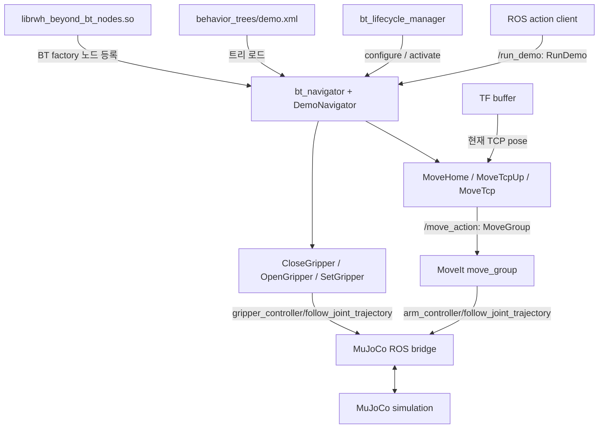
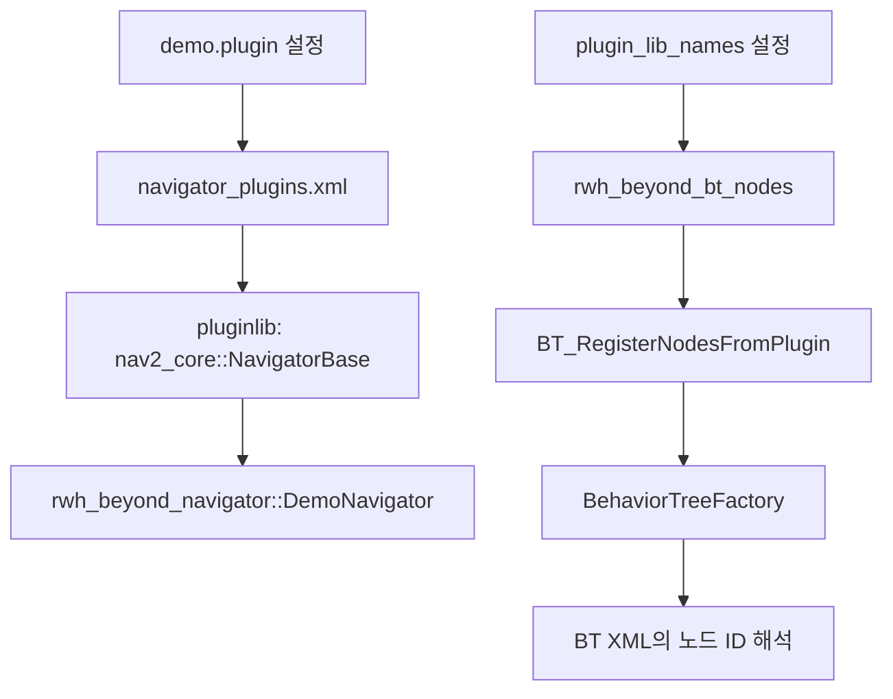
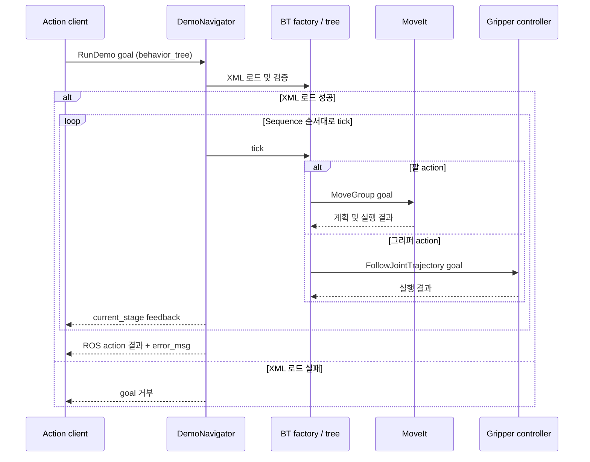
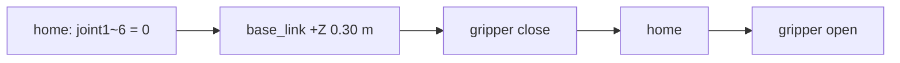
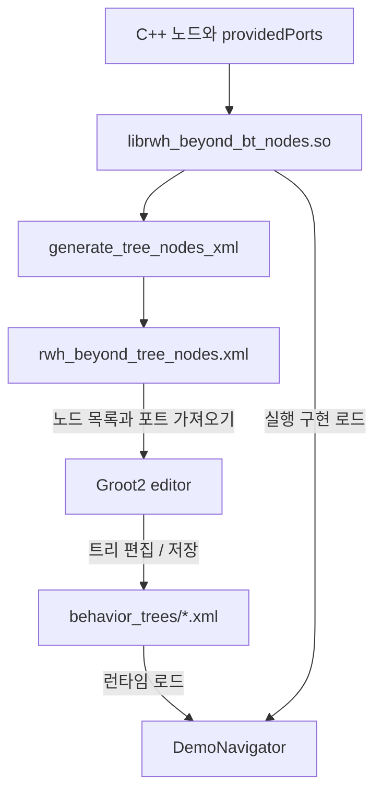

# 로봇 팔 Behavior Tree 아키텍처

이 구성은 ROS 2 Jazzy의 Nav2 BT Navigator를 로봇 팔 작업 실행기로 사용합니다.
사용자는 `/run_demo` action에 실행할 BT XML 경로를 전달하고, BT action 노드는
MoveIt 또는 그리퍼 trajectory controller에 명령을 전달합니다.
현재 `bt_demo.launch.py`의 실행 대상은 MuJoCo 시뮬레이션입니다.

## 패키지와 실행 계층



| 패키지 / 레포 | 역할 |
| --- | --- |
| `rwh_beyond_msgs` | `RunDemo.action` 인터페이스 정의 |
| `rwh_beyond_navigator` | `BehaviorTreeNavigator<RunDemo>` 구현과 Nav2 pluginlib 등록 |
| `rwh_beyond_bt` | BT C++ 노드, 실행 XML, Groot2 모델 XML, 생성기와 테스트 |
| `rwh_beyond_bringup` | MuJoCo·MoveIt·navigator·lifecycle manager 통합 launch |
| `moma-mj-lab` | 시뮬레이션 launch와 ROS action을 MuJoCo에 연결하는 bridge |
| `agx_arm_ros` | 공식 로봇 모델, MoveIt 설정 및 실물 드라이버 |
| `ros_runner` | `bt_demo` 실행과 다른 PiPER runner의 상호 비활성화 |

패키지 이름은 로봇 종류를 포함하지 않지만 현재 구현은 `arm` planning group,
`joint1`~`joint6`, `base_link`, `tcp_link`, `gripper`를 사용하는 PiPER 모델을 대상으로 합니다.
다른 로봇에 적용하려면 이 모델 의존 설정도 바꿔야 합니다.
`rwh_beyond_bt_plugins`는 `rwh_beyond_bt`로 통합되었으므로 별도 설치하지 않습니다.

## 서로 다른 두 플러그인 로딩 경로



Navigator는 `navigator_plugins.xml`을 통해 Nav2의 `NavigatorBase` 플러그인으로 등록됩니다.
BT 노드는 별도의 shared library `librwh_beyond_bt_nodes.so`에 들어 있으며,
`src/register_nodes.cpp`의 `BT_REGISTER_NODES`가 factory에 6개 노드를 등록합니다.
라이브러리에는 `BT_PLUGIN_EXPORT` compile definition이 있어야
`BT_RegisterNodesFromPlugin` 심볼이 export됩니다.
Navigator pluginlib XML은 BT 노드 라이브러리를 대신 등록하지 않습니다.

소스 구조:

```text
rwh_beyond_bt/
├── include/rwh_beyond_bt/action/   # MoveGroup·gripper 공통 베이스
├── src/action/                    # action 노드별 구현
├── src/condition/                 # condition 노드를 추가할 위치; 현재 구현 없음
├── src/register_nodes.cpp         # BT factory 등록 진입점
├── src/generate_tree_nodes_xml.cpp
├── behavior_trees/
│   ├── demo.xml
│   └── parameterized_demo.xml
├── rwh_beyond_tree_nodes.xml       # Groot2 노드 모델
└── test/test_custom_actions.cpp
```

## 시작과 goal 실행 흐름

`bt_demo.launch.py`는 `moma_bringup/simulation.launch.py`를 `moveit:=true`로 include합니다.
`bt_lifecycle_manager`가 `bt_navigator`를 configure하고 activate합니다.
활성화 과정에서 XML의 action 노드가 action server에 연결하므로,
`wait_for_service_timeout`은 MoveIt 초기화 시간을 고려해 `30000` ms로 설정했습니다.
이 값은 서버 발견 대기 시간이며 로봇 동작 완료 제한 시간이 아닙니다.
BT loop 주기는 10 ms, goal 응답 대기 기본값 `default_server_timeout`은 20 ms입니다.



`RunDemo.action`은 다음 필드를 갖습니다.

| 구분 | 필드 | 의미 |
| --- | --- | --- |
| Goal | `string behavior_tree` | 실행할 XML 경로; 빈 문자열이면 기본 트리 |
| Result | `uint16 error_code`, `string error_msg` | navigator 결과 정보 |
| Feedback | `string current_stage` | `demo_stage` blackboard의 현재 단계 |

기본 트리는 `rwh_beyond_bt/behavior_trees/demo.xml`이며 순서는 다음과 같습니다.



각 단계가 성공해야 다음 단계로 진행합니다. `parameterized_demo.xml`은 같은 순서를
`MoveTcp`와 `SetGripper`로 표현한 선택용 예제입니다. 기본 트리를 자동으로 대체하지 않습니다.
새 goal로 실행 중인 작업을 preempt하는 것은 지원하지 않으며, 진행 중인 goal을 먼저 cancel해야 합니다.

## BT 노드와 입력 포트

| 노드 ID | 역할 |
| --- | --- |
| `MoveHome` | joint1~joint6의 0 rad home 목표 |
| `MoveTcpUp` | 현재 TCP에서 base_link Z축 +0.30 m, 자세 유지 |
| `MoveTcp` | 입력 position + optional quaternion 목표 |
| `CloseGripper` | 총 개방 폭 0 m, 3초 trajectory |
| `OpenGripper` | 총 개방 폭 0.1 m, 3초 trajectory |
| `SetGripper` | 정수 개방 폭과 duration 입력 |

위 세 팔 노드는 `/move_action` (`moveit_msgs/action/MoveGroup`),
세 그리퍼 노드는 `/gripper_controller/follow_joint_trajectory`
(`control_msgs/action/FollowJointTrajectory`)를 사용합니다.
모든 action 노드는 Nav2의 `server_name`, `server_timeout` 포트를 상속합니다.

### SetGripper: 정수 mm 개방 폭

```xml
<SetGripper opening="50" duration="2.5"/>
<SetGripper opening="{gripper_opening_mm}"/>
```

| 포트 | 기본값 | 의미 |
| --- | --- | --- |
| `opening` | 필수 | 양쪽 손가락 사이 총 개방 폭; 현재 모델은 정수 0~100 mm |
| `unit` | `mm` | `percent`를 명시하면 0~100% 개방률 모드 |
| `duration` | `3.0` | 초 단위 trajectory 시간; 유한한 값, 0 초과 3600 이하 |

`opening="50"`은 총 50 mm이며 controller에는 `gripper=0.05` m로 변환하여 전달합니다.
각 손가락에 50 mm를 지정하는 의미가 아닙니다. 소수 입력을 정수로 잘라 쓰지 않으며,
범위 초과·비정수·잘못된 단위·잘못된 시간은 goal 전송 전에 거부합니다.

### MoveTcp: position과 orientation

```xml
<MoveTcp x="0.25" y="0" z="0.35"
         qx="0" qy="0" qz="0" qw="1"
         frame_id="base_link" tcp_link="tcp_link"/>
```

| 포트 | 기본값 | 의미 |
| --- | --- | --- |
| `x`, `y`, `z` | 필수 | m 단위 위치 |
| `qx`, `qy`, `qz`, `qw` | 생략 가능 | frame_id 기준 목표 quaternion, ROS 순서 x/y/z/w |
| `frame_id` | `base_link` | 목표 위치와 자세의 기준 좌표계 |
| `tcp_link` | `tcp_link` | 제어할 TCP link |
| `relative` | `false` | true이면 xyz를 현재 TCP 위치에 더할 기준 좌표계 축 방향 offset으로 해석 |

Quaternion은 네 값을 모두 입력하거나 모두 생략합니다. 생략하면 현재 TCP 자세를 유지합니다.
입력값은 모두 유한해야 하며 norm이 `1e-12` 이상인 quaternion을 정규화해 전달합니다.
일부 성분만 입력하거나 0 quaternion을 입력하면 goal을 보내지 않습니다.
`relative=true`도 orientation은 항상 `frame_id` 기준 절대 자세입니다.
회전 증분을 현재 자세에 곱하는 동작은 하지 않습니다.

```xml
<!-- base_link 축 방향으로 0.30 m 상승; 현재 자세 유지 -->
<MoveTcp x="0" y="0" z="0.30" relative="true"/>
<!-- blackboard에서 full pose 입력 -->
<MoveTcp x="{target_x}" y="{target_y}" z="{target_z}"
         qx="{target_qx}" qy="{target_qy}" qz="{target_qz}" qw="{target_qw}"/>
```

위 blackboard 값은 호출자가 별도로 제공해야 합니다. 현재 `RunDemo` goal 자체는
좌표 필드를 받지 않으므로 XML의 상수 또는 해당 blackboard를 채우는 BT 구성이 필요합니다.
상대 위치 또는 자세 유지에는 TF가 필요합니다. 절대 full pose는 현재 TCP TF 조회 없이
목표를 생성하며, 목표 프레임과 도달 가능성은 MoveIt이 검증합니다.

팔 계획 설정은 `arm`, OMPL / `RRTConnectkConfigDefault`, 계획 시간 10초,
속도·가속도 비율 0.1, 위치 허용오차 5 mm, 자세 허용오차 0.01 rad입니다.
이 노드는 pose goal을 지정하며 직선 Cartesian 궤적을 보장하지 않습니다.
도달 불가·충돌 목표를 임의 관절 목표로 우회하지 않습니다.

## MuJoCo 그리퍼 force 처리와 실패 의미

Bridge는 trajectory 마지막 시점 이후에 위치·속도 허용오차를 만족하면 성공합니다.
닫기 목표가 약 0 m (`desired <= 1e-4`)일 때에는 양쪽 손가락의
MuJoCo `actuator_force` 절댓값 중 작은 값이 threshold 이상이어도 성공을 반환합니다.
`gripper_contact_force_threshold` 기본값은 1.0이며 0 이하는 이 대체 성공 조건을 끕니다.
이는 actuator force 기반 접촉 추정이며 물체를 안정적으로 파지했다는 독립적인 검증은 아닙니다.

새 `MoveTcp`와 `SetGripper`는 ROS action의 성공 상태 외에 MoveIt/controller의
application error code도 확인하고, 오류나 cancel이면 BT FAILURE를 반환합니다.
기존 고정 노드 4개는 Nav2 기본 결과 처리에 의존하므로 같은 검증이 모두 적용된 것은 아닙니다.
현재 navigator는 실패의 비영(非零) `error_code` 매핑을 구현하지 않았습니다.
호출자는 숫자 코드만 보지 말고 ROS action status와 `error_msg`도 확인해야 합니다.

## Groot2: 실행 XML과 노드 모델 XML



`rwh_beyond_tree_nodes.xml`은 노드 종류·ID·입출력 포트와 기본값을 기술합니다.
`behavior_trees/*.xml`은 실행할 노드의 순서와 포트 값을 기술합니다.
Groot2에 모델 XML을 가져오는 것은 C++ 라이브러리를 설치하거나 로봇을 움직이는 동작이 아닙니다.
현재 launch에는 Groot2 실시간 모니터 연결 설정을 추가하지 않았습니다.

컨테이너에서 편집기를 시작합니다.

```bash
groot2
```

노드 모델은 `/root/ros2_ws/src/rwh_beyond/rwh_beyond_bt/rwh_beyond_tree_nodes.xml`을 가져오고,
`behavior_trees/demo.xml` 또는 `parameterized_demo.xml`을 엽니다.
노드·포트 수정 후에는 빌드하고 모델을 재생성합니다.

```bash
source /opt/ros/jazzy/setup.bash
source /root/ros2_ws/install/setup.bash
ros2 run rwh_beyond_bt generate_tree_nodes_xml \
  /root/ros2_ws/src/rwh_beyond/rwh_beyond_bt/rwh_beyond_tree_nodes.xml
```

생성기는 라이브러리를 factory에 등록하지만 action 노드를 생성하거나 goal을 보내지 않습니다.
C++ 변경을 적용하려면 navigator 프로세스를 재시작하고, Groot2에서는 모델 XML을 다시 가져옵니다.

## 빌드와 등록 확인

```bash
source /opt/ros/jazzy/setup.bash
cd /root/ros2_ws
colcon build --packages-select \
  rwh_beyond_msgs rwh_beyond_bt rwh_beyond_navigator \
  moma_mujoco_ros moma_bringup rwh_beyond_bringup --symlink-install
source install/setup.bash
ros2 launch rwh_beyond_bringup bt_demo.launch.py gui:=false rviz:=false
```

다른 터미널에서 같은 ROS 환경을 source한 뒤 상태만 확인합니다.

```bash
ros2 lifecycle get /bt_navigator
ros2 action info /run_demo
ros2 param get /bt_navigator plugin_lib_names
```

기대값은 `active [3]`, `/run_demo` 서버 1개, `rwh_beyond_bt_nodes`입니다.
launch와 상태 확인 명령은 demo goal을 보내지 않습니다.
`ros_runner`의 `bt_demo`도 같은 launch를 사용하며,
`piper_moveit`, `piper_moveit_sim`, `bt_demo` 사이에 상호 비활성화 관계가 있습니다.

`bt_demo`는 MuJoCo 경로입니다. 실물 runner `piper_moveit`는 별도 경로이며
현재 BT demo launch가 실물 CAN 드라이버를 띄우지는 않습니다.

## 검증 범위

```bash
cd /root/ros2_ws
colcon test --packages-select rwh_beyond_bt --return-code-on-test-failure
colcon test-result --test-result-base build/rwh_beyond_bt/test_results
```

8개 mock 테스트는 ROS domain 87에서 실제 로봇 명령 없이 실행됩니다.
mm 변환, 정수·범위 검사, absolute/relative 위치, 현재 자세 유지, explicit quaternion 전달과 정규화,
blackboard 입력, 잘못된 quaternion, TF 실패, application error 결과를 검증했습니다.
통합 headless 실행에서는 lifecycle active와 action server 등록 및 라이브러리 로딩을 확인했습니다.
전체 demo의 MuJoCo 동작 완료와 실물 동작은 이 검증 결과에 포함되지 않습니다.

## 참고

- [Nav2 Jazzy XML 모델 생성기](https://github.com/ros-navigation/navigation2/blob/jazzy/nav2_behavior_tree/src/generate_nav2_tree_nodes_xml.cpp)
- [Nav2 Jazzy Groot2 안내](https://docs.nav2.org/jazzy/tutorials/general_tutorials/groot_tutorials/groot2/groot2/)
- [opennav_coverage Jazzy](https://github.com/open-navigation/opennav_coverage/tree/jazzy): custom action → navigator plugin → BT plugin → XML 구조의 참고 저장소
