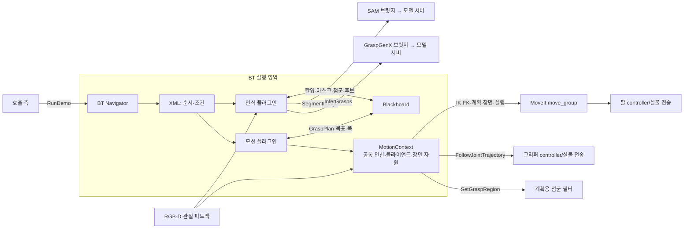
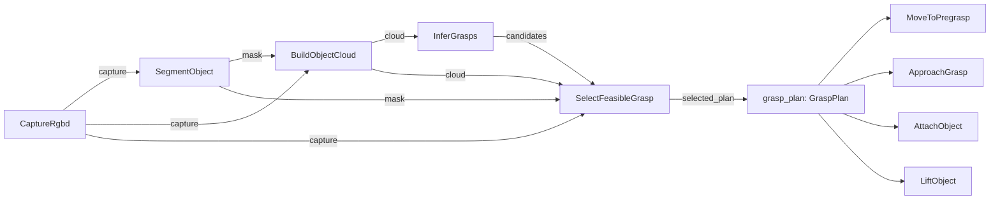
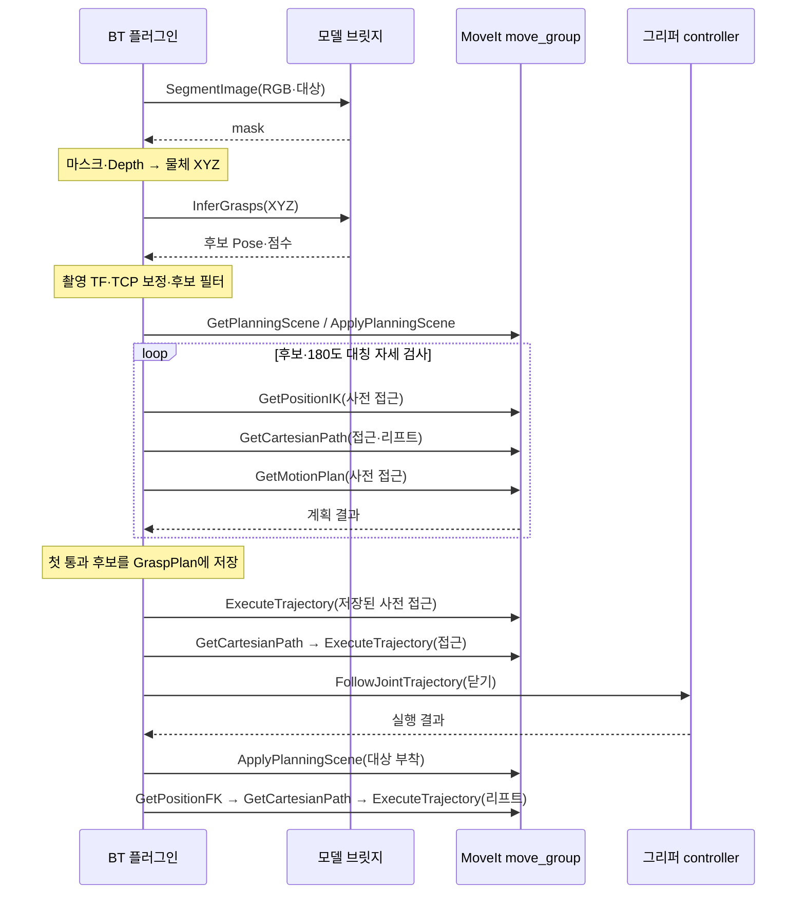
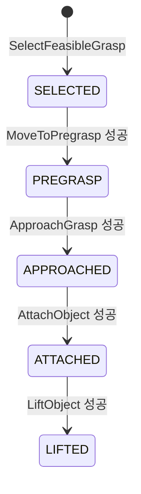

# BT와 실행 구조

`DemoNavigator`가 `/run_demo`를 제공하고 **BT가 작업 순서·관측 데이터·목표·경로를 소유**합니다.
coordinator 프로세스와 단계별 중계 액션은 없습니다. BT 플러그인이 모델 브릿지·MoveIt·그리퍼를 직접 호출합니다.

[집기·배치 흐름](bt-flows.md) → [16개 플러그인 기능·포트](bt-grasp-stages.md) →
[데이터와 좌표계](project-data.md) 순서로 읽으면 실행과 구현을 연결할 수 있습니다.

## 프로세스와 책임

| 구성 | 담당 |
|---|---|
| Navigator | 요청별 트리·대상 선택, BT 실행, feedback/result, 취소, 실패 시 정리 연결 |
| BT XML | 노드 순서·조건·포트 연결, 관측·접근·리프트 거리 지정 |
| 인식 플러그인 | 새 RGB-D 수집, SAM 호출, 마스크·깊이 역투영, 파지 브릿지 호출 |
| 모션 플러그인 | 입력 해석, 후보 선택·TCP 목표 생성, 모션·그리퍼·부착 동작, 완료 상태 갱신 |
| MotionContext | TF·피드백·MoveIt/그리퍼 클라이언트·형상·공통 검증 공유. BT 내부 C++ 객체 |
| SAM·GraspGenX 브릿지 | 모델 프로토콜 변환과 ROS 액션 결과 반환 |
| MoveIt | IK·FK·충돌·경로 계획·Planning Scene·궤적 실행 |
| physical_trajectory | 실물 제어 명령 전달·피드백·취소 처리 |
| target_cloud_filter | 선택한 대상 영역을 계획용 점군에서 제외 |

MotionContext는 root Blackboard에 보관하며 별도 ROS 서버를 제공하지 않습니다.
물리 전송과 점군 필터는 장치·센서 기능을 담당하는 별도 노드로 유지합니다.

## XML 로드 전 처리

Groot에서 저장한 기본·사용자 XML은 Navigator의 `XmlTreeFilter`를 거칩니다.
빈 문자열 속성을 제거한 임시 실행 사본을 Nav2에 전달하며 상대 include도 함께 처리합니다.
원본 편집 파일은 유지하고, 변경된 파일은 다음 요청에서 새 사본으로 로드합니다.
세부 동작은 [Groot XML 자동 정리](bt-operation.md#groot-xml-filter)를 참고하세요.

## 데이터 흐름과 보관 위치

| Blackboard 값 | 타입·내용 | 소비 노드 |
|---|---|---|
| `capture` | 불변 Observation: RGB·Depth·CameraInfo·촬영 관절값·ID | SegmentObject, BuildObjectCloud, SelectFeasibleGrasp |
| `object_mask` | 원본 영상에 대응하는 Image | BuildObjectCloud, SelectFeasibleGrasp |
| `object_cloud` | 카메라 좌표계 XYZ PointCloud2 | InferGrasps, SelectFeasibleGrasp |
| `grasps` | 모델 GraspCandidate 배열 | SelectFeasibleGrasp |
| `grasp_plan` | GraspPlan 포인터: 촬영·TCP 목표·사전 접근 궤적·손목 제한·폭·리프트 거리·진행 상태 | 사전 접근·접근·부착·리프트 |
| `pregrasp`, `grasp_pose` | base 좌표계 TcpPose | 사용자 트리·목표 확인 |
| `grasp_width`, `close_width` | 관측 전체 폭·명령 전체 간격(m) | 사용자 트리·진단; 실행은 계획에 저장한 폭 사용 |

키 이름은 기본 XML의 연결 이름입니다. 사용자 XML에서 같은 타입의 다른 키로 바꿀 수 있습니다.
마지막 결과를 보여 주는 RViz 토픽은 데이터 전달 경로가 아닙니다.

## MoveIt과 controller 호출 흐름

위 후보 루프는 앞 단계가 통과한 후보만 다음 검사를 수행합니다.
MoveIt이 계산한 결과를 BT가 다시 검사하며 불완전한 Cartesian 경로, 손목 제한 위반,
잘못된 사전 접근 목표를 실행하지 않습니다. 후보 선택 자체는 로봇을 움직이지 않습니다.

## 상태와 실패 처리

이 상태는 GraspPlan의 단계 순서를 확인합니다. 별도로 MotionContext가 대상 부착과
배치 완료(`release_ready`)를 관리합니다. 단계 건너뛰기·중복 실행·다른 계획 사용은 거부합니다.
동시에 두 모션 BT 분기가 같은 로봇을 명령하는 것도 거부합니다.

작업 중에는 BT가 `RUNNING`을 반환합니다. halt는 작업의 취소 토큰을 설정하고
진행 중인 MoveIt·그리퍼 액션의 취소를 요청합니다. 결과 수신이나 요청 응답을 무한정 기다리지 않습니다.
이미 전송한 일반 ROS 서비스에는 액션과 같은 취소 기능이 없으므로 후속 실행을 중단하고 장면을 정리합니다.

미부착 실패는 임시 대상 형상·손가락 충돌 허용·점군 제외를 정리합니다.
닫기 시작 이후 또는 부착 후 실패는 물체를 자동으로 놓거나 형상을 지우지 않습니다.
닫기 중단 후 실제 장면 부착이 없는 불확실한 상태는 자동 이동 대신 상태 확인을 요구합니다.

## 설정과 구현 위치

- 인식: `bt_navigator.ros__parameters.bt_perception`.
- 모션: `bt_navigator.ros__parameters.bt_motion`.
- MoveIt OMPL·실행 감시: 같은 YAML의 `move_group.ros__parameters`.
- 실행 파일·공통 자료형: [코드를 따라 읽기](project-code-map.md).
- 실행 시 모드·요청·오류: [RunDemo](bt-operation.md).

공통 파일은 `rwh_beyond_bringup/config/bt_demo.yaml`입니다.
XML에서 명시한 값이 해당 노드 호출에 우선하며, 생략한 값은 YAML 또는 코드 기본값을 사용합니다.

## 검증 범위 { #bt-validation }

coordinator 제거와 직접 호출 구조의 기준 커밋은 `15d07eb`입니다.
2026-11-17 사용자 확인으로 실행 검증 완료를 기록했습니다.

| 검증 계층 | 확인 내용 |
|---|---|
| BT 모의 서버 | 촬영·모델 브릿지·로컬 점군, 직접 IK/Cartesian/OMPL·실행·닫기·부착·리프트·배치·해제 |
| 거부·취소 검사 | 부분 경로·목표 불일치·촬영 후 관절 이동·잘못된 단계·잘못된 inset·전송 준비·액션 취소 |
| Navigator 통합 | 실제 navigator와 모의 controller의 오류·성공 초기화·요청별 대상·Groot |
| Python·launch | 장치 전송·점군 필터·모델 브릿지·실물 launch·공통 설정 |
| 사용자 실행 검증 | 변경된 BT 중심 구조의 실행 검증 완료 확인 |

실행 성공은 시퀀스 완료를 의미합니다. 실제 물체 잡힘을 센서로 판정하는 별도 기능은 현재 포함하지 않습니다.
