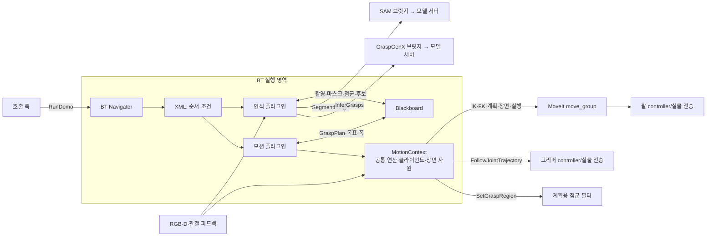
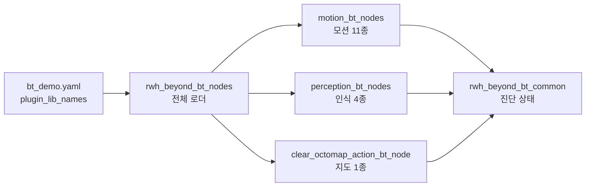
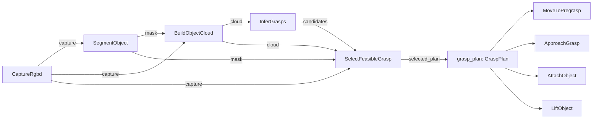
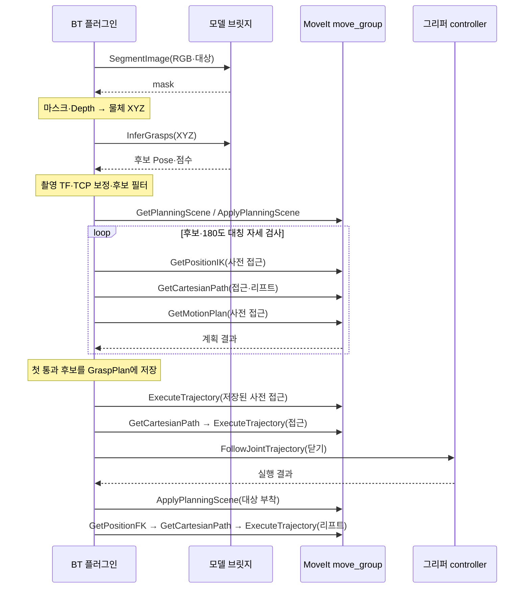
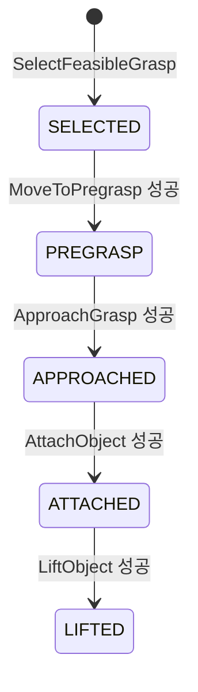

# BT와 실행 구조

`DemoNavigator`가 `/run_demo`를 제공하고 **BT가 작업 순서·관측 데이터·목표·경로를 소유**합니다.
BT 플러그인이 모델 브릿지·MoveIt·그리퍼를 직접 호출합니다.

[집기·배치 흐름](bt-flows.md) → [16개 플러그인 기능·포트](bt-grasp-stages.md) →
[데이터와 좌표계](project-data.md) 순서로 읽으면 실행과 구현을 연결할 수 있습니다.

전체 그림은 [BT 전체 흐름 이미지](bt-flows.md#bt-workflow-image)를 참고하세요.

## 프로세스와 책임



| 구성 | 담당 |
|---|---|
| Navigator | 요청별 트리·대상 선택, BT 실행, feedback/result, 취소, 실패 시 정리 연결 |
| BT XML | 노드 순서·조건·포트 연결, 관측·접근·리프트 거리 지정 |
| 인식 플러그인 | 새 RGB-D 수집, SAM 호출, 마스크·깊이 역투영, 파지 브릿지 호출 |
| 모션 플러그인 | 입력 해석, 후보 선택·TCP 목표 생성, 모션·그리퍼·부착 동작, 완료 상태 갱신 |
| MotionContext | TF·피드백·MoveIt/그리퍼 클라이언트·형상·공통 검증 공유. BT 내부 C++ 객체 |
| SAM·GraspGenX 브릿지 | 모델 프로토콜 변환과 ROS 액션 결과 반환 |
| MoveIt | IK·FK·충돌·경로 계획·Planning Scene·궤적 실행 |
| physical_trajectory | 실물 제어 명령 전달·피드백·취소 처리 |
| target_cloud_filter | 선택한 대상 영역을 계획용 점군에서 제외 |

MotionContext는 root Blackboard에 보관하며 별도 ROS 서버를 제공하지 않습니다.
물리 전송과 점군 필터는 장치·센서 기능을 담당하는 별도 노드로 유지합니다.

## 플러그인 디렉터리와 등록 { #plugin-structure }

`rwh_beyond_bt/`에는 사용자 정의 Action 노드 **16종**이 있습니다. 현재 사용자 정의
Condition 노드는 없으며 `plugins/condition/`은 향후 Condition을 위한 자리입니다.
`CheckGraspReady`는 설정에 따라 기존 물체를 해제할 수 있으므로 Action입니다.
`Sequence`는 BehaviorTree.CPP가 제공하는 제어 노드입니다.

```text
rwh_beyond_bt/
├── include/rwh_beyond_bt/plugins/action/  # Action 선언
│   ├── motion_action.hpp                 # 모션 노드 공통 기반
│   └── move_home_action.hpp              # 예: 노드별 헤더
├── plugins/
│   ├── action/
│   │   ├── motion_action.cpp             # 공통 실행·취소
│   │   ├── motion_actions.cpp            # 모션 노드 11종 등록
│   │   ├── move_home_action.cpp          # 예: 노드별 구현
│   │   ├── perception_actions.cpp        # 인식 노드 4종 구현·등록
│   │   └── clear_octomap_action.cpp      # 지도 초기화 구현·등록
│   ├── condition/                        # 현재 사용자 정의 노드 없음
│   └── register_nodes.cpp                # 전체 라이브러리 로더
└── src/                                  # 진단·MotionContext 등 공통 코드
```

모션 Action은 아래 파일명에 `.hpp`를 붙이면 `include/rwh_beyond_bt/plugins/action/`의
선언이고, `.cpp`를 붙이면 `plugins/action/`의 구현입니다.

| BT 노드 | 파일명 | BT 노드 | 파일명 |
|---|---|---|---|
| `CheckGraspReady` | `check_grasp_ready_action` | `SelectFeasibleGrasp` | `select_feasible_grasp_action` |
| `MoveToPregrasp` | `move_to_pregrasp_action` | `ApproachGrasp` | `approach_grasp_action` |
| `AttachObject` | `attach_object_action` | `LiftObject` | `lift_object_action` |
| `MoveHome` | `move_home_action` | `MoveObservation` | `move_observation_action` |
| `MovePlace` | `move_place_action` | `OpenGripper` | `open_gripper_action` |
| `ReleaseObject` | `release_object_action` | — | — |

인식 노드 4종의 선언은 `include/rwh_beyond_bt/plugins/action/perception_actions.hpp`에
함께 있으며, `ClearOctomap`은 별도 헤더·소스를 사용합니다.
전체 포트와 기능은 [플러그인별 기능·포트](bt-grasp-stages.md)를 참고하세요.



모션 노드는 `rwh_beyond_motion_bt_nodes` **하나의 공유 라이브러리**로 빌드합니다.
공통 YAML은 `rwh_beyond_bt_nodes` 로더로 16개 노드를 등록합니다. 세 노드 라이브러리를 직접 나열해 로드할 수도 있지만,
같은 노드를 전체 로더와 개별 라이브러리로 중복 등록하지 않습니다.

## 모션 공통 실행과 Blackboard { #motion-execution }

각 모션 클래스의 `providedPorts()`는 XML 포트를 정의하고 `prepare()`는 BT 스레드에서
입력을 읽습니다. `perform()`에는 해당 노드의 실제 동작이 있습니다.
`SelectFeasibleGrasp`는 완료 후 선택된 계획·목표·폭을 출력 포트로 기록합니다.

| 공통 처리 | 역할 |
|---|---|
| `MotionAction::onStart()` | 단계 진단 초기화, 입력 확인, 취소 토큰 생성, 비동기 작업 시작 |
| `MotionContext::operation` | 동시 모션 작업을 거부해 두 분기가 같은 로봇을 동시에 명령하지 않도록 보호 |
| `MotionAction::onRunning()` | 작업 완료 전 `RUNNING`, 완료 후 출력과 `SUCCESS` 또는 진단과 `FAILURE` |
| `onHalted()`·소멸자 | 취소 요청 후 작업 종료를 기다림. 파생 노드도 소멸 전에 작업을 중지 |
| `MotionContext` | Blackboard의 공유 객체로 MoveIt·그리퍼 클라이언트, 장면과 부착 상태 관리 |

Blackboard는 관측·계획과 공유 객체를 전달하지만 비동기 실행이나 취소를 대신하지 않습니다.
`execution_state`에는 mutex로 보호하는 최신 진단 상태가 있으며, Navigator가 이를 읽어
ROS Feedback과 Result를 만듭니다. 과거 이력을 저장하는 큐는 아닙니다.
[Feedback·오류 전달](bt-operation.md#feedback-result)에서 외부 필드를 확인하세요.

## XML 로드 전 처리

Groot에서 저장한 기본·사용자 XML은 Navigator의 `XmlTreeFilter`를 거칩니다.
빈 문자열 속성을 제거한 임시 실행 사본을 Nav2에 전달하며 상대 include도 함께 처리합니다.
원본 편집 파일은 유지하고, 변경된 파일은 다음 요청에서 새 사본으로 로드합니다.
세부 동작은 [Groot XML 자동 정리](bt-operation.md#groot-xml-filter)를 참고하세요.

## 데이터 흐름과 보관 위치



| Blackboard 값 | 타입·내용 | 소비 노드 |
|---|---|---|
| `capture` | 불변 Observation: RGB·Depth·CameraInfo·촬영 관절값·ID | SegmentObject, BuildObjectCloud, SelectFeasibleGrasp |
| `object_mask` | 원본 영상에 대응하는 Image | BuildObjectCloud, SelectFeasibleGrasp |
| `object_cloud` | 카메라 좌표계 XYZ PointCloud2 | InferGrasps, SelectFeasibleGrasp |
| `grasps` | 모델 GraspCandidate 배열 | SelectFeasibleGrasp |
| `grasp_plan` | GraspPlan 포인터: 촬영·TCP 목표·사전 접근 궤적·손목 제한·폭·리프트 거리·진행 상태 | 사전 접근·접근·부착·리프트 |
| `pregrasp`, `grasp_pose` | base 좌표계 TcpPose | 사용자 트리·목표 확인 |
| `grasp_width`, `close_width` | 관측 전체 폭·명령 전체 간격(m) | 사용자 트리·진단; 실행은 계획에 저장한 폭 사용 |

키 이름은 기본 XML의 연결 이름입니다. 사용자 XML에서 같은 타입의 다른 키로 바꿀 수 있습니다.
마지막 결과를 보여 주는 RViz 토픽은 데이터 전달 경로가 아닙니다.

## MoveIt과 controller 호출 흐름



위 후보 루프는 앞 단계가 통과한 후보만 다음 검사를 수행합니다.
MoveIt이 계산한 결과를 BT가 다시 검사하며 불완전한 Cartesian 경로, 손목 제한 위반,
잘못된 사전 접근 목표를 실행하지 않습니다. 후보 선택 자체는 로봇을 움직이지 않습니다.

## 상태와 실패 처리



이 상태는 GraspPlan의 단계 순서를 확인합니다. 별도로 MotionContext가 대상 부착과
배치 완료(`release_ready`)를 관리합니다. 단계 건너뛰기·중복 실행·다른 계획 사용은 거부합니다.
동시에 두 모션 BT 분기가 같은 로봇을 명령하는 것도 거부합니다.

작업 중에는 BT가 `RUNNING`을 반환합니다. halt는 작업의 취소 토큰을 설정하고
진행 중인 MoveIt·그리퍼 액션의 취소를 요청합니다. 결과 수신이나 요청 응답을 무한정 기다리지 않습니다.
이미 전송한 일반 ROS 서비스에는 액션과 같은 취소 기능이 없으므로 후속 실행을 중단하고 장면을 정리합니다.

미부착 실패는 임시 대상 형상·손가락 충돌 허용·점군 제외를 정리합니다.
닫기 시작 이후 또는 부착 후 실패는 물체를 자동으로 놓거나 형상을 지우지 않습니다.
닫기 중단 후 실제 장면 부착이 없는 불확실한 상태는 자동 이동 대신 상태 확인을 요구합니다.

## 설정과 구현 위치

- 인식: `bt_navigator.ros__parameters.bt_perception`.
- 모션: `bt_navigator.ros__parameters.bt_motion`.
- MoveIt OMPL·실행 감시: 같은 YAML의 `move_group.ros__parameters`.
- 실행 파일·공통 자료형: [코드를 따라 읽기](project-code-map.md).
- 실행 시 모드·요청·오류: [RunDemo](bt-operation.md).

공통 파일은 `rwh_beyond_bringup/config/bt_demo.yaml`입니다.
XML에서 명시한 값이 해당 노드 호출에 우선하며, 생략한 값은 YAML 또는 코드 기본값을 사용합니다.

## 테스트와 검증 { #bt-validation }

BT 모의 서버는 촬영·모델 결과·IK·Cartesian·OMPL·궤적 실행과
부착·배치·해제의 상태 전이를 검사합니다. Navigator 통합 검사는 요청별 대상,
오류 전달·초기화·취소·Groot 연결을 다룹니다.
테스트 위치와 실행 명령은 [테스트와 개발](development.md)에 정리했습니다.

모의 검사 통과는 실제 물체 파지나 실물 장착 보정의 검증을 뜻하지 않습니다.
