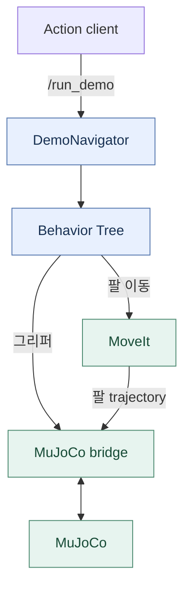
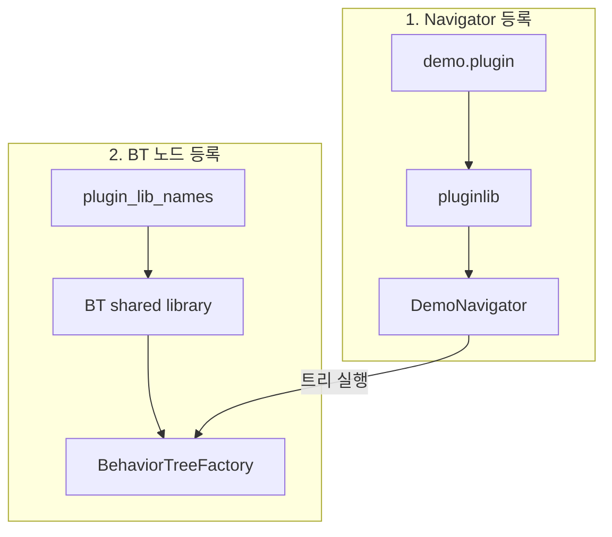
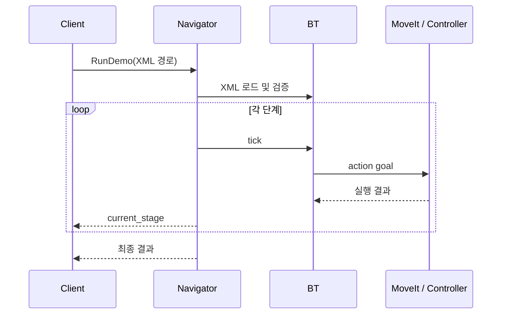

# 로봇 팔 BT 아키텍처

> 처음 읽는 경우 [전체 흐름](project-overview.md) → [현재 실행 절차](grasp-pipeline-guide.md) → [코드 안내](project-code-map.md) 순서로 보세요. 이 페이지의 상세·과거 예제보다 현재 실행 절차를 우선합니다.


**BT XML이 작업 순서를 정하고, C++ 노드가 MoveIt과 그리퍼 controller를 호출합니다.**
Nav2 BT Navigator는 이 트리를 `/run_demo` action으로 실행합니다.
현재 데모의 실행 대상은 **PiPER MuJoCo 시뮬레이션**입니다. 시뮬레이션과
BT navigator는 별도의 launch로 실행합니다.

| 알고 싶은 것 | 읽을 문서 |
| --- | --- |
| 구성 요소와 실행 흐름 | 이 페이지 |
| Runner 자동 기동과 depth 충돌 계획 | [Depth 관측과 runner 흐름](depth-bt-flow.md) |
| 그리퍼 mm, 목표 좌표와 자세 입력 | [BT 노드 사용법](bt-nodes.md) |
| 빌드, runner, Groot2, 검증 | [실행과 Groot2](bt-operation.md) |

## 전체 흐름



| 연결 | 인터페이스 |
| --- | --- |
| 사용자 → navigator | `/run_demo` · `rwh_beyond_msgs/action/RunDemo` |
| BT → MoveIt | `/move_action` · `moveit_msgs/action/MoveGroup` |
| MoveIt → bridge | `/arm_controller/follow_joint_trajectory` |
| BT → gripper bridge | `/gripper_controller/follow_joint_trajectory` |

두 trajectory action의 타입은 `control_msgs/action/FollowJointTrajectory`입니다.
TF는 상대 이동과 현재 자세 유지에 필요한 TCP pose를 제공합니다.

## 패키지별 책임

직접 구현한 네 패키지의 역할은 다음과 같습니다.

| 패키지 | 책임 |
| --- | --- |
| `rwh_beyond_msgs` | `RunDemo.action`, `TcpPose.msg` 정의 |
| `rwh_beyond_navigator` | goal 수신, XML 로드, 트리 실행, 진행 상태와 결과 전달 |
| `rwh_beyond_bt` | BT 노드 10개, 실행 XML, Groot2 모델 XML, 생성기와 테스트 |
| `rwh_beyond_bringup` | BT navigator와 lifecycle manager launch; 지도 초기화는 트리 노드가 담당 |

외부 레포는 실행 기반을 제공합니다.

| 레포 | 제공하는 기능 |
| --- | --- |
| `moma-mj-lab` | MuJoCo 시뮬레이션과 ROS bridge |
| `agx_arm_ros` | 공식 모델, MoveIt 설정, 실물 드라이버 |
| `ros_runner` | `bt_demo_sim → piper_moveit_sim` 자동 의존성 실행 및 로봇 실행 경로 간 상호 비활성화 |

!!! note "현재 로봇 모델"
    패키지 이름은 공통으로 쓰지만 구현은 PiPER의 `arm` group,
    `joint1`~`joint6`, `base_link`, `tcp_link`, `gripper`를 사용합니다.
    `rwh_beyond_bt_plugins`는 `rwh_beyond_bt`로 통합했습니다.

## 플러그인은 두 단계로 로드합니다

Navigator 플러그인과 BT 노드 플러그인은 **등록 방식이 다릅니다.**



| 구분 | Navigator | BT 노드 |
| --- | --- | --- |
| 등록 파일 | `navigator_plugins.xml` | 각 `plugins/action/*_action.cpp` |
| 설정 키 | `demo.plugin` | `plugin_lib_names` |
| 로더 | ROS `pluginlib` | BehaviorTree.CPP factory |
| 로드 대상 | `rwh_beyond_navigator::DemoNavigator` | `rwh_beyond_bt_nodes` |

현재 BT 노드는 각 `librwh_beyond_<name>_action_bt_node.so`로 나뉩니다.
각 CPP의 `BT_REGISTER_NODES`와 `BT_PLUGIN_EXPORT`가 등록 함수를 공개합니다.
기존 `librwh_beyond_bt_nodes.so`는 19개 개별 라이브러리를 불러오는 호환 로더입니다.
[헤더·CPP 구성과 Nav2 스타일](bt-code-style.md)을 참고하세요.

## Goal을 받으면 일어나는 일



1. Navigator가 요청한 XML을 읽습니다. 빈 경로이면 기본 트리를 사용합니다.
2. XML 로딩에 실패하면 goal을 거부합니다.
3. `Sequence`의 각 단계가 성공하면 다음 단계로 넘어갑니다. 실패하면 중단합니다.
4. 진행 중에는 root blackboard의 `demo_feedback` 객체에서 현재 단계·노드·MoveIt 상태와 오류를 전달합니다.

| `RunDemo` 필드 | 의미 |
| --- | --- |
| Goal · `behavior_tree` | 실행할 XML 경로 |
| Feedback · `current_stage`, `current_node`, `moveit_state` | 현재 BT 단계·노드·MoveIt 내부 상태 |
| Feedback · `error_code`, `error_name`, `error_source`, `error_msg` | 마지막 오류 코드·이름·발생 컴포넌트·메시지 |
| Result · `error_code`, `error_name`, `error_source`, `error_msg` | 성공 또는 상세 실패 정보 |
| Result · `failed_stage`, `failed_node`, `moveit_state` | 실패 위치와 마지막 MoveIt 상태 |

현재 preemption은 지원하지 않습니다. 실행 중인 작업을 바꾸려면 먼저 cancel해야 합니다.
MoveIt의 signed 오류 코드를 보존하고 controller 오류와 BT 내부 오류를 구분합니다.
[실패 진단 예제](bt-operation.md#bt-error-reporting)를 참고하세요.

## 기본 작업 순서

기본 `demo.xml`은 빨간 상자를 집어 들어올리는 MuJoCo 전용 트리다.

**준비 확인 → 지도 초기화 → home → 열기 → 관측 자세 → RGB-D/실제 모델 추론과 후보 검증
→ pregrasp → 직선 접근 → 닫기 → 접촉 확인·부착 → 상승·물리 검증**

현재 기본 트리는 [역할별 플러그인](bt-grasp-stages.md)으로 마스크·점군·후보를 Blackboard에 전달한다.
모델 추론은 `InferGrasps`, IK·충돌·경로 검사는 `SelectFeasibleGrasp`가 담당한다.
기존 `GraspStep + command`는 호환용으로 남긴다.

예전 고정 home/up/close/home/open은 `legacy_demo.xml`에 보존했다.
`parameterized_demo.xml`은 `MakeTcpPose → MoveTcp`와 `SetGripper`로 같은 원래
작업을 표현한 별도 예제다.

## 소스에서 찾아볼 위치

```text
rwh_beyond_bt/
├── plugins/action/                         # 노드별 구현·BT_REGISTER_NODES
├── include/rwh_beyond_bt/plugins/action/   # 노드별 공개 선언
├── include/rwh_beyond_bt/bt_*.hpp          # 공통 Action 베이스 선언
├── src/bt_*.cpp                           # 공통 베이스 구현
├── src/register_nodes.cpp                 # 기존 설정용 호환 로더
├── src/generate_tree_nodes_xml.cpp
├── behavior_trees/                        # 실행 트리·Groot2 모델
└── test/                                  # 동작·플러그인 로딩·lint 검사
```

## 참고

- [Nav2 Jazzy 모델 XML 생성기](https://github.com/ros-navigation/navigation2/blob/jazzy/nav2_behavior_tree/src/generate_nav2_tree_nodes_xml.cpp)
- [Nav2 Jazzy Groot2 안내](https://docs.nav2.org/jazzy/tutorials/general_tutorials/groot_tutorials/groot2/groot2/)
- [opennav_coverage Jazzy](https://github.com/open-navigation/opennav_coverage/tree/jazzy): custom action·navigator·BT plugin·XML 구조 참고
