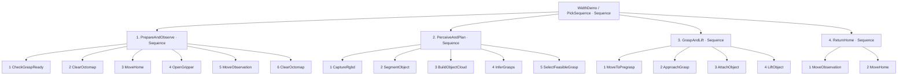
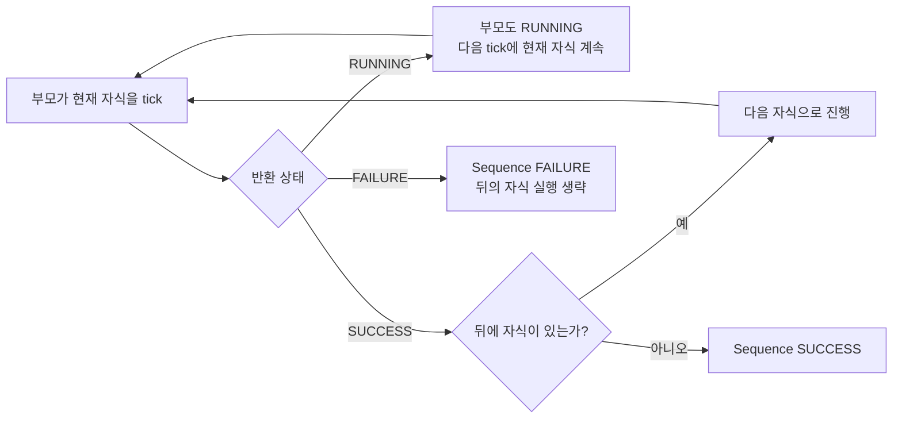
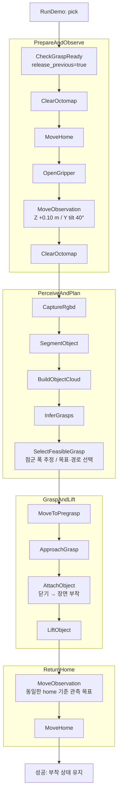
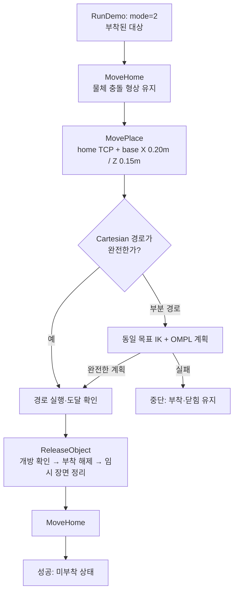
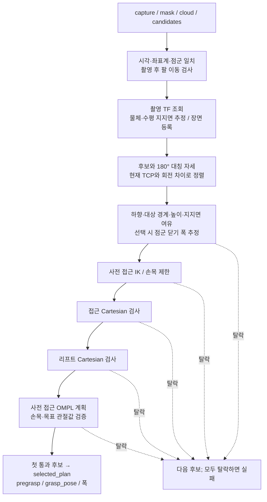
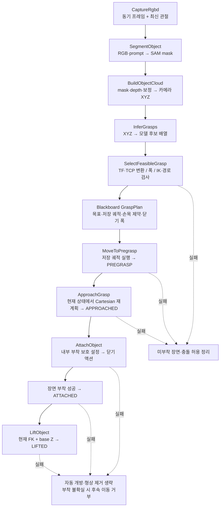
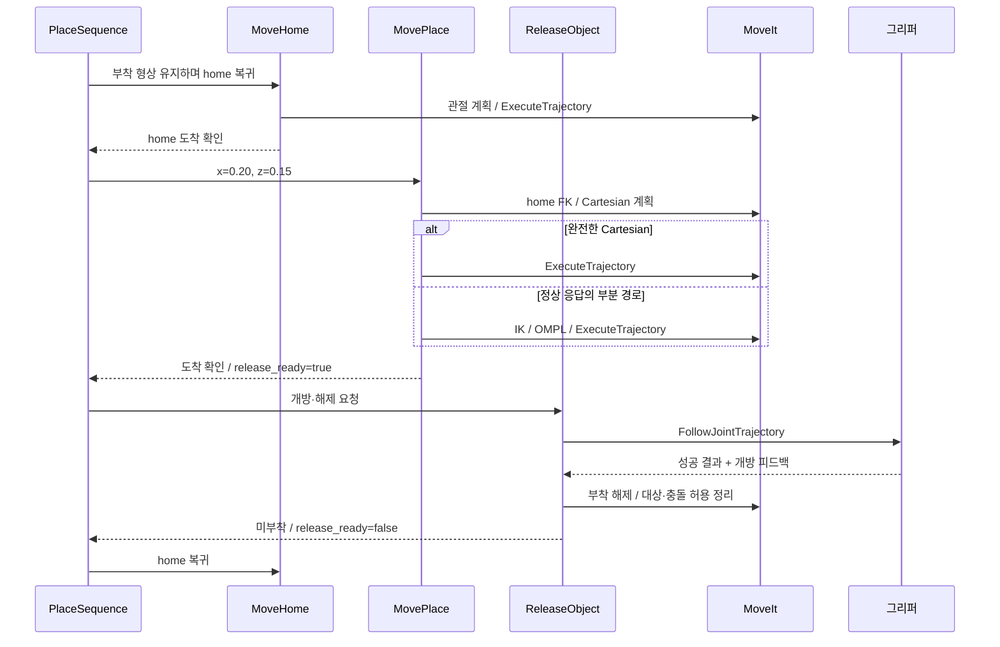

# BT 실행 흐름

현재 작업은 BT가 촬영·인식·목표 선택·MoveIt 호출·그리퍼 제어까지 수행합니다.
외부에서는 `/run_demo`를 호출하고, BT 내부 데이터는 Blackboard로 전달합니다.
각 노드의 세부 입력은 [플러그인별 기능과 포트](bt-grasp-stages.md)를 참고하세요.

## 전체 흐름 한눈에 보기 { #bt-workflow-image }

[](assets/images/piper-bt-workflow.png)

이미지를 클릭하면 원본 크기로 볼 수 있습니다. **집기와 배치는 별도 요청**입니다.
집기 완료 후 부착을 유지하며, `mode: 2`를 요청해야 배치·해제합니다.
아래 Mermaid는 각 XML의 세부 순서와 조건을 설명합니다.

## 트리 선택

| 요청 | 실행 XML | 동작 |
|---|---|---|
| `mode: 1` 또는 생략한 `mode: 0` | YAML의 `default_demo_bt_xml`: 현재 `demo_width.xml` | 점군 추정 폭으로 집기·리프트·복귀 |
| `mode: 2` | YAML의 `default_place_bt_xml`: 현재 `place.xml` | 들고 있는 물체 배치·해제·복귀 |
| `behavior_tree`에 경로 지정 | 지정 XML; mode보다 우선 | 사용자 지정 흐름, 예: 고정 폭 `demo.xml` |

파일은 `rwh_beyond_bt/behavior_trees/`에 있습니다. 심·실물은 같은 XML을 사용하고
launch가 시간과 `bt_motion.simulation_only`를 정합니다.

## 실제 BT 계층과 tick 순서

아래는 `demo_width.xml`의 **제어 트리**입니다. 부모에서 자식으로 이어진 선은 실행 명령이나
ROS 통신이 아니라 BT의 포함 관계를 나타냅니다. 각 Sequence의 자식은 번호 순서대로 실행합니다.
뒤의 순서도는 같은 동작을 시간 순으로 펼친 그림입니다.





현재 기본 트리에는 Fallback·Retry 제어 노드가 없습니다. 따라서 SAM 실패 시 자동 재촬영하거나
후보가 모두 탈락했을 때 관측 자세를 바꿔 재시도하는 동작은 없습니다.
후보 루프는 `SelectFeasibleGrasp` 내부 연산이며 트리 전체의 재시도와는 다릅니다.

## 기본 집기: demo_width.xml



네 Sequence는 차례로 실행됩니다. 어떤 자식이 `RUNNING`이면 완료를 기다리고,
`FAILURE`이면 뒤의 노드를 실행하지 않고 전체 요청을 실패 처리합니다. 기본 XML에는 자동 재시도가 없습니다.

| 그룹 | 실제 처리 | 완료 시 결과 |
|---|---|---|
| PrepareAndObserve | 준비 검사, 지도 갱신, home·개방·관측 이동 | 새 RGB-D를 촬영할 자세 |
| PerceiveAndPlan | 촬영 → SAM → 점군 → 모델 → 실행 가능한 후보 선택 | 목표·경로·닫기 폭을 담은 GraspPlan |
| GraspAndLift | 저장 경로 실행 → 최종 접근 → 닫기·부착 → 리프트 | 물체를 부착된 충돌 형상으로 취급 |
| ReturnHome | 부착 형상을 유지하며 관측 위치와 home으로 복귀 | 다음 place 요청을 받을 수 있는 상태 |

시작·종료 MoveHome을 XML에서 주석 처리하면 시작 home 이동과 최종 home 복귀가 생략됩니다.
이 경우 첫 관측 전 이미 home에 있어야 하고 관측 자세에서 끝납니다.
배치 트리의 첫 MoveHome은 별도로 적용됩니다.

현재 XML은 사전 접근 0.10m, 리프트 0.08m를 명시합니다.
관측 목표는 **home TCP 위치 + base Z 0.10m**, 방향은 **home 로컬 Y +40°**입니다.
YAML 관측 기본값 Z=0.20m·Y=30°보다 XML의 값이 우선합니다.

`CheckGraspReady release_previous="true"`는 이전 대상이 부착돼 있으면 **현재 위치에서 먼저
그리퍼를 열고 부착을 해제**합니다. 따라서 이 트리로 연속 pick을 요청하면 이전 물체를 현재 위치에서 놓습니다.
배치 위치로 이동해 놓으려면 pick 다음에 `mode: 2`를 사용합니다.

현재 공통 설정은 `octomap_enabled: false`이므로 두 `ClearOctomap`은 성공으로 건너뜁니다.
대상 박스·Planning Scene 처리는 계속 사용합니다. Octomap을 켜면 clear 후 새 점군과 지도 재생성을 기다립니다.

## 고정 폭 집기: demo.xml

집기 순서와 관측·접근·리프트 거리는 기본 집기와 같습니다. 차이는 다음 두 가지입니다.

| 항목 | demo_width.xml | demo.xml |
|---|---|---|
| 기존 부착 대상 | 준비 검사에서 현재 위치 개방·해제 | 자동 해제하지 않고 거부 |
| 닫기 폭 | `use_estimated_width=true`, 점군 폭에서 inset 차감 | `gripper_close_width` 사용; 현재 0.04m |

두 트리 모두 모델이 반환한 파지 자세를 사용합니다. 폭 추정은 BT의 기하 계산이며 모델의 폭 예측이 아닙니다.
고정 폭 트리도 관측·점군·충돌 형상·MoveIt 도달 가능성 검사는 수행합니다.

```bash
ros2 action send_goal /run_demo rwh_beyond_msgs/action/RunDemo \
  '{behavior_tree: "/root/ros2_ws/install/rwh_beyond_bt/share/rwh_beyond_bt/behavior_trees/demo.xml", target_text: "yellow block"}' --feedback
```

## 배치·해제: place.xml



`MovePlace`는 부착된 대상이 있고 home에 도착한 경우에만 실행합니다.
XML의 X·Z는 home TCP 기준 **base 축** 오프셋이며, 절대 위치나 현재 자세에서 누적하는 이동량이 아닙니다.
Cartesian 요청 자체가 오류이면 중단합니다. 정상 응답이지만 부분 경로이면 충돌 검사 IK·관절 경로를 시도합니다.
`ReleaseObject`는 배치 이동이 성공해야 열 수 있습니다. 새로운 촬영·SAM·파지 추론은 하지 않습니다.

## 파지 선택 안의 흐름



모델이 만드는 것은 후보 위치·방향·점수입니다. TCP 보정과 사전 접근·리프트 목표는 BT가 생성합니다.
선택 중에는 실제 팔을 움직이지 않습니다. `MoveToPregrasp`가 처음으로 선택 경로를 실행하고,
접근·리프트는 실행 시점의 현재 상태와 장면으로 Cartesian 경로를 다시 계산합니다.

## 플러그인 내부 처리의 연결

다음 그림은 XML의 새 제어 노드가 아니라 플러그인 안의 처리 단계입니다.
실선은 정상 진행, 점선은 실패 이후 정리 판단으로 이어집니다.





배치 그림은 성공 경로를 나타냅니다. 어느 호출이든 실패하면 뒤의 XML 노드로 진행하지 않으며,
개방 전 실패와 개방 후 장면 정리 실패의 물리 상태는 서로 다를 수 있습니다.

## 실패·취소·완료

| 발생 시점 | 처리 |
|---|---|
| 인식·후보 선택 실패 | 후속 모션 중단, 등록한 미부착 대상과 임시 설정 정리 |
| 이동 중 실패·취소 | 실행 액션 취소 요청, 미부착 장면 정리 |
| 닫기 시작 이후 실패 | 잡힘이 불명확할 수 있어 자동 개방·장면 제거를 하지 않음 |
| 부착 후 실패 | 계획용 물체 형상을 유지하고 자동으로 놓지 않음 |
| pick 성공 | 리프트·복귀 완료, 부착 상태 유지 |
| place 성공 | 개방·부착 해제·복귀 완료 |

성공은 BT 시퀀스의 완료입니다. 물체의 실제 잡힘 여부를 별도 센서로 판정하지는 않습니다.
실행 결과와 실패 노드는 [RunDemo 인터페이스](bt-operation.md)에서 확인합니다.

## 검증 기록

2026-11-17, coordinator 제거 후 BT가 직접 MoveIt·그리퍼를 호출하는 구조에 대해
사용자가 실행 검증을 마쳤다고 확인했습니다. 이 기록에는 별도 성공률·사이클 시간 측정값은 포함하지 않습니다.
코드의 모의 서버·통합 검증 범위는 [실행 구조](bt-architecture.md#bt-validation)에 정리했습니다.

[플러그인별 기능·포트](bt-grasp-stages.md) · [데이터와 좌표계](project-data.md) · [설정](real-bt.md)
