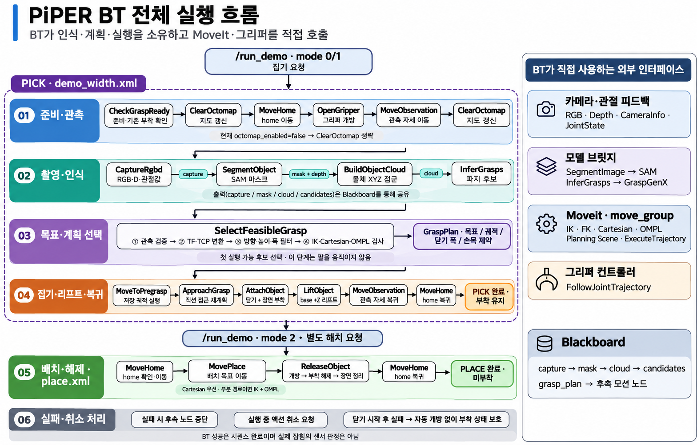
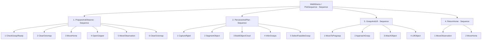
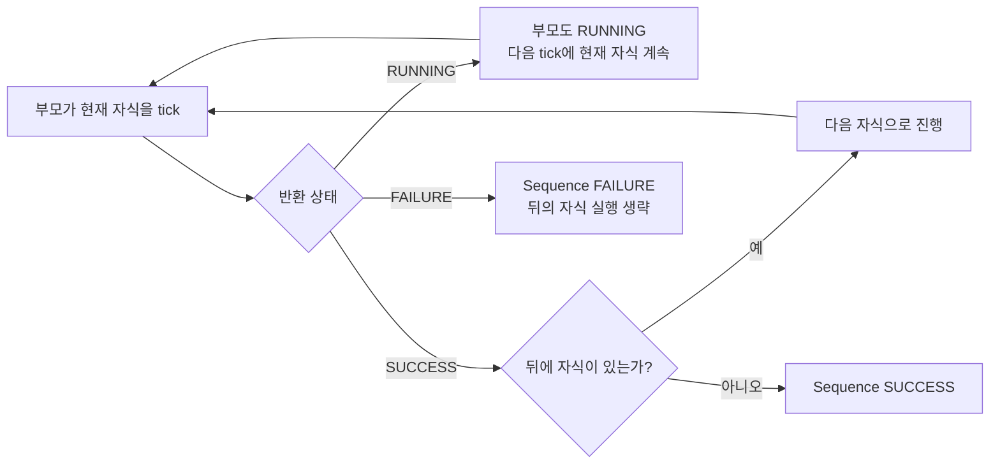
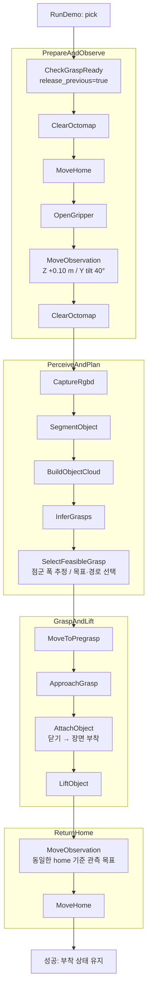
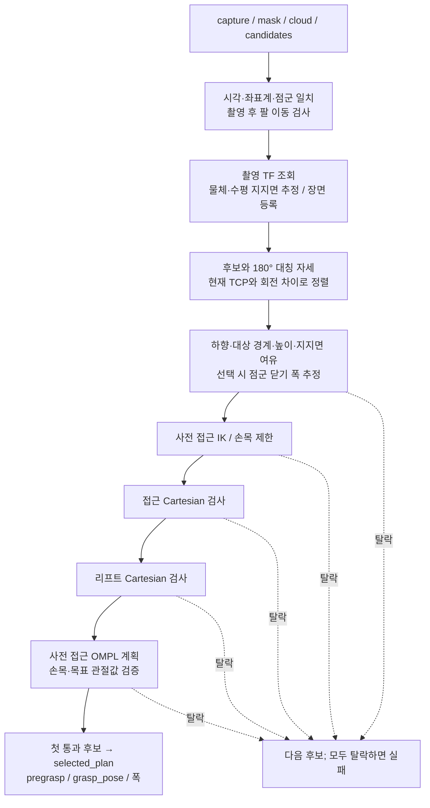
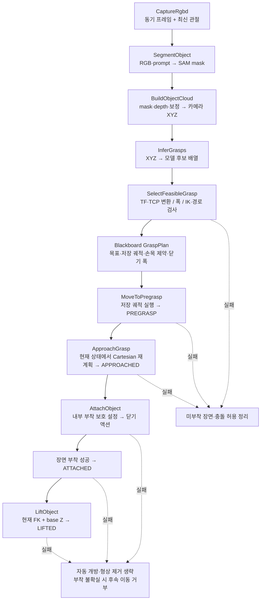

# BT 실행 흐름

현재 작업은 BT가 촬영·인식·목표 선택·MoveIt 호출·그리퍼 제어까지 수행합니다.
외부에서는 `/run_demo`를 호출하고, BT 내부 데이터는 Blackboard로 전달합니다.
각 노드의 세부 입력은 [플러그인별 기능과 포트](bt-grasp-stages.md)를 참고하세요.

## 전체 흐름 한눈에 보기 { #bt-workflow-image }

[](assets/images/piper-bt-workflow.png)

이미지를 클릭하면 원본 크기로 볼 수 있습니다. **집기와 배치는 별도 요청**입니다.
집기 완료 후 부착을 유지하며, `mode: 2`를 요청해야 배치·해제합니다.
아래 Mermaid는 각 XML의 세부 순서와 조건을 설명합니다.

## 트리 선택

| 요청 | 실행 XML | 동작 |
|---|---|---|
| `mode: 0` (기본) 또는 `mode: 1` (파일 추론) | YAML의 `default_demo_bt_xml`: 현재 `demo_multiview.xml` | 점군 추정 폭으로 집기·리프트·복귀 |
| `mode: 2` | YAML의 `default_place_bt_xml`: 현재 `place.xml` | 들고 있는 물체 배치·해제·복귀 |
| `behavior_tree`에 경로 지정 | 지정 XML; mode보다 우선 | 사용자 지정 흐름, 예: 고정 폭 `demo.xml` |

파일은 `rwh_beyond_bt/behavior_trees/`에 있습니다. 심·실물은 같은 XML을 사용하고
launch가 시간과 `bt_motion.simulation_only`를 정합니다.

## 실제 BT 계층과 tick 순서

아래는 `demo_width.xml`의 **제어 트리**입니다. 부모에서 자식으로 이어진 선은 실행 명령이나
ROS 통신이 아니라 BT의 포함 관계를 나타냅니다. 각 Sequence의 자식은 번호 순서대로 실행합니다.
뒤의 순서도는 같은 동작을 시간 순으로 펼친 그림입니다.





현재 기본 트리에는 Fallback·Retry 제어 노드가 없습니다. 따라서 SAM 실패 시 자동 재촬영하거나
후보가 모두 탈락했을 때 관측 자세를 바꿔 재시도하는 동작은 없습니다.
후보 루프는 `SelectFeasibleGrasp` 내부 연산이며 트리 전체의 재시도와는 다릅니다.

## 기본 집기: demo_multiview.xml

`PickWithRecovery`는 `front`의 단일 관측으로 먼저 집기를 시도합니다.
실패하면 `left`·`right`의 분할 점군을 base 좌표계에서 융합해 다시 후보를 고릅니다.
점군 융합과 관절 자세 설정은 [추정 폭·멀티뷰](width-aware-bt.md#multiview)를 참고하세요.

## 단일 시점 집기: demo_width.xml



네 Sequence는 차례로 실행됩니다. 어떤 자식이 `RUNNING`이면 완료를 기다리고,
`FAILURE`이면 뒤의 노드를 실행하지 않고 전체 요청을 실패 처리합니다. 기본 XML에는 자동 재시도가 없습니다.

| 그룹 | 실제 처리 | 완료 시 결과 |
|---|---|---|
| PrepareAndObserve | 준비 검사, 지도 갱신, home·개방·관측 이동 | 새 RGB-D를 촬영할 자세 |
| PerceiveAndPlan | 촬영 → SAM → 점군 → 모델 → 실행 가능한 후보 선택 | 목표·경로·닫기 폭을 담은 GraspPlan |
| GraspAndLift | 저장 경로 실행 → 최종 접근 → 닫기·부착 → 리프트 | 물체를 부착된 충돌 형상으로 취급 |
| ReturnHome | 부착 형상을 유지하며 관측 위치와 home으로 복귀 | 다음 place 요청을 받을 수 있는 상태 |

시작·종료 MoveHome을 XML에서 주석 처리하면 시작 home 이동과 최종 home 복귀가 생략됩니다.
첫 관측은 현재 자세에서 home 기준 관측 목표까지 계획하며 마지막에는 관측 자세에서 끝납니다.
배치 트리의 첫 MoveHome은 별도로 적용됩니다.

현재 XML은 사전 접근 0.10m, 리프트 0.08m를 명시합니다.
관측 목표는 **home TCP 위치 + base Z 0.10m**, 방향은 **home 로컬 Y +40°**입니다.
YAML 관측 기본값 Z=0.20m·Y=30°보다 XML의 값이 우선합니다.

`CheckGraspReady release_previous="true"`는 이전 대상이 부착돼 있으면 **현재 위치에서 먼저
그리퍼를 열고 부착을 해제**합니다. 따라서 이 트리로 연속 pick을 요청하면 이전 물체를 현재 위치에서 놓습니다.
배치 위치로 이동해 놓으려면 pick 다음에 `mode: 2`를 사용합니다.

현재 공통 설정은 `octomap_enabled: false`이므로 두 `ClearOctomap`은 성공으로 건너뜁니다.
대상 박스·Planning Scene 처리는 계속 사용합니다. Octomap을 켜면 clear 후 새 점군과 지도 재생성을 기다립니다.

## 고정 폭 집기: demo.xml { #fixed-width-pick }

관측·접근·리프트 거리는 단일 시점 `demo_width.xml`과 같습니다. 차이는 다음 두 가지입니다.

| 항목 | demo_width.xml | demo.xml |
|---|---|---|
| 기존 부착 대상 | 준비 검사에서 현재 위치 개방·해제 | 자동 해제하지 않고 거부 |
| 닫기 폭 | `use_estimated_width=true`, 점군 폭에서 inset 차감 | `gripper_close_width` 사용; 현재 0.04m |

두 트리 모두 모델이 반환한 파지 자세를 사용합니다. 폭 추정은 BT의 기하 계산이며 모델의 폭 예측이 아닙니다.
고정 폭 트리도 관측·점군·충돌 형상·MoveIt 도달 가능성 검사는 수행합니다.

```bash
ros2 action send_goal /run_demo rwh_beyond_msgs/action/RunDemo \
  '{behavior_tree: "/root/ros2_ws/install/rwh_beyond_bt/share/rwh_beyond_bt/behavior_trees/demo.xml", target_text: "yellow block"}' --feedback
```

## 배치·해제 { #place-tree }

`place.xml`은 **home → 저장된 `place` 관절 자세 → 그리퍼 개방·해제 → 저장된 `front` → home**을 실행합니다.
`MoveJointPose release_on_arrival="true"`가 목표 도착을 확인하면 부착된 물체를 해제할 수 있습니다.
이동 실패·취소 시 해제 노드로 진행하지 않습니다.
`ReleaseObject`는 목표 0.10m, 3초로 열고 피드백을 확인한 뒤 계획 장면에서 부착을 제거합니다.
기본 XML은 `allow_empty="true"`로 빈 그리퍼도 열 수 있게 합니다.

`MovePlace`는 TCP 오프셋이 필요한 사용자 트리에서 쓸 수 있는 별도 노드입니다.
[포트 참조](bt-grasp-stages.md#moveplace) · [저장 자세 설정](real-bt.md)

## 파지 선택 안의 흐름



모델이 만드는 것은 후보 위치·방향·점수입니다. TCP 보정과 사전 접근·리프트 목표는 BT가 생성합니다.
선택 중에는 실제 팔을 움직이지 않습니다. `MoveToPregrasp`가 처음으로 선택 경로를 실행하고,
접근·리프트는 실행 시점의 현재 상태와 장면으로 Cartesian 경로를 다시 계산합니다.

## 좌표·목표·폭 계산식 { #bt-equations }

이 절은 위 흐름의 **실제 C++ 계산**을 풀어 쓴 것입니다. 거리·폭은 m,
회전 행렬에 넣는 각도는 rad입니다. XML의 `tilt_deg`는 도 단위로 받고 rad로 바꿉니다.
`B`는 base, `C`는 촬영 카메라 optical frame, `G`는 모델 파지 좌표계,
`T`는 로봇 TCP입니다. $\mathbf e_x,\mathbf e_y,\mathbf e_z$는 각 좌표계의 단위축입니다.

### 1. 마스크·깊이 → 카메라 점군

`BuildObjectCloud`는 마스크가 0이 아닌 픽셀 $(u,v)$ 중 유한한 양의 깊이만 사용합니다.
`CameraInfo.K`의 $f_x,f_y$는 초점 거리(px), $c_x,c_y$는 주점(px),
$s=K_{01}$은 skew입니다. 왜곡이 0일 때 코드의 계산은 다음과 같습니다.

$$
z = \begin{cases}0.001\,D(u,v) & \texttt{16UC1 (mm)}\\D(u,v)&\texttt{32FC1 (m)}\end{cases}
$$

$$
x_n=\frac{u-c_x}{f_x},\qquad y_n=\frac{v-c_y}{f_y},\qquad
\mathbf p^C=z\begin{bmatrix}x_n\\y_n\\1\end{bmatrix}.
$$

현재 코드는 $K_{01}$을 계산에 사용하지 않으므로 위 식은 skew를 보정하지 않습니다.
왜곡 계수가 있으면 `plumb_bob`의 5개 또는 8개 계수만 지원하며,
$(x_0,y_0)=(x_n,y_n)$에서 아래 갱신을 **8회** 수행한 뒤 $(zx_8,zy_8,z)$를 저장합니다.

$$
\begin{aligned}
r_j^2&=x_j^2+y_j^2,\\
a_j&=\frac{1+k_1r_j^2+k_2r_j^4+k_3r_j^6}{1+k_4r_j^2+k_5r_j^4+k_6r_j^6},\\
\delta x_j&=2p_1x_jy_j+p_2(r_j^2+2x_j^2),\\
\delta y_j&=p_1(r_j^2+2y_j^2)+2p_2x_jy_j,\\
x_{j+1}&=x_j+x_n-(x_ja_j+\delta x_j),\\
y_{j+1}&=y_j+y_n-(y_ja_j+\delta y_j).
\end{aligned}
$$

계수 배열 순서는 `D=[k1,k2,p1,p2,k3,k4,k5,k6]`이며 5개 계수에서는 분모를 1로 둡니다.
유효한 대상 점이 100개 미만이면 실패합니다. RGB·Depth·보정은 동일 해상도·좌표계의
정렬된 관측이어야 하며, 이 단계에서 RGB와 Depth의 외부 보정을 새로 계산하지 않습니다.

구현: `rwh_beyond_bt/plugins/action/perception_actions.cpp`의 `project_object_cloud()`.

### 2. 촬영 TF·대칭 후보·TCP 보정

${}^{A}\!T_D$는 D 좌표를 A 좌표로 옮기는 4×4 동차 변환입니다.
촬영 시각 $t_c$의 TF와 모델 응답을 곱해 base 기준 파지 자세를 만듭니다.

$$
{}^BT_G={}^BT_C(t_c)\,{}^CT_G,\qquad
{}^BT_G=\begin{bmatrix}R_G&\mathbf p_G\\\mathbf0^\mathsf T&1\end{bmatrix}.
$$

모델 로컬 Z축을 중심으로 180° 회전한 대칭 자세도 검사합니다.
$\sigma\in\{0,1\}$에 대해:

$$
{}^BT_{G,\sigma}={}^BT_G
\begin{bmatrix}R_z(\sigma\pi)&\mathbf0\\\mathbf0^\mathsf T&1\end{bmatrix},\qquad
{}^BT_{T,\sigma}={}^BT_{G,\sigma}\,{}^GT_T.
$$

$$
{}^GT_T=\begin{bmatrix}R_z(\psi)R_y(\theta)R_x(\phi)&\mathbf t\\\mathbf0^\mathsf T&1\end{bmatrix},\quad
\mathbf t=\begin{bmatrix}0\\0\\0.13\end{bmatrix},\quad
(\phi,\theta,\psi)=(0,0,-\pi/2).
$$

위 보정값은 현재 YAML `model_to_tcp_xyz/rpy`입니다.
곱셈을 풀어 쓰면 $\mathbf p_T=\mathbf p_G+R_{G,\sigma}\mathbf t$,
$R_T=R_{G,\sigma}R_{GT}$입니다. **0.13m는 모델 로컬 축 방향의 보정**이며,
base Z에 일괄 0.13m를 더하는 계산이 아닙니다. URDF의 flange→TCP 오프셋과도 다릅니다.

### 3. 후보 검사 순서와 위치 필터

브릿지는 점수 내림차순의 `top_k`개 후보를 반환합니다. BT는 그중 앞의
`max_candidates`개를 원본·대칭 자세로 확장합니다. 기본값
`moveit_prefer_current_grasp_orientation=true`에서는 다음 회전 차이가 작은 순서로
**전체 대칭 후보 목록을 stable sort**합니다.

$$
\alpha_{i,\sigma}=\cos^{-1}\!\left(
\frac{\operatorname{tr}(R_{\mathrm{current}}^\mathsf T R_{T,i,\sigma})-1}{2}\right),\qquad
0\le\alpha\le\pi.
$$

코드는 Eigen의 `AngleAxisd(...).angle()`로 같은 회전각을 구합니다.
동률일 때 입력 순서를 유지하며, 옵션이 false이면 모든 정렬 키가 0이므로
원래 후보 순서에서 원본→대칭 순으로 검사합니다. 모든 검사를 통과한 **첫 후보**를
선택하며 점수와 회전각의 가중합을 최적화하지 않습니다.

모델 접근축은 $\mathbf a=R_G\mathbf e_z$입니다. 하향 접근 허용각
$\beta=55^\circ$이면 다음 조건이 필요합니다.

$$
\mathbf e_z^\mathsf T\mathbf a\le-\cos\beta.
$$

대상 경계는 base 점군 각 축의 1·99백분위로 계산합니다. Z 하한은 주변 Depth로
추정한 지지면 $z_s$로 교체하고, 박스 크기에 총 6mm를 더합니다.

$$
\mathbf l=(Q_{.01}(X_B),Q_{.01}(Y_B),z_s)^\mathsf T,\quad
\mathbf u=(Q_{.99}(X_B),Q_{.99}(Y_B),Q_{.99}(Z_B))^\mathsf T,
$$

$$
\mathbf c=\frac{\mathbf l+\mathbf u}{2},\quad
\mathbf d=\mathbf u-\mathbf l+0.006\,\mathbf1,\quad
\mathbf p_{\mathrm{contact}}=\mathbf p_G+0.105\,\mathbf a.
$$

경계 검사는 $|p_{\mathrm{contact},a}-c_a|\le d_a/2+m$이며 현재 여유
$m=0.05$m입니다. 높이 필터가 꺼져 있으면 X·Y·Z, 켜져 있으면 X·Y만 검사합니다.
접촉 기준점의 0.105m와 TCP 보정 0.13m는 서로 다른 값입니다.

지지면 추정은 물체 XY 중심 반경 0.35m 안이고 물체 상단보다 5mm 이상 낮은
배경 점을 모아 5mm 높이 bin의 최빈 구간을 찾습니다. 해당 bin 중심 ±6mm의 점이
100개 이상이면서 전체 배경 후보의 15% 이상이면 그 중앙값을 $z_s$로 사용합니다.
물체 상단은 $z_{\mathrm{top}}=Q_{.99}(Z_B)$입니다.

$$
p_{T,z}\ge z_s+c_{\mathrm{table}},\qquad
h_{\min}-10^{-9}\le p_{T,z}-z_{\mathrm{top}}\le h_{\max}+10^{-9}.
$$

첫 조건은 항상 적용하며 현재 $c_{\mathrm{table}}=0.01$m입니다. 두 번째 조건은
`grasp_height_filter_enabled=true`일 때만 적용합니다(현재 false).
높이 필터는 후보를 이동시키지 않고 탈락 여부만 결정합니다.

### 4. 사전 접근·접근·리프트 목표

최종 TCP 위치 $\mathbf p_T$에서 **모델 접근축의 반대 방향**으로
$d_{\mathrm{pre}}=0.10$m 이동한 곳이 사전 접근 목표입니다.

$$
\mathbf p_{\mathrm{pre}}=\mathbf p_T-d_{\mathrm{pre}}\mathbf a,\qquad
R_{\mathrm{pre}}=R_T.
$$

접근은 이 목표에서 $\mathbf p_T$까지의 Cartesian 경로입니다.
선택 중 리프트 검사는 $\mathbf p_T+d_{\mathrm{lift}}\mathbf e_z$를 사용하지만,
실행 중 `LiftObject`는 **그 시점 관절 피드백의 FK**를 기준으로 목표를 다시 만듭니다.

$$
\mathbf p_{\mathrm{lift,check}}=\mathbf p_T+0.08\mathbf e_z,\qquad
\mathbf p_{\mathrm{lift,run}}=\mathbf p_{\mathrm{FK,current}}+0.08\mathbf e_z.
$$

리프트는 base +Z이며 접근축 방향이 아닙니다. 각 리프트 계산은 기준 자세의 방향을 유지합니다.
후보 검사는 사전 접근 IK→접근 Cartesian→리프트 Cartesian→사전 접근 OMPL 순입니다.
Cartesian 응답은 MoveIt 성공, 유한한 `fraction >= 0.999`, 유효 궤적을 모두 요구합니다.
손목 제한이 켜지면 선택 시작 시 `joint4/joint6` 값 $q_{j,0}$ 기준으로
$|q_j-q_{j,0}|\le\Delta$를 IK 목표와 검사 궤적의 모든 점에 적용합니다.
$\Delta$는 `moveit_pregrasp_wrist_max_deviation_deg`를 rad로 변환한 값입니다.

### 5. 점군 백분위수 → 전체 닫기 폭 { #grasp-width-equations }

카메라 점 $\mathbf p_k^C$를 원본 모델 파지의 로컬 X축으로 투영합니다.
TCP 보정 후의 로컬 X축과 혼동하지 않도록 주의합니다.

$$
s_k=(\mathbf p_k^C-\mathbf p_G^C)^\mathsf T R_G^C\mathbf e_x,\qquad
L=Q_{.02}(s),\quad U=Q_{.98}(s).
$$

$Q_p$는 정렬된 $n$개 값 $s_{(0)},\ldots,s_{(n-1)}$에서 선형 보간합니다.
$j=\lfloor p(n-1)\rfloor$, $\lambda=p(n-1)-j$일 때:

$$
Q_p(s)=s_{(j)}+\lambda\big(s_{(\min(j+1,n-1))}-s_{(j)}\big).
$$

최소 100점, $U-L\ge0.008$m, $L<0<U$가 필요합니다.
통과하면 중심축 양쪽을 대칭으로 감싸는 전체 폭과 명령 폭을 계산합니다.

$$
w_{\mathrm{observed}}=2\max(|L|,|U|),\qquad
w_{\mathrm{close}}=\min(w_{\max},w_{\mathrm{observed}}-\delta).
$$

$U-L$ 대신 대칭 폭을 쓰므로 후보 중심이 물체 중앙에서 벗어나도 더 먼 쪽까지 감쌉니다.
현재 YAML은 $\delta=0.005$m(전체 간격에서 차감), $w_{\max}=0.10$m입니다.
예를 들어 $L=-0.018$m, $U=0.022$m이면 관측 폭은 44mm,
닫기 명령은 39mm입니다. inset은 손가락마다 빼는 값이 아닙니다.

`grasp_width`는 상한 적용 전 관측 폭, `close_width`는 명령 전체 간격입니다.
관측 폭이 최대 개방 폭보다 커도 코드는 명령 폭만 제한합니다.
추정 실패 시 해당 후보가 탈락하며 고정 폭으로 대체하지 않습니다.
고정 폭 트리는 이 추정을 생략하고 `gripper_close_width`(현재 0.04m)를 사용합니다.

### 6. home 기준 관측·배치 목표

home 관절값의 FK를 $(R_H,\mathbf p_H)$라고 하면 관측 목표는:

$$
\mathbf p_{\mathrm{obs}}=\mathbf p_H+\begin{bmatrix}x\\y\\z\end{bmatrix},\qquad
R_{\mathrm{obs}}=R_HR_z(\gamma)R_y(\beta)R_x(\alpha).
$$

평행이동은 base 축, 회전은 home 로컬 축 기준입니다. roll·yaw는 YAML의
`observation_tilt_rpy_deg`를 사용하고 `tilt_deg` 포트가 pitch를 덮어씁니다.
현재 XML/YAML 조합은 $(x,y,z)=(0,0,0.10)$m, $(\alpha,\beta,\gamma)=(0,40^\circ,0)$입니다.
복귀 시에도 같은 home 기준 목표를 계산하므로 현재 위치에 오프셋을 누적하지 않습니다.

배치 목표는 다음과 같고 home 방향을 유지합니다.

$$
\mathbf p_{\mathrm{place}}=\mathbf p_H+\begin{bmatrix}0.20\\0\\0.15\end{bmatrix},\qquad
R_{\mathrm{place}}=R_H.
$$

구현 근거: `rwh_beyond_bt/src/motion_context.cpp`의 `select()`·`estimate_aperture()`·`quantile()`,
`plugins/action/move_observation_action.cpp`, `move_place_action.cpp`, `lift_object_action.cpp`.
위 관측 예제는 `demo_width.xml` 기준이며, TCP 배치 식은 사용자 트리의 `MovePlace`에 해당합니다. 기본 배치는 저장된 관절 자세를 사용합니다.

## 플러그인 내부 처리의 연결

다음 그림은 XML의 새 제어 노드가 아니라 플러그인 안의 처리 단계입니다.
실선은 정상 진행, 점선은 실패 이후 정리 판단으로 이어집니다.



## 실패·취소·완료

| 발생 시점 | 처리 |
|---|---|
| 인식·후보 선택 실패 | 후속 모션 중단, 등록한 미부착 대상과 임시 설정 정리 |
| 이동 중 실패·취소 | 실행 액션 취소 요청, 미부착 장면 정리 |
| 닫기 시작 이후 실패 | 잡힘이 불명확할 수 있어 자동 개방·장면 제거를 하지 않음 |
| 부착 후 실패 | 계획용 물체 형상을 유지하고 자동으로 놓지 않음 |
| pick 성공 | 리프트·복귀 완료, 부착 상태 유지 |
| place 성공 | 개방·부착 해제·복귀 완료 |

성공은 BT 시퀀스의 완료입니다. 물체의 실제 잡힘 여부를 별도 센서로 판정하지는 않습니다.
실행 결과와 실패 노드는 [RunDemo 인터페이스](bt-operation.md)에서 확인합니다.

[플러그인별 기능·포트](bt-grasp-stages.md) · [데이터와 좌표계](project-data.md) · [설정](real-bt.md)
