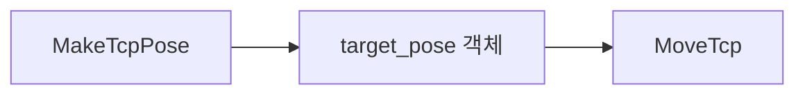

# BT 노드 사용법

그리퍼는 **정수 mm**, 팔 위치는 **m**, 팔 자세는 **quaternion**으로 입력합니다.
[전체 구조](bt-architecture.md) · [실행과 Groot2](bt-operation.md)

## 노드 목록

| 노드 | 바꿀 수 있는 값 | 동작 |
| --- | --- | --- |
| `GraspStep` | command, pregrasp 출력 | 파지 단계별 Action 호출, prepare에서만 모델 추론 |
| `MoveObservation` | 고정 | MuJoCo의 카메라 관측 자세로 MoveIt 이동 |
| `ClearOctomap` | 1회 실행 여부·대기 시간·새 점군 수 | clear 후 새 관측 지도 확인 |
| `SetGripper` | 개방 폭, 단위, 시간 | 지정한 폭으로 그리퍼 이동 |
| `MakeTcpPose` | 위치, 자세, 기준 프레임 | 하나의 `TcpPose` 객체 생성 |
| `MoveTcp` | `pose` 객체, TCP link | MoveIt pose goal 실행 |
| `CloseGripper` | 고정 | 0 mm로 닫기, 3초 |
| `OpenGripper` | 고정 | 100 mm로 열기, 3초 |
| `MoveHome` | 고정 | joint1~joint6 = 0 rad |
| `MoveTcpUp` | 고정 | base_link +Z 0.30 m, 현재 자세 유지 |

ROS Action 기반 이동/그리퍼/GraspStep 노드는 Nav2의 `server_name`, `server_timeout` 포트를 상속합니다. ClearOctomap과 MakeTcpPose는 별도 포트를 사용합니다.

## ClearOctomap — 이동 전 지도 초기화

```xml
<ClearOctomap once="true" timeout="30.0" fresh_clouds="2"/>
```

서비스를 한 번 호출하고 새 관측 지도까지 확인하는 비동기 action 노드입니다.
준비 중에는 `RUNNING`, 완료 시 `SUCCESS`, timeout이나 서비스 오류 시 `FAILURE`를 반환합니다.
`once=true`는 이 노드 인스턴스의 첫 성공 이후 초기화를 건너뜁니다.
Groot2에서 트리 맨 앞에 배치하세요. 상세 포트와 실행 기준은 [실행 안내](bt-operation.md)를 참고하세요.

## SetGripper — 개방 폭 지정

**50 mm 열기:**

```xml
<SetGripper opening="50" duration="2.5"/>
```

| 입력 | 필수 / 기본값 | 단위와 범위 |
| --- | --- | --- |
| `opening` | 필수 | 총 개방 폭, 정수 0~100 mm |
| `unit` | `mm` | `mm` 또는 `percent` |
| `duration` | `3.0` | 초, 0 초과 3600 이하 |

`opening="50"`은 **양쪽 손가락 사이 총 50 mm**입니다.
Controller에는 `gripper=0.05` m로 전달합니다.
`0`이면 닫힘, `100`이면 현재 모델의 최대 개방 폭입니다.

Blackboard 값도 연결할 수 있습니다.

```xml
<SetGripper opening="{gripper_opening_mm}"/>
```

`unit="percent"`를 명시하면 0~100% 개방률로 해석합니다.
현재 모델의 최대 폭이 100 mm여서 두 단위의 숫자가 일치합니다.
소수·범위 초과·잘못된 단위·유효하지 않은 시간은 goal 전송 전에 거부합니다.

## TcpPose — 목표를 객체 하나로 관리

위치 3개와 quaternion 4개를 따로 blackboard에 저장하는 대신,
**`rwh_beyond_msgs/msg/TcpPose` 객체 하나**를 저장합니다.



메시지 정의:

```text
string frame_id "base_link"
geometry_msgs/Pose pose
bool relative false
bool keep_current_orientation false
```

| 필드 | 의미 |
| --- | --- |
| `frame_id` | 위치와 자세의 기준 좌표계 |
| `pose.position` | m 단위 위치 x/y/z |
| `pose.orientation` | 기준 좌표계의 quaternion x/y/z/w |
| `relative` | true이면 위치를 현재 TCP 위치에 더할 offset으로 해석 |
| `keep_current_orientation` | true이면 메시지의 quaternion을 무시하고 현재 TCP 자세 유지 |

!!! note "메시지의 초기 자세"
    ROS 메시지의 기본 quaternion은 `(0, 0, 0, 1)`인 단위 회전입니다.
    메시지를 직접 만들면 이 자세가 목표가 됩니다.
    현재 자세를 유지하려면 `keep_current_orientation=true`로 설정합니다.
    `MakeTcpPose`는 quaternion 입력을 생략하면 이 값을 true로 설정합니다.

## MakeTcpPose — 객체 만들기

XML에서 **한 번 생성하고 이후에는 객체 이름만 연결**합니다.

```xml
<Sequence>
  <MakeTcpPose x="0.25" y="0" z="0.35"
               qx="0" qy="0" qz="0" qw="1"
               pose="{target_pose}"/>
  <MoveTcp pose="{target_pose}"/>
</Sequence>
```

| 입력 / 출력 | 필수 / 기본값 | 의미 |
| --- | --- | --- |
| 입력 `x`, `y`, `z` | 필수 | m 단위 위치 |
| 입력 `qx`, `qy`, `qz`, `qw` | 생략 가능 | 모두 지정하거나 모두 생략 |
| 입력 `frame_id` | `base_link` | 위치·자세 기준 좌표계 |
| 입력 `relative` | `false` | 상대 위치 여부 |
| 출력 `pose` | 필수 | `TcpPose`를 저장할 blackboard key |

Quaternion을 생략하면 `keep_current_orientation=true`인 객체를 만듭니다.
네 값을 모두 넣으면 `false`로 설정하고 quaternion을 정규화합니다.
이 노드는 **객체 생성만 수행**하며 로봇을 움직이지 않습니다.
검증에 실패하면 출력 객체를 덮어쓰지 않고 FAILURE를 반환합니다.

### 현재 자세를 유지하며 상대 이동

```xml
<Sequence>
  <MakeTcpPose x="0" y="0" z="0.30" relative="true" pose="{lift_pose}"/>
  <MoveTcp pose="{lift_pose}"/>
</Sequence>
```

기준 프레임 Z축 방향으로 0.30 m 상승하는 예제입니다.
`relative`는 위치에만 적용되며, 입력 quaternion은 항상 `frame_id` 기준 **절대 자세**입니다.

### 다른 C++ 노드에서도 메시지를 바로 저장할 수 있습니다

```cpp
rwh_beyond_msgs::msg::TcpPose target;
target.pose.position.x = 0.25;
target.pose.position.z = 0.35;
target.pose.orientation.w = 1.0;
blackboard->set("target_pose", target);
```

Blackboard key를 일곱 개 만들 필요 없이 `{target_pose}` 하나를 재사용합니다.
문자열이나 XML의 `<SetBlackboard>`로 넣은 임의 문자열은 이 메시지 객체를 대신하지 않습니다.
`RunDemo` goal은 XML 경로만 받으며, 외부 ROS 메시지가 자동으로 blackboard에 들어오지는 않습니다.

## MoveTcp — 객체로 이동하기

```xml
<MoveTcp pose="{target_pose}" tcp_link="tcp_link"/>
```

| 입력 | 필수 / 기본값 | 의미 |
| --- | --- | --- |
| `pose` | 필수 | `TcpPose` 타입의 blackboard 객체 |
| `tcp_link` | `tcp_link` | 제어할 TCP link |

`x/y/z`, `qx/qy/qz/qw`, `frame_id`, `relative` 개별 포트는 제거했습니다.
기존 XML은 위 `MakeTcpPose → MoveTcp` 구성으로 옮깁니다.

입력 객체는 복사해 검증하므로 **정규화와 상대 좌표 계산이 원본 객체를 바꾸지 않습니다.**
객체가 없거나 타입이 다르면 goal을 보내지 않습니다.
위치는 유한해야 하고 프레임은 비어 있으면 안 됩니다.
명시적 자세의 quaternion은 유한하며 norm이 `1e-12` 이상이어야 합니다.

| 객체의 설정 | 현재 TCP TF 필요 여부 |
| --- | --- |
| 절대 위치 + 명시적 자세 | 불필요 |
| 상대 위치 | 필요 |
| 현재 자세 유지 | 필요 |

목표 프레임과 도달 가능성은 MoveIt이 검증합니다.

### MoveIt 계획 설정

| 항목 | 값 |
| --- | --- |
| Planning group | `arm` |
| Pipeline / planner | OMPL / `RRTConnectkConfigDefault` |
| 계획 시간 | 10초 |
| 속도 / 가속도 비율 | 각각 0.1 |
| 위치 / 자세 허용오차 | 5 mm / 0.01 rad |

이 노드는 pose goal을 실행합니다. 직선 Cartesian 궤적을 보장하지 않으며,
도달 불가·충돌 목표를 임의 관절 목표로 바꾸지 않습니다.

## 실패와 그리퍼 접촉 처리

### 새 노드의 성공 판정

`MoveTcp`와 `SetGripper`는 **ROS action status와 application error code**를 함께 확인합니다.
오류나 cancel이면 BT FAILURE를 반환합니다.
잘못된 literal 값은 XML 로드 단계에서 거부될 수 있으며,
잘못된 runtime 입력이나 필요한 TF의 조회 실패는 goal 전송 전에 실패합니다.

기존 고정 노드 4개는 Nav2 기본 결과 처리에 의존하므로 같은 검증이 모두 적용된 것은 아닙니다.

### MuJoCo의 닫기 성공 조건

Trajectory의 마지막 시점 이후, 다음 중 하나를 만족하면 bridge가 성공을 반환합니다.

1. 위치와 속도가 허용오차 안에 들어옴.
2. 닫기 목표가 약 0 m (`desired <= 1e-4`)이고, 양쪽 손가락 force가 threshold 이상임.

Force는 MuJoCo `actuator_force`의 절댓값으로 읽습니다.
두 값 중 작은 값이 threshold 이상이어야 합니다.

| 파라미터 | 기본값 | 설정 의미 |
| --- | --- | --- |
| `gripper_contact_force_threshold` | `1.0` | 양쪽 손가락 force threshold |
| 같은 값이 0 이하 | — | force 기반 대체 성공 조건 비활성화 |

이는 actuator force를 통한 접촉 추정입니다. 물체가 안정적으로 파지됐는지를
독립적으로 검증하는 조건은 아닙니다.

## GraspStep — 파지 단계별 공통 플러그인

같은 노드를 여러 번 쓰지만 `command`에 따라 다른 단계를 수행한다. `prepare`에서만
RGB-D 인식과 GraspGenX 추론을 한 번 실행한다. XML `name`으로 Groot2에서 단계를 구분한다.

```xml
<GraspStep name="PrepareRedBoxGrasp" command="prepare" server_timeout="1000" pregrasp="{red_pregrasp}"/>
<GraspStep name="MoveToRedPregrasp" command="move_pregrasp" server_timeout="1000"/>
<GraspStep name="ApproachRedBox" command="approach" server_timeout="1000"/>
<CloseGripper/>
<GraspStep name="VerifyAndAttachRedBox" command="attach" server_timeout="1000"/>
<GraspStep name="LiftAndVerifyRedBox" command="lift" server_timeout="1000"/>
```

전체 기본 트리에는 앞에 시뮬레이터 확인·지도 준비·관측 자세 단계도 있다.
[각 command와 충돌/취소 처리](red-box-grasp.md)를 참고한다.
