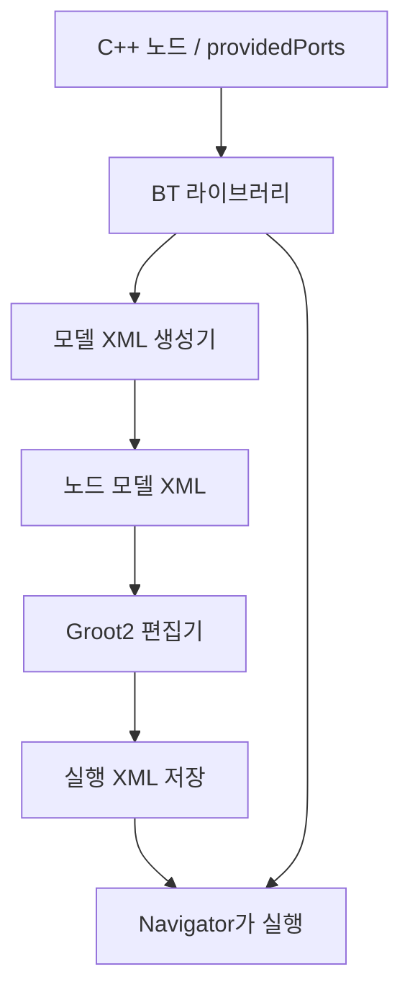

# BT 실행과 Groot2

[전체 구조](bt-architecture.md) · [BT 노드 사용법](bt-nodes.md)

## 1. 빌드하고 실행하기

컨테이너 workspace에서 실행합니다.

```bash
source /opt/ros/jazzy/setup.bash
cd /root/ros2_ws
colcon build --packages-select \
  rwh_beyond_msgs rwh_beyond_bt rwh_beyond_navigator \
  moma_mujoco_ros moma_bringup rwh_beyond_bringup --symlink-install
source install/setup.bash
ros2 launch rwh_beyond_bringup bt_demo.launch.py gui:=false rviz:=false
```

MuJoCo·MoveIt과 navigator가 시작됩니다. **Launch만으로 demo goal을 보내지는 않습니다.**
GUI를 표시하려면 `gui:=true rviz:=true`를 사용합니다.

`ros_runner`에서는 `bt_demo`를 실행합니다.
`piper_moveit`, `piper_moveit_sim`, `bt_demo`는 서로 비활성화하도록 설정돼 있습니다.

| 실행 경로 | 대상 |
| --- | --- |
| `bt_demo` | MuJoCo + MoveIt + BT navigator |
| `piper_moveit_sim` | MuJoCo + MoveIt |
| `piper_moveit` | 실물 CAN 드라이버 + MoveIt |

## 2. 서버 등록 확인하기

다른 터미널에서 ROS와 workspace 환경을 source한 뒤 확인합니다.

```bash
ros2 lifecycle get /bt_navigator
ros2 action info /run_demo
ros2 param get /bt_navigator plugin_lib_names
```

| 확인 항목 | 기대값 |
| --- | --- |
| Lifecycle 상태 | `active [3]` |
| `/run_demo` 서버 수 | 1개 |
| BT 라이브러리 설정 | `rwh_beyond_bt_nodes` |

시작 시에는 `bt_lifecycle_manager`가 navigator를 configure하고 activate합니다.
XML의 action 노드가 서버에 연결할 수 있어야 활성화가 완료됩니다.

| 시간 설정 | 기본값 | 용도 |
| --- | --- | --- |
| `wait_for_service_timeout` | 30000 ms | MoveIt 등 action server 발견 대기 |
| `bt_loop_duration` | 10 ms | 트리 tick 주기 |
| `default_server_timeout` | 20 ms | goal 응답 대기 |

서버 발견 대기 시간은 로봇 동작 완료 제한 시간이 아닙니다.

## 3. Groot2에서 편집하기

```bash
groot2
```

다음 순서로 파일을 불러옵니다.

1. **노드 모델 가져오기:** `rwh_beyond_bt/rwh_beyond_tree_nodes.xml`
2. **트리 열기:** `rwh_beyond_bt/behavior_trees/demo.xml` 또는 `parameterized_demo.xml`

위 경로는 `/root/ros2_ws/src/rwh_beyond/` 기준입니다.

### 두 XML은 역할이 다릅니다

| 파일 | 담고 있는 것 | 사용하는 곳 |
| --- | --- | --- |
| `rwh_beyond_tree_nodes.xml` | 노드 ID, 종류, 포트와 기본값 | Groot2 노드 목록 |
| `behavior_trees/*.xml` | 실행 순서와 입력값 | Navigator의 트리 실행 |



Groot2는 모델 XML로 포트를 표시합니다. 실행 구현은 navigator가 C++ 라이브러리에서
로드합니다. 현재 launch에는 Groot2 실시간 모니터 연결을 설정하지 않았습니다.

### C++ 노드나 포트를 바꿨을 때

빌드하고 workspace를 source한 뒤 모델 XML을 재생성합니다.

```bash
source /opt/ros/jazzy/setup.bash
source /root/ros2_ws/install/setup.bash
ros2 run rwh_beyond_bt generate_tree_nodes_xml \
  /root/ros2_ws/src/rwh_beyond/rwh_beyond_bt/rwh_beyond_tree_nodes.xml
```

- **Navigator:** 프로세스를 재시작해 새 라이브러리를 로드합니다.
- **Groot2:** 갱신된 노드 모델 XML을 다시 가져옵니다.

생성기는 factory에 노드를 등록하지만 action 노드를 생성하거나 goal을 보내지는 않습니다.

## 4. 테스트와 검증 범위

```bash
cd /root/ros2_ws
colcon test --packages-select rwh_beyond_bt --return-code-on-test-failure
colcon test-result --test-result-base build/rwh_beyond_bt/test_results
```

| 검증 | 확인한 내용 |
| --- | --- |
| Mock 테스트 8개 | mm 변환, 정수·범위 검사, 절대·상대 위치, 자세 유지, quaternion 전달·정규화 |
| 잘못된 입력 테스트 | quaternion·TF·blackboard 입력 오류, application error 처리 |
| Headless 통합 실행 | lifecycle active, action server 등록, 라이브러리 로딩 |

Mock 테스트는 ROS domain 87에서 실제 로봇 명령 없이 실행합니다.
**MuJoCo 전체 demo 완료와 실물 동작은 아직 검증하지 않았습니다.**
