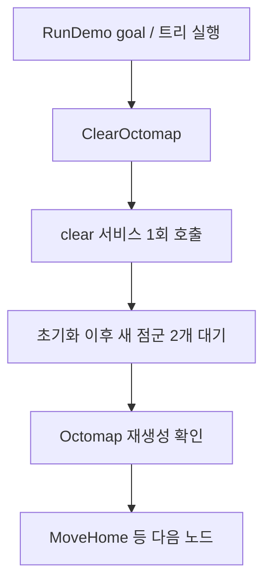
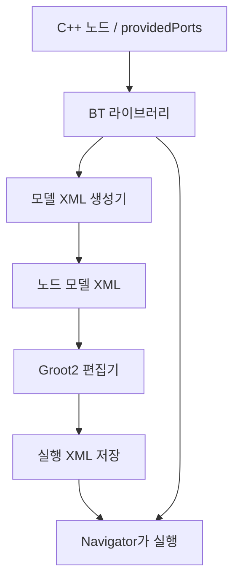

# BT 실행과 Groot2

> 처음 읽는 경우 [전체 흐름](project-overview.md) → [현재 실행 절차](grasp-pipeline-guide.md) → [코드 안내](project-code-map.md) 순서로 보세요. 이 페이지의 상세·과거 예제보다 현재 실행 절차를 우선합니다.


[최종 SAM 파지 실행 가이드](grasp-pipeline-guide.md) · [전체 구조](bt-architecture.md) · [BT 노드 사용법](bt-nodes.md)

## 1. 빌드하고 실행하기

컨테이너 workspace에서 실행합니다.

```bash
source /opt/ros/jazzy/setup.bash
cd /root/ros2_ws
colcon build --symlink-install --packages-up-to \
  rwh_beyond_bringup rwh_beyond_grasp_bridge ros_runner
source install/setup.bash
ros2 launch moma_bringup simulation.launch.py gui:=false moveit:=true rviz:=false
```

MuJoCo·MoveIt이 준비되면 다른 터미널에서 아래 BT launch를 실행합니다. 이 launch가
grasp pipeline도 시작하므로 별도로 실행하지 않습니다. 기본 트리는
[빨간 상자 파지](red-box-grasp.md)이며 실제 SAM 3와 GraspGenX 서버가 모두 필요합니다.
GUI를 표시하려면 시뮬레이션 launch에 `gui:=true rviz:=false`를 사용합니다.

```bash
source /opt/ros/jazzy/setup.bash
source /root/ros2_ws/install/setup.bash
ros2 launch rwh_beyond_bringup bt_demo.launch.py
```

BT launch가 MoveIt/SAM/파지 통합 RViz도 함께 실행합니다. GUI 없이 실행하려면
`bt_demo.launch.py rviz:=false`를 사용합니다. runner의 경우 RViz는 bt_demo_sim이 소유하며
`piper_sim`은 별도 창을 만들지 않습니다.

BT navigator·lifecycle manager·모델 bridge·coordinator 설정은
`rwh_beyond_bringup/config/bt_demo.yaml`에서 관리합니다. 값을 수정한 뒤
`rwh_beyond_bringup`을 다시 빌드하고 navigator를 재시작하세요. 별도 설정 파일은
`ros2 launch rwh_beyond_bringup bt_demo.launch.py params_file:=/absolute/path/bt_demo.yaml`로
지정할 수 있으며, 다섯 노드의 설정을 모두 포함해야 합니다.

`ros_runner`에서 **`bt_demo_sim`만 활성화**하면 `bt_demo_sim → piper_sim`에 의해
MuJoCo·MoveIt·RViz가 자동으로 시작됩니다. 이미 실행 중인 `piper_sim`은 재사용합니다.
BT launch가 추론 Bridge/coordinator를 직접 시작하며, runner가 시뮬레이션 의존성을 관리합니다.
**자동으로 demo goal을 보내지는 않습니다.**

```bash
ros2 service call /runner_manager_node/activate_bt_demo_sim std_srvs/srv/Empty "{}"
# navigator와 사용되지 않는 simulator 의존성 종료
ros2 service call /runner_manager_node/deactivate_bt_demo_sim std_srvs/srv/Empty "{}"
```

`piper_sim`을 중지하면 이에 의존하는 `bt_demo_sim`도 중지됩니다.
다른 robot backend로 전환할 때도 의존 관계에 따라 navigator가 함께 종료됩니다.
YAML을 갱신한 뒤 기존 ros_runner 프로세스를 재시작해야 새 설정이 적용됩니다.

### 트리 안에서 Octomap 초기화

Launch는 navigator와 lifecycle manager, grasp pipeline 및 선택적 RViz를 실행합니다. **지도 초기화는 이동 전 ClearOctomap 노드가 수행**합니다.

```xml
<Sequence>
  <ClearOctomap once="true" timeout="30.0" fresh_clouds="2"/>
  <MoveHome/>
  <!-- 이후 이동과 그리퍼 작업 -->
</Sequence>
```



`once=true`는 **이 BT 노드 인스턴스에서 초기화가 한 번 성공하면** 다음 실행에서 건너뜁니다.
같은 XML을 재사용하는 반복 goal에서는 다시 clear하지 않습니다.
XML 변경·다른 트리 로딩·navigator 재시작으로 노드가 새로 만들어지면 다시 초기화합니다.
`once=false`이면 노드가 새로 실행될 때마다 clear하며 매 tick 반복 호출하지는 않습니다.
실패·취소된 준비는 성공으로 기억하지 않으므로 다음 시도에서 다시 준비합니다.

| BT 포트 | 기본값 | 의미 |
| --- | --- | --- |
| `once` | `true` | 노드 인스턴스의 성공한 초기화 재사용 |
| `timeout` | `30.0` | 서비스 대기부터 맵 확인까지 총 wall time, 초 |
| `fresh_clouds` | `2` | clear 이후 필요한 서로 다른 비어 있지 않은 점군 수 |
| `service_name` | `/clear_octomap` | MoveIt clear 서비스 |
| `cloud_topic` | `/camera/depth/filtered_points` | 로봇 제거 후 점군 |
| `scene_service` | `/get_planning_scene` | 지도 확인 서비스 |

초기화 전 timestamp의 점군은 인정하지 않습니다. Timeout·빈 지도·서비스 오류는
`FAILURE`로 반환해 다음 이동을 막고, `/run_demo`의 실패 단계는 `clear_octomap`으로 표시합니다.
새 관측 수신을 확인하는 것이며 작업 영역 전체의 관측 완료를 보장하지는 않습니다.
기본 `demo.xml`과 `parameterized_demo.xml`의 맨 앞에 이 노드를 배치했습니다.
Octomap을 사용하지 않는 트리에서는 해당 노드를 넣지 않으면 됩니다.

### 기본 RViz 화면

시뮬레이션은 `scene_source:=depth`와 `moma_bringup/config/depth_planning.rviz`를 사용합니다.

| 표시 | Topic / 데이터 | 기본 상태 |
| --- | --- | --- |
| MotionPlanning | `/monitored_planning_scene`의 로봇·Octomap | 켜짐 |
| Planned Path | `/display_planned_path` | 켜짐 |
| Depth points - robot filtered | `/camera/depth/filtered_points` | 켜짐, cyan |
| Depth points - raw | `/camera/depth/color/points` | 비교용, 꺼짐 |
| RGB camera | `/camera/color/image_raw` | 켜짐 |
| Depth camera | `/camera/depth/image_rect_raw` | 켜짐 |
| Camera pose | `/camera/pose` | 비교용, 꺼짐 |

Octomap은 별도 `/octomap` display가 아니라 MotionPlanning의 Scene Geometry에 표시됩니다.
점군·영상은 센서의 Best Effort QoS에 맞췄습니다. 겹쳐 보이면 Displays에서 점군을 끄고
Octomap만 확인하세요. 최초 계획 전 카메라 영상과 Octomap 수신을 확인하세요.
GUI 옵션은 runner 시작 전 `RWH_PIPER_SIM_GUI`, `RWH_BT_RVIZ` 환경변수로 바꿀 수 있습니다.

| 실행 경로 | 대상 |
| --- | --- |
| `bt_demo_sim` | `piper_sim` 자동 시작 + grasp pipeline 및 BT navigator와 RViz |
| `piper_sim` | MuJoCo + MoveIt (RViz 별도 실행) |
| `piper_moveit` | 실물 CAN 드라이버 + MoveIt |

## 2. 서버 등록 확인하기

다른 터미널에서 ROS와 workspace 환경을 source한 뒤 확인합니다.

```bash
ros2 lifecycle get /bt_navigator
ros2 action info /run_demo
ros2 param get /bt_navigator plugin_lib_names
```

| 확인 항목 | 기대값 |
| --- | --- |
| Lifecycle 상태 | `active [3]` |
| `/run_demo` 서버 수 | 1개 |
| BT 라이브러리 설정 | `rwh_beyond_bt_nodes` |

시작 시에는 `bt_lifecycle_manager`가 navigator를 configure하고 activate합니다.
XML의 action 노드가 서버에 연결할 수 있어야 활성화가 완료됩니다.

| 시간 설정 | 기본값 | 용도 |
| --- | --- | --- |
| `wait_for_service_timeout` | 30000 ms | MoveIt 등 action server 발견 대기 |
| `bt_loop_duration` | 10 ms | 트리 tick 주기 |
| `default_server_timeout` | 20 ms | goal 응답 대기 |

서버 발견 대기 시간은 로봇 동작 완료 제한 시간이 아닙니다.

## BT 실패 진단 {#bt-error-reporting}

`RunDemo`는 현재 단계뿐 아니라 MoveIt 내부 상태와 실패 원인을 feedback/result로 전달합니다.
MoveIt의 `error_code.val`, `message`, `source`를 사용하며,
**result.error_code는 uint16에서 int32로 변경**해 음수 코드를 보존합니다.
성공은 0, MoveIt·controller 실패는 원래 코드이며 `error_source`와 `error_name`으로 구분합니다.
BT 자체 오류는 -1000 이하입니다.

```text
Feedback:
  current_stage: move_home
  current_node: MoveHome
  moveit_state: MONITOR
  error_code: -3
  error_name: MOTION_PLAN_INVALIDATED_BY_ENVIRONMENT_CHANGE
  error_source: move_action
  error_msg: Planning scene changed during execution; the remaining trajectory became invalid. ...

Result:
  error_code: -3
  error_name: MOTION_PLAN_INVALIDATED_BY_ENVIRONMENT_CHANGE
  failed_stage: move_home
  failed_node: MoveHome
```

위 예제는 MoveIt의 원문 메시지·source가 비어 있을 때의 fallback입니다.
원문이 있으면 `error_msg`와 `error_source`에 그대로 전달합니다.
`moveit_state`는 action feedback의 마지막 `state`이며 진행률 퍼센트가 아닙니다.
실패가 마지막 tick에 발생해도 terminal result 직전에 진단 feedback을 한 번 더 발행합니다.
새 stage/goal을 시작할 때 이전 오류를 초기화합니다.

| 오류 예 | 의미 |
| --- | --- |
| `MOTION_PLAN_INVALIDATED_BY_ENVIRONMENT_CHANGE (-3)` | 실행 중 scene 갱신으로 남은 경로가 무효화됨 |
| `START_STATE_IN_COLLISION (-10)` | 시작 상태가 충돌 상태 |
| `GOAL_IN_COLLISION (-12)` | 목표 상태가 충돌 상태 |
| `NO_IK_SOLUTION (-31)` | 목표 자세의 IK 해가 없음 |
| `GOAL_TOLERANCE_VIOLATED` | 그리퍼 controller가 목표 tolerance를 만족하지 못함 |
| `INVALID_INPUT (-1000)` | pose·그리퍼 입력 검증 실패 |
| `ACTION_REQUEST_FAILED (-1001)` | goal 거부·전송 실패·응답 timeout |
| `BT_FAILED (-1002)` | 구체적인 action 오류가 남지 않은 트리 실패 |
| `OCTOMAP_TIMEOUT (-1100)` | ClearOctomap의 서비스·새 관측·맵 확인 시간 초과 |
| `OCTOMAP_SERVICE_ERROR (-1101)` | Octomap 서비스 처리 오류 |
| `BT_EXCEPTION (-1003)` | TF 조회 등 BT 실행 중 예외 |
| `ACTION_CANCELED / DEMO_CANCELED (-1004)` | action/demo 취소 |

충돌 링크 쌍은 MoveGroup result의 독립 필드가 아닙니다.
따라서 `<octomap> - gripper_link1`이 MoveIt 로그에만 있고 result.message에는 없다면
navigator가 그 쌍을 정확히 반환할 수는 없습니다. 이 경우 -3의 의미를 설명하고 MoveIt collision 로그를 안내합니다.
여러 goal이 섞일 수 있는 전역 로그를 원래 action result로 간주해 합치지 않습니다.

**적용 시 runner와 action client를 재시작**하고 새 workspace를 source하세요.
Action 타입이 바뀌었으므로 이전 타입을 로드한 Python client/navigator를 계속 사용할 수 없습니다.
BT 오류 전달은 SubTree 안에서도 root blackboard를 사용합니다.
기본 `MoveHome`, `MoveTcpUp`, `CloseGripper`, `OpenGripper`도 ROS 상태뿐 아니라
MoveIt/controller의 application error를 확인합니다.

## 3. Groot2에서 편집하기

```bash
groot2
```

다음 순서로 파일을 불러옵니다.

1. **노드 모델 가져오기:** `rwh_beyond_bt/behavior_trees/rwh_beyond_tree_nodes.xml`
2. **트리 열기:** `rwh_beyond_bt/behavior_trees/demo.xml` 또는 `parameterized_demo.xml`

위 경로는 `/root/ros2_ws/src/rwh_beyond/` 기준입니다.

### 두 XML은 역할이 다릅니다

| 파일 | 담고 있는 것 | 사용하는 곳 |
| --- | --- | --- |
| `rwh_beyond_tree_nodes.xml` | 노드 ID, 종류, 포트와 기본값 | Groot2 노드 목록 |
| `behavior_trees/*.xml` | 실행 순서와 입력값 | Navigator의 트리 실행 |



Groot2는 모델 XML로 포트를 표시합니다. 실행 구현은 navigator가 C++ 라이브러리에서
로드합니다.

### 실시간 모니터 연결

BT navigator가 활성화되면 Groot2의 **Monitor** 모드에서 navigator가 실행되는
호스트와 포트 `5555`로 연결합니다. 같은 호스트에서는 `127.0.0.1:5555`를 사용합니다.
`5555`는 요청 포트이고 `5556`은 상태 전송 포트이므로 원격 연결 시 둘 다 접근 가능해야 합니다.
연결 후 goal을 보내면 트리 노드의 상태가 실시간으로 표시됩니다.

설정은 `rwh_beyond_bringup/config/bt_demo.yaml`의
`run_demo.enable_groot_monitoring`과 `run_demo.groot_server_port`에서 변경합니다.
포트는 1~65534 사이여야 하며, 변경 시 다음 포트도 사용됩니다. 비활성화하려면
`enable_groot_monitoring: false`로 설정합니다. 설정이나 라이브러리 변경 후에는
navigator를 재시작하세요.

모니터 포트는 모든 네트워크 인터페이스에서 열리며 인증을 제공하지 않습니다.
신뢰할 수 있는 호스트만 접속하도록 방화벽 등으로 두 포트를 제한하세요.

### C++ 노드나 포트를 바꿨을 때

빌드하고 workspace를 source한 뒤 모델 XML을 재생성합니다.

```bash
source /opt/ros/jazzy/setup.bash
source /root/ros2_ws/install/setup.bash
ros2 run rwh_beyond_bt generate_tree_nodes_xml \
  /root/ros2_ws/src/rwh_beyond/rwh_beyond_bt/behavior_trees/rwh_beyond_tree_nodes.xml
```

- **Navigator:** 프로세스를 재시작해 새 라이브러리를 로드합니다.
- **Groot2:** 갱신된 노드 모델 XML을 다시 가져옵니다.

생성기는 factory에 노드를 등록하지만 action 노드를 생성하거나 goal을 보내지는 않습니다.

## 4. 테스트와 검증 범위

```bash
cd /root/ros2_ws
colcon test --packages-select rwh_beyond_bt --return-code-on-test-failure
colcon test-result --test-result-base build/rwh_beyond_bt/test_results
```

| 검증 | 확인한 내용 |
| --- | --- |
| Mock 테스트 24개 | mm 변환, 객체 생성·전달·재사용·SubTree 연결, 위치·자세와 quaternion 정규화 |
| 잘못된 입력 테스트 | quaternion·TF·blackboard 입력 오류, application error 처리 |
| Navigator mock 통합 테스트 | 음수 코드·원문·발생 컴포넌트·최종 feedback 전달, 다음 goal 오류 초기화 |
| Headless 통합 실행 | lifecycle active, action server 등록, 라이브러리 로딩 |

Mock 테스트는 ROS domain 87에서 실제 로봇 명령 없이 실행합니다.
**MuJoCo 전체 demo 완료와 실물 동작은 아직 검증하지 않았습니다.**


### 심/실물 공통 기본 트리

`bt_demo.launch.py`는 두 mode 모두 `behavior_trees/demo.xml`을 기본 시나리오로 사용합니다.
관측 높이와 각도는 해당 XML의 `rise_m`, `tilt_deg`로 조정합니다.
`hardware_demo.xml`은 같은 파일을 가리키는 호환 링크입니다.
리프트 뒤에는 attachment를 유지한 채 관측 자세와 home으로 복귀합니다.
자세한 흐름과 환경별 controller 차이는 [실물 BT](real-bt.md)를 참고하세요.


### Action별 인식 대상 지정

`/run_demo`의 `rwh_beyond_msgs/action/RunDemo` Goal에서 `target_text`를 지정합니다.

```bash
ros2 action send_goal /run_demo rwh_beyond_msgs/action/RunDemo \
  '{target_text: "blue cup"}' --feedback
```

`behavior_tree: ""`는 심/실물 공통 기본 트리입니다. `target_text`를 생략하거나
빈 값으로 보내면 YAML의 기본 대상이 적용되며, 이전 요청의 대상은 유지되지 않습니다.
요청한 텍스트는 Navigator → BT SegmentObject → coordinator → SAM 3로 전달됩니다.
호출 측은 변경된 `rwh_beyond_msgs`를 빌드하고 실행 환경을 다시 source해야 합니다.
