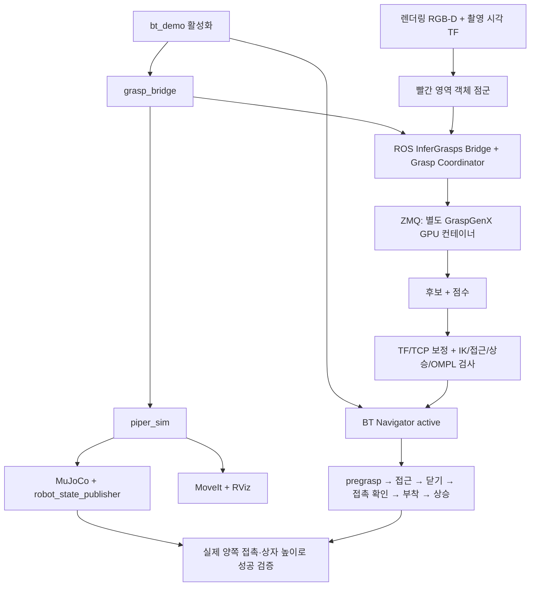
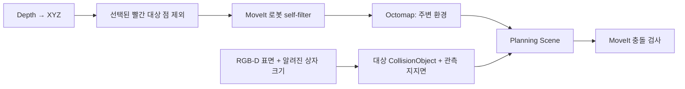

# Depth 관측과 BT 실행 흐름

`bt_demo` runner로 시뮬레이션·추론 Bridge·BT navigator를 준비하고,
`/run_demo` goal로 [빨간 상자 파지](red-box-grasp.md)를 실행한다.

runner 활성화는 프로세스 준비만 하며 이동 goal은 보내지 않는다.
이미 켠 dependency는 재사용한다. 종료 시 사용되지 않는 Bridge/simulator도
정리하며, simulator를 끄면 그 dependent runner도 종료한다.
GPU 모델 컨테이너는 별도 관리하고 호스트 Docker/Podman socket을 ROS에 노출하지 않는다.

## Planning Scene

기본 `scene_source:=depth`는 MuJoCo 물체 pose를 계획에 직접 넣지 않는다.
파지 준비 때만 RGB-D로 추정한 target/support 객체를 추가한다.
Ground truth는 비교용 `scene_source:=ground_truth` 또는 별도 physics 검증 서비스에만 있다.

| 데이터 | Topic |
|---|---|
| RGB / depth / 내부 파라미터 | /camera/color/image_raw, /camera/depth/image_rect_raw, /camera/depth/camera_info |
| 센서 XYZ / 로봇 제거 후 XYZ | /camera/depth/color/points, /camera/depth/filtered_points |
| 파지 입력 snapshot / red mask | /grasp/object_cloud, /grasp/red_mask |
| 선택한 TCP 목표 | /grasp/selected_tcp |
| 충돌 장면 / 계획 경로 | /monitored_planning_scene, /display_planned_path |

RViz는 RGB/depth·Octomap·점군·계획 경로와 추가한 대상 점군/TCP 축을 표시한다.
센서 QoS는 Best Effort, Octomap은 world 기준 10 mm / 최대 2 Hz / 2 m 설정이다.
Self-filter의 20 mm padding은 가까운 환경점에도 영향을 줄 수 있다.

## 지도 준비와 접촉

- 최초 `ClearOctomap once=true`가 clear 후 새 점군 2개/지도 생성을 확인한다.
- 각 `prepare`는 대상의 의미적 분리를 위해 RGB 점 제외 → clear → 새 관측 지도 확인을
  다시 수행한다. 물체 자체는 CollisionObject로 유지하며 빈 지도에서 이동하지 않는다.
- target과 두 손가락의 ACM pair만 허용한다. 그리퍼와 Octomap 전체는 계속 검사한다.
- 파지 후 AttachedCollisionObject는 들고 있는 물체의 환경 충돌 검사에 사용한다.
  실제 물리 부착은 생성하지 않는다.
- 실패/취소는 임시 규칙을 복원하고, 이미 든 물체는 자동으로 놓지 않는다.

카메라 미관측 영역의 안전이나 동적 장애물의 실시간 회피를 보장하지 않는다.
검증 방법과 현재 구현 범위는 [빨간 상자 파지 검증](red-box-grasp.md)을 참고한다.
