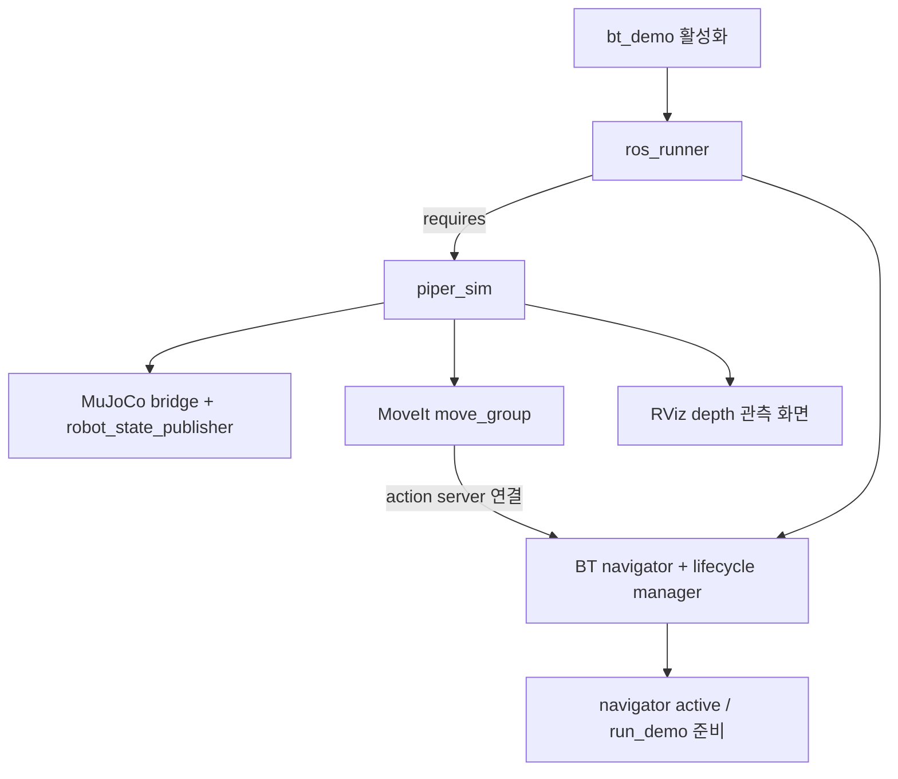
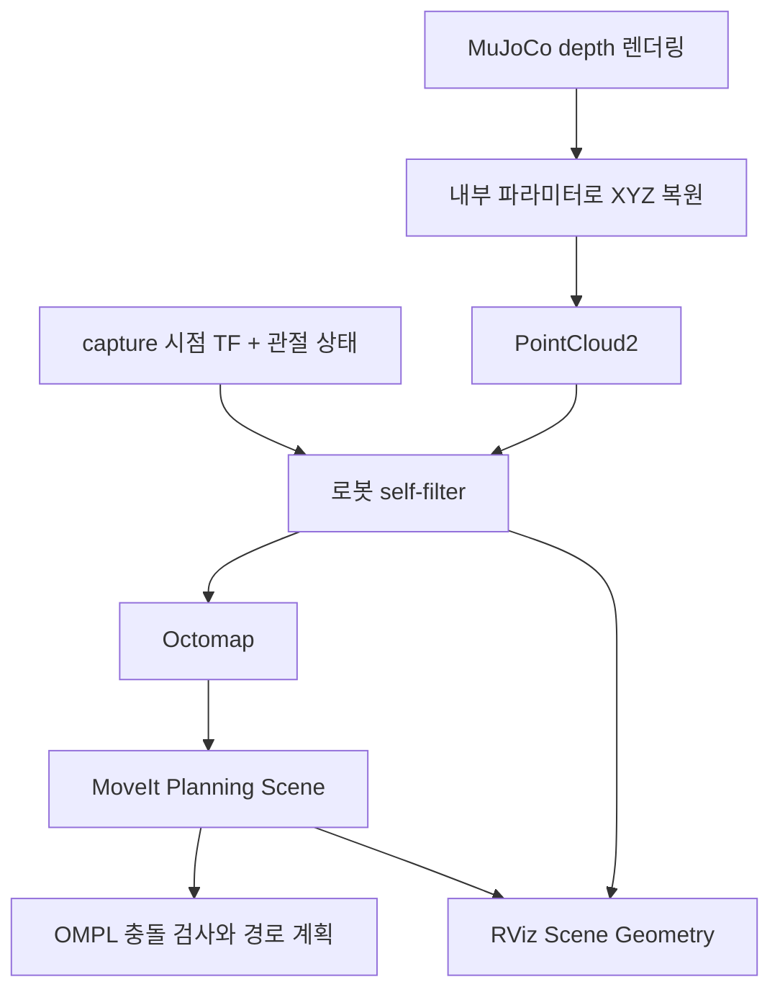
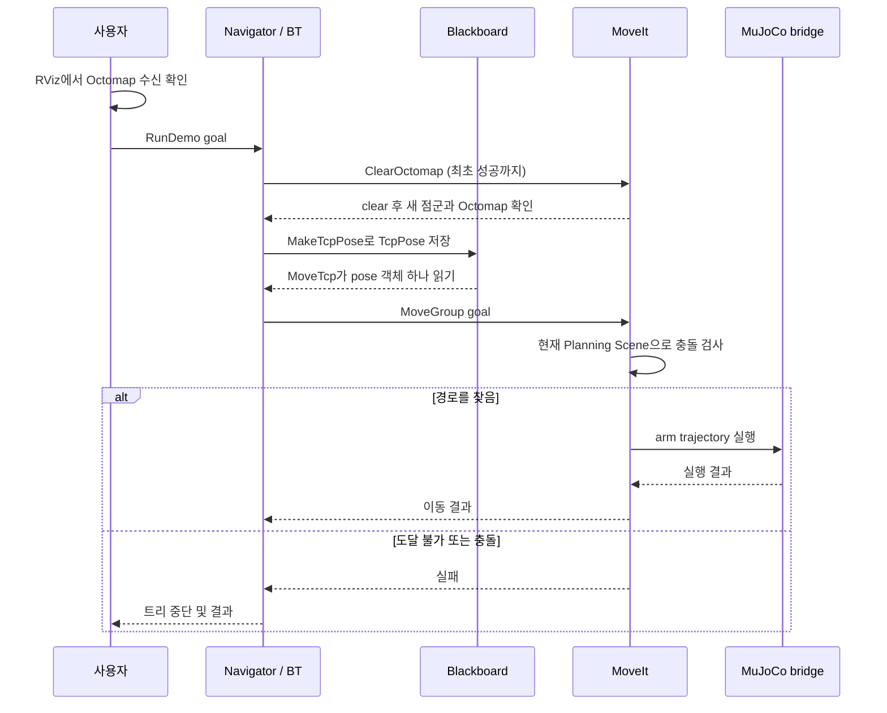

# Depth 관측과 BT 실행 흐름

**`bt_demo` runner 하나로 시뮬레이션과 navigator를 준비하고,
카메라로 관측한 장애물을 반영해 MoveIt이 경로를 계획합니다.**
작업 시작은 별도의 `/run_demo` goal로 요청합니다.

[구조 이해](bt-architecture.md) · [노드 사용법](bt-nodes.md) · [실행 방법](bt-operation.md)

## 1. Runner가 실행 환경을 준비합니다

- `piper_sim`이 이미 실행 중이면 중복 실행하지 않습니다.
- 실제 CAN driver나 다른 simulator와는 runner의 비활성화 규칙으로 중복을 막습니다.
- `bt_demo`를 중지하면 다른 runner가 사용하지 않는 `piper_sim`도 종료합니다.
- `piper_sim`을 중지하면 이에 의존하는 `bt_demo`도 종료합니다.

`requires`는 프로세스 시작 의존성입니다. 지도 초기화는 launch에서 실행하지 않습니다.
Goal을 받은 뒤 트리 첫 `ClearOctomap` 노드가 clear와 새 관측 대기를 수행합니다.
Navigator active 자체는 지도 준비 완료를 의미하지 않습니다.

## 2. Depth 관측으로 Planning Scene을 만듭니다

기본 `scene_source:=depth`에서는 MuJoCo의 물체 이름·크기·pose를 직접 등록하지 않습니다.
기존 비교 모드는 `scene_source:=ground_truth`이며, 이때는 직접 등록을 사용하고 Octomap을 끕니다.

| 데이터 | Topic / 설정 |
| --- | --- |
| Depth 영상 | `/camera/depth/image_rect_raw` |
| 카메라 내부 파라미터 | `/camera/depth/camera_info` |
| 원본 XYZ | `/camera/depth/color/points` |
| 로봇 제거 후 XYZ | `/camera/depth/filtered_points` |
| MoveIt scene / 계획 경로 | `/monitored_planning_scene` / `/display_planned_path` |
| 지도 설정 | `world` frame, 10 mm voxel, 최대 관측 거리 2 m, 최대 2 Hz |
| RViz 설정 | `moma_bringup/config/depth_planning.rviz` |

RGB·depth 영상은 RViz 오른쪽 패널에, 로봇·Octomap·계획 경로는 중앙에 표시합니다.
Cyan 점군을 끄면 충돌 검사에 쓰이는 Octomap만 볼 수 있습니다.
센서 표시의 QoS는 Best Effort입니다.

## 3. Goal을 받아 관측 환경에서 계획·실행합니다

`MakeTcpPose → MoveTcp`는 `parameterized_demo.xml`의 예제입니다.
기본 `demo.xml`의 `MoveHome`·`MoveTcpUp`도 같은 MoveIt scene으로 계획합니다.
그리퍼는 BT에서 별도의 FollowJointTrajectory action을 호출합니다.
Runner 활성화만으로 goal이나 로봇 이동을 요청하지 않습니다.

## 관측과 파지의 현재 범위

- 카메라는 보이는 표면만 관측합니다. 미관측 영역이 비어 있음을 보장하지 않습니다.
- Self-filter는 로봇 표면 오검출을 줄이기 위해 20 mm 여유를 사용합니다.
  이 범위의 가까운 관측점도 제외될 수 있습니다.
- Octomap은 물체 ID가 없는 점유 지도입니다. 집을 대상의 분할·별도 객체 등록·접촉 허용·부착은 후속 작업입니다.
- 그리퍼와 Octomap 전체의 충돌 검사는 유지합니다.
- 물체 이동·simulation reset 뒤 오래된 점유가 남으면 정지 상태에서
  `/clear_octomap`을 호출하고 다시 관측합니다.
- 현재 구성은 계획 시 충돌 검사이며 실행 중 장애물에 대한 실시간 회피는 아닙니다.

## 검증한 결과

| 검증 | 결과 |
| --- | --- |
| `bt_demo`만 활성화 | simulator·MoveIt·RViz 자동 시작, navigator active, `/run_demo` 등록 |
| Depth scene | 직접 등록 물체 0개, Octomap 생성 |
| MoveIt 계획 | 관측 환경에서 계획 성공, 관측 Octomap과 충돌하는 목표 거부 |
| RViz | 점군·RGB·depth 수신과 패널 배치 확인 |
| 중지 | navigator와 미사용 simulator 의존성 종료 |

검증에서 실행용 이동 goal은 보내지 않았습니다. 전체 grasp 시퀀스의 성공 검증은 포함하지 않습니다.
