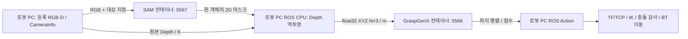

# SAM → 로컬 PointCloud → GraspGenX → BT 실행 가이드

현재 기본 집기 흐름과 실행 방법을 정리한 문서다. 상세 실험 이력은
[역할별 플러그인·최신 검증](bt-grasp-stages.md), [SAM 검증 기록](sam3-perception.md), 날짜별 변경은 [작업일지](work-log-2026-11-10.md)를 참고한다.
현재 이동/접촉 검증은 MuJoCo 전용이며 실물 로봇 자동 집기는 지원하지 않는다.

## 데이터가 처리되는 위치



SAM의 2D 마스크에는 깊이가 없다. 같은 촬영의 등록된 Depth와 CameraInfo를 로컬에서
사용해 XYZ를 만든다. `/grasp/object_cloud` 발행이 파지 추론보다 먼저 일어난다.
GraspGenX는 이 XYZ를 입력으로 사용하므로 triangle mesh 재구성을 추가하지 않았다.
내보낸 PLY도 점군 파일이며 mesh가 아니다. 가려진 면의 정확한 형상은 복원하지 않는다.

현재 로컬 RTX 3060 PC에서는 두 GPU 모델을 별도 컨테이너에서 실행한다.
원격 GPU 서버로 옮길 때도 ROS CPU 역투영은 로봇 PC에 남기고 ZMQ endpoint만 바꾼다.
원격 공용 RTX 5090 서버의 Docker 배포는 아직 완료하지 않았다.

## BT 단계

| 노드 | 수행 내용 |
|---|---|
| CheckGraspReady / ClearOctomap | 시뮬레이터·실제 모델 준비 확인, 최초 지도 재생성 |
| MoveHome / OpenGripper / MoveObservation | 초기 자세·그리퍼·카메라 관측 자세 준비 |
| SegmentObject | 새 관측과 TF 저장, SAM 서버에서 객체 마스크 수신 |
| BuildObjectCloud | 로컬 CPU에서 Depth/K 역투영, 객체 PointCloud2 발행 |
| InferGrasps | 같은 점군을 POINT_CLOUD Action으로 전송, 파지 후보 반환 |
| SelectFeasibleGrasp | 전달된 후보로 충돌 모델·IK·접근/상승·사전 접근 경로 검사 |
| MoveToPregrasp / ApproachGrasp / CloseGripper | 사전 접근·최종 접근·닫기 |
| AttachObject / LiftObject | 실제 양쪽 접촉 확인, MoveIt 부착, 물리 리프트 검증 |
| MoveHome | 닫힌 그리퍼로 홈 복귀; 내려놓기/열기는 포함하지 않음 |

기본 파일은 `rwh_beyond_bt/behavior_trees/demo.xml`이다. [역할별 BT 플러그인](bt-grasp-stages.md)이
마스크·점군·후보를 typed Blackboard 포트로 전달한다. 관측 ID와 계획 ID로 원본 관측과 경로를 연결한다.
단계가 실패하면 뒤의 이동은 실행하지 않는다. 30초 지난 관측이나 촬영 후 팔 관절이
0.02 rad 넘게 달라진 관측은 재관측을 요구한다. 움직이는 물체의 추적은 지원하지 않는다.

별도의 RGBD 모드 InferGrasps Action은 분할·로컬 역투영·파지 추론을 한 요청에서
처리하는 편의 API로 유지한다. 기본 BT는 이 API를 중복 호출하지 않고 분리된 단계를 사용한다.

## 실행

### 호스트 PC: 두 모델 서버

```bash
# 컨테이너만 시작: 기존 모델 프로세스가 있으면 다시 기동하지 않는다.
bash ~/sam3_workspace/deploy/local_podman.sh start
bash ~/graspgenx_workspace/docker/scripts/local_podman.sh start

# 각각 health를 확인한다.
bash ~/sam3_workspace/deploy/local_podman.sh health
bash ~/graspgenx_workspace/docker/scripts/local_podman.sh health
```

컨테이너만 켜져 있고 모델이 꺼져 있다면 각 터미널에서 다음을 실행한다.

```bash
bash ~/sam3_workspace/deploy/local_podman.sh model-start
bash ~/graspgenx_workspace/docker/scripts/local_podman.sh model-start
```

각 명령은 foreground로 실행되므로 별도 터미널이 필요하다. Ctrl+C는 해당 모델만
종료하며 idle 컨테이너는 유지한다. 이미 healthy인 서버를 중복 실행하지 않는다.
endpoint는 **로봇 ROS 컨테이너 내부**의 localhost 5567/5566이다.
호스트 localhost와 같다고 가정하지 않는다. 상세 생성 옵션·인증·복구는
[SAM 운영 문서](sam3-perception.md)와 `deploy/graspgenx-docker/LOCAL_PODMAN.md`를 참고한다.

### 로봇 ROS 컨테이너: runner와 BT

인터페이스 변경 후 관련 패키지를 함께 빌드하고 기존 Action 프로세스와 runner를 재시작한다.
runner는 새 `ros_runner/config/runners.yaml`을 읽어야 한다. GPU 모델은 runner가 관리하지 않는다.

```bash
source /opt/ros/jazzy/setup.bash
cd /root/ros2_ws
colcon build --symlink-install --packages-select \
  rwh_beyond_msgs rwh_beyond_grasp_bridge rwh_beyond_bt rwh_beyond_navigator \
  moma_mujoco_ros moma_bringup rwh_beyond_bringup
source install/setup.bash

# 기존 runner를 새 설정으로 재시작한 후:
ros2 service call /runner_manager_node/activate_bt_demo std_srvs/srv/Empty "{}"
# navigator가 active가 된 뒤에만 goal 전송:
ros2 action send_goal /run_demo rwh_beyond_msgs/action/RunDemo "{}" --feedback
```

runner 이름이 다르면 service prefix도 바꾼다. runner와 수동 simulation/Bridge launch를
동시에 실행하지 않는다. Groot2는 갱신된 demo.xml을 다시 연다.
기본 대상 문구는 `red box`이며 runner 시작 전 `RWH_GRASP_TARGET_TEXT`로 바꿀 수 있다.
복수 객체는 기본 unique 정책에서 거부하므로 텍스트·박스·선택 픽셀로 대상을 지정한다.
SAM이 실패하면 색상 알고리즘이나 mock으로 자동 대체하지 않는다.

다시 집을 때는 기존 물체를 내려놓거나 시뮬레이션을 초기화해야 한다.
현재는 내려놓기 시퀀스가 없어 이미 잡은 상태의 새 goal은 거부한다.

```bash
ros2 service call /runner_manager_node/deactivate_piper_sim std_srvs/srv/Empty "{}"
ros2 service call /runner_manager_node/activate_bt_demo std_srvs/srv/Empty "{}"
```

## 관측·검증 결과

| 항목 | 결과 |
|---|---|
| 마스크 / 로컬 점군 / 선택 TCP | /grasp/object_mask, /grasp/object_cloud, /grasp/selected_tcp |
| 실제 RGBD 편의 Action | 파지 후보 20개, 약 1.06초; 단일 관측 |
| 명시적 BT의 로컬 점군 | 2783점, optical frame·m 단위 보존, 추론 전에 발행 |
| 기본 전체 BT | 약 7.6 cm 리프트 후 홈 복귀 성공, 최종 양쪽 접촉 유지 |
| 추가 runner 실험 | 취소/영역 복원·재실행 리프트 후, 5초 유지에서 한 번 미끄러짐 |
| 시작 실패 기록 | START_STATE_INVALID, 다른 시도에서 lifecycle 시작 요청 실패 |
| 단위·프로토콜 | 52 tests + 3 subtests 통과 |

성공한 실행만으로 반복 성공률을 주장하지 않는다. 시작 실패와 추가 유지 실패는
[원시 결과 JSON](validation/sam3-local-2026-11-10.json)에 함께 기록했다.
물리 접촉/높이의 시뮬레이터 정답은 검증에만 쓰고 SAM 입력·파지 목표를 만드는 데 쓰지 않는다.

현재 모델 프로세스 관측 VRAM은 SAM 약 5480 MiB, GraspGenX 약 1002 MiB다.
정확한 peak나 다른 장면의 성능 보장은 아니다. 실물·복수 객체·조명 변화·동적 장애물,
장시간 파지 안정성은 추가 검증이 필요하다.

실험 아티팩트는 호스트 `~/sam3_workspace/logs`의 `object-cloud.ply`,
`object-cloud.npy`, `validation.json`, `observation.png`, `mask-overlay.png`다.
