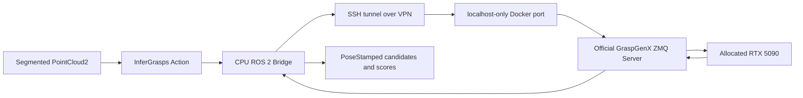
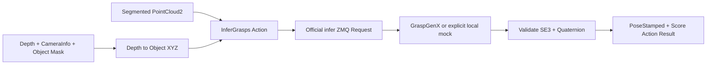

# GraspGenX 원격 추론 통합

> 처음 읽는 경우 [전체 흐름](project-overview.md) → [현재 실행 절차](grasp-pipeline-guide.md) → [코드 안내](project-code-map.md) 순서로 보세요. 이 페이지의 상세·과거 예제보다 현재 실행 절차를 우선합니다.


초기 Docker/ZMQ/ROS Action 구축 기록이다. 이후 MuJoCo 전용 TF/TCP·IK·충돌 검사와
[빨간 상자 파지 BT](red-box-grasp.md)를 추가했다. 실물 PiPER 실행은 포함하지 않는다.



## Phase 1 현황 — 2026-11-10

| 항목 | 확인 결과 |
|---|---|
| SSH | 키를 명시한 BatchMode 인증 성공; 비밀번호 저장 없음 |
| 실제 접속 대상 | BB-Jr, Ubuntu 24.04.5, 로컬 nvidia-smi에서 RTX 5090 확인 |
| GPU | 0, GPU-eeabd5b9-6869-9b26-5479-7f691fd4e925, 32607 MiB |
| NVIDIA Driver | 595.91.07; nvidia-smi CUDA capability 13.2 |
| 관측 GPU 점유 | 15 MiB, utilization 0%, Xorg만 표시; 사용 허가를 의미하지 않음 |
| Docker / Compose CLI | 29.8.1 / v5.5.1 |
| Docker daemon 권한 | /var/run/docker.sock permission denied; 계정은 docker 그룹 미포함 |
| NVIDIA container 도구 | nvidia-container-cli, nvidia-ctk 경로 존재; 동작은 미검증 |
| rootless Docker | 현재 context는 default, /run/user/1005/docker.sock 미발견 |
| 디스크 | root 1.8 TB, free 약 139 GB, 사용률 93% |
| RAM | 총 123 GiB, available 약 114 GiB; 할당량 아님 |
| 기존 컨테이너 | daemon 권한 부족으로 조회 불가 |
| TCP 5556 | 읽기 전용 ss 관측에서 listener 없음 |
| 작업 위치 | /home/ircgroup1/rwh_lab, 기존 pose2actionLLM-isolated 변경하지 않음 |
| 관리자 확인 필요 | Docker 사용 경로, GPU 할당, CPU/RAM/디스크 한도, 이미지 빌드 정책 |

원격에서 실행한 작업은 읽기 전용 진단뿐이다. 호스트 패키지, 권한,
서비스, 컨테이너, 파일은 변경하지 않았다. 추가로 승인된 `sudo -n docker info/ps` 조회는 비밀번호 요구로 실패했다.
이후 대화형 SSH 터미널의 `sudo -v`가 `user ircgroup1 may not run sudo on BB-Jr`로
거부되어 계정의 sudo 권한 부재도 확인했다. 비밀번호는 도구에 입력하지 않았다.
GPU 컨테이너 실행/이미지
빌드/모델 다운로드는 정책 확인 전 보류한다.

## 초기 원격 구축 순서와 검증 상태

1. Phase 1: SSH/GPU/OS/디스크/CLI 확인. Docker 접근과 리소스 정책에서 차단됨.
2. Phase 2: 추론 전용 Dockerfile/Compose 작성. 원격 이미지 빌드 및 모델 로드는 미검증.
3. Phase 3: 공식 서버 기동/health/piper_hand 검증 명령 준비. 원격 실행은 미검증.
4. Phase 4: SSH 터널 명령 준비. TCP forwarding 및 실제 ZMQ 원격 추론은 미검증.
5. Phase 5: ROS 인터페이스, Action bridge, 입력/SE(3) 검증, timeout/cancel 구현.
   로봇 컨테이너의 CPU 모의 서버 테스트로 검증하며 실제 모델 검증과 구분한다.
6. 초기에는 Phase 6–7을 후속 범위로 두었으며, 이후 로컬 MuJoCo에서 TF/TCP,
   IK/충돌 검사와 BT 집기를 구현·검증했다. 최신 내용은 [빨간 상자 파지 BT](red-box-grasp.md) 참고.

GPU 환경은 CUDA 13.0.2 / PyTorch 2.9.1 cu130을 후보로 사용한다.
공식 소스는 44eb1d77d6d27bc97ee361e3afb717a2115e30a9로 고정한다.
일반 PyTorch 추론을 먼저 검증하고 TensorRT는 이후 별도 devel 이미지로 진행한다.

설치·복구 명령은 저장소의 `deploy/graspgenx-docker/README.md`,
Action 사용법은 `rwh_beyond_grasp_bridge/README.md`를 참고한다.

## 좌표계와 입력 계약

객체별로 분할한 XYZ, float32, 미터 단위가 필요하다. PointCloud2의 원래
header.frame_id와 timestamp를 각 PoseStamped에 보존한다. 서버는 ROS
header를 알지 못한다. 모델의 +Z는 접근, +X는 그리퍼 닫힘 방향이다.
PiPER TCP와의 관계를 보정하기 전에는 이 후보를 바로 이동 목표로 사용하지 않는다.

ROS가 컨테이너 내부라면 호스트 SSH 터널의 localhost와 다를 수 있다.
터널과 Bridge가 같은 네트워크 namespace에서 동작하는지 먼저 확인한다.
현재 Bridge는 MoveIt/로봇 제어 API에 의존하지 않으며 goal을 전송하지 않는다.

## 로컬 검증 결과

기존 로봇 컨테이너 `moma_mj_lab_1.1.2_gui`, ROS 2 Jazzy에서 실행했다.

```bash
source /opt/ros/jazzy/setup.bash
cd /root/ros2_ws
colcon build --symlink-install --packages-up-to rwh_beyond_grasp_bridge
source install/setup.bash
PYTEST_DISABLE_PLUGIN_AUTOLOAD=1 ROS_DOMAIN_ID=93 python3 -m pytest -q src/rwh_beyond/rwh_beyond_grasp_bridge/test
```

- 메시지 패키지와 Bridge 빌드 성공.
- 테스트 **18개 통과**: 실제 Action과 mock ZMQ 왕복, float32 wire 형식,
  frame/timestamp 보존, score 정렬, 180도 quaternion, 서버 오류/빈 후보,
  비정상 SE(3)/NaN/응답 shape/그리퍼 불일치, 입력 거부, timeout 후 재요청,
  취소/중복 goal 거부, big-endian/padded row, 비-map 응답, object dtype 거부.
- colcon test도 pytest를 선택하도록 test extra를 등록했으며 **18개 통과**,
  colcon test-result에서 0 errors / 0 failures를 확인했다.
- Compose v5.5.1에서 stdin으로 전달한 compose.yaml의 `config --quiet` 성공.
  테스트용 환경변수로 파싱만 수행했으며 컨테이너를 생성하지 않았다.
- 로봇 컨테이너에만 python3-zmq/msgpack/msgpack-numpy를 추가했다.
  외부 GPU 호스트 패키지는 변경하지 않았다.
- 기존 환경의 자동 pytest plugin 충돌을 피하기 위해 이 테스트 명령은
  `PYTEST_DISABLE_PLUGIN_AUTOLOAD=1`로 실행한다.

이 결과는 GPU 모델 추론 성공을 의미하지 않는다. 다음 실제 검증은 관리자
허용 Docker 접근·리소스 할당 후 모델 load → health → segmented cloud 추론 →
동일 namespace SSH 터널 → ROS Action 후보 수신 순서다.

## ROS–ZMQ Bridge 입력 확장

`/infer_grasps` Action은 두 입력 모드를 제공한다.

| 모드 | ROS 입력 | ZMQ 요청 |
|---|---|---|
| POINT_CLOUD (0) | 분할된 object_cloud | 공식 infer + float32 XYZ |
| DEPTH_IMAGE (1) | depth_image + camera_info + object_mask | Bridge에서 역투영한 객체 XYZ로 공식 infer |

Depth는 16UC1(mm) 또는 32FC1(m), 마스크는 mono8/8UC1(nonzero=한 객체)다.
K는 해당 undistorted optical frame의 pinhole calibration이어야 한다.
마스크/깊이의 크기·좌표계·timestamp와 입력 버퍼를 검사한다.
RGB 자체는 공식 추론 입력이 아니므로 전송하지 않는다.



실행:

```bash
source /root/ros2_ws/install/setup.bash
# 실제 ZMQ endpoint로 연결; 모델 프로세스는 별도로 실행되어 있어야 한다.
ros2 launch rwh_beyond_grasp_bridge inference.launch.py
# GPU 없이 통신/변환만 검증; 결과에 MOCK_ONLY 표시.
ros2 launch rwh_beyond_grasp_bridge inference.launch.py mock:=true
```

한 번에 위 두 실행 중 하나만 사용한다. mock은 합성 후보를 반환하며
파지 추론/실행 가능성을 의미하지 않는다. 실제 원격 모델은 아직 미검증이다.
이 확장에도 MoveIt goal 또는 로봇 제어 명령은 없다.

확장 검증: ROS 인터페이스 재생성/2개 패키지 빌드 성공. colcon test에서
**33 tests, 0 errors, 0 failures**. 실제 Action과 mock REP의 단위/통합 검증에
더해 설치된 ros2 launch/run 진입점으로 PointCloud CLI와 Depth CLI 결과를
받는 smoke test를 통과했다. 이 테스트는 독립 ROS domain과 임시 loopback
port를 사용하며, 종료 시 생성한 프로세스를 정리한다.

## Beyond 패키지 구조

독립 인터페이스 패키지를 없애고 기존 `rwh_beyond_msgs`에
`msg/GraspCandidate.msg`, `action/InferGrasps.action`을 통합했다.
Bridge 이름과 Python 모듈은 `rwh_beyond_grasp_bridge`로 맞췄다.
기존 RunDemo, TcpPose, GetStatus는 유지했다. Action 이름 `/infer_grasps`도 유지한다.
이름 변경 후 2개 패키지 빌드와 테스트 **33개**가 통과했다.

## 로컬 PC 실행 가능성 — 2026-11-10

| 항목 | 직접 관측 |
|---|---|
| GPU | RTX 3060 12 GB, compute capability 8.6 |
| VRAM | nvidia-smi 기준 총 12288 MiB, 사용 약 1482 MiB; CUDA context 생성 후 free 약 10365 MiB |
| 드라이버 | 595.99.02, CUDA Driver API 13.2 |
| RAM | 총 31 GiB, available 약 13 GiB; desktop/시뮬레이터가 함께 사용 중 |
| 디스크 | /home/ggh filesystem 여유 약 300 GB |
| 컨테이너 엔진 | Docker CLI는 Podman 4.9.3 wrapper; rootless Podman 사용 가능 |
| GPU 장치 연결 | NVIDIA CDI 파일 존재; 개별 GPU 0 지정으로 새 임시 컨테이너 실행 성공 |
| CUDA 실연산 | 기존 robot 컨테이너 및 새 제한된 임시 컨테이너에서 1-thread CUDA 커널 실행 결과 42 확인 |
| PyTorch/GraspGenX | robot 컨테이너에는 미설치; 실제 모델 load/추론/peak VRAM은 아직 미측정 |

판단: **로컬 일반 PyTorch 추론을 시도할 만한 하드웨어와 GPU 컨테이너 경로가 있다.**
이는 전체 모델 추론 성공 또는 12 GB 이내 동작을 확인했다는 뜻은 아니다.
공식 모델 저장소의 release .pth 파일 크기는 generator 약 1.21 GB,
discriminator 약 0.484 GB로 합계 약 1.69 GB다. 실제 로딩/activation/CUDA
workspace 메모리는 이보다 크며 후보 수와 실행 경로에 따라 달라진다.

로컬에서는 기존 robot ROS 컨테이너에 PyTorch를 섞지 말고, **별도 추론
컨테이너**에서 시작한다. ROS Bridge는 현재 robot 컨테이너에 둔다.
처음에는 PyTorch eager, 객체 하나, num_grasps=20/top_k=5로 실제 peak VRAM과
지연시간을 측정한다. TensorRT는 그 뒤에 검토한다. 디스플레이/시뮬레이터와
같은 GPU를 쓰므로 기존 프로세스를 종료하지 않고 남은 자원 안에서 검증한다.

임시 GPU probe는 기존 이미지로 CPU 1개/RAM 512 MiB, network none,
read-only root, cap-drop ALL, GPU 0만 사용했다. PyTorch/모델 다운로드나
호스트 드라이버/런타임 설정 변경은 없었다. 종료 시 컨테이너를 제거했다.
`deploy/graspgenx-docker/scripts/check_local_cuda.py`는 컨테이너 안에서
표준 Python ctypes로 최소 CUDA 커널을 실행하는 재현용 probe다.

로컬 Podman은 개별 CDI 장치를 `--device nvidia.com/gpu=0`으로 선택한다.
원격 Docker의 NVIDIA driver reservation compose 설정을 로컬 Podman에
그대로 적용했다고 가정하지 않는다. 두 컨테이너가 별도 network namespace면
localhost도 다르므로, 실제 로컬 배치 시 전용 컨테이너 network/endpoint를
명시해 Bridge와 모델 서버를 연결해야 한다.

참고:
[NVIDIA 공식 Podman/CDI 문서](https://docs.nvidia.com/datacenter/cloud-native/container-toolkit/latest/cdi-support.html),
[PyTorch 2.9 CUDA 13 지원](https://pytorch.org/blog/pytorch-2-9/),
[공식 가중치 목록](https://huggingface.co/adithyamurali/GraspGenXModel/tree/main/release).

## 로컬 전용 추론 컨테이너 실증 — 2026-11-10

앞의 사양 검토 이후, 별도 rootless Podman 컨테이너
`rwh-graspgenx-local`에서 실제 모델 추론까지 완료했다.
외부 연구실 서버의 권한/환경은 변경하지 않았다.

| 항목 | 결과 |
|---|---|
| 모델/환경 | 공식 commit 44eb1d7, PyTorch 2.9.1+cu130, FP32 eager |
| 그리퍼 | piper_hand, 공식 에셋 로드 성공 |
| GPU | 로컬 RTX 3060 12 GB, CDI로 GPU 0만 연결 |
| endpoint | robot 컨테이너 내부 tcp://127.0.0.1:5566 |
| 입력 | 공식 객체 점군 샘플을 2048점으로 샘플링 |
| 소규모 Action | num_grasps 20 / top_k 5, 후보 5개 정상 수신 |
| 기본 크기 Action | num_grasps 100 / top_k 20, 후보 20개 정상 수신 |
| 측정 지연 | client 명령 전체 약 1.265초, 단일 관측; ROS discovery/CLI 시간 포함 |
| 점수 범위 | 기본 요청의 반환 후보 약 0.854–0.959, 정확도/파지 성공률 지표는 아님 |
| 모델 GPU 메모리 | 10회 nvidia-smi 샘플에서 964–972 MiB; 정확한 peak 아님 |
| 컨테이너 RAM | 관측 약 1.311 GB, 한도 8 GiB |
| 지속 상태 | 모델 서버 및 rwh_beyond_grasp_bridge 실행 중 |

기존 ROS 컨테이너를 재시작하지 않고 network namespace만 공유한다.
호스트 포트는 새로 공개하지 않았으며, 기존 5556 listener는 유지했다.
추론 환경/Python/filesystem은 별도이고 rootless UID 0은 host ggh(1000)에
매핑된다. CPU 2, RAM 8 GiB(no additional swap), cap-drop ALL,
no-new-privileges, read-only root 및 개인 bind mount를 사용한다.
PyTorch allocator fraction은 0.6이며 드라이버 등 모든 GPU 할당을 강제하는
quota는 아니다. 호스트 Python/드라이버/런타임은 변경하지 않았다.

모델/에셋 디렉터리는 `/home/ggh/graspgenx_workspace/models`이며,
컨테이너 재생성 후 재다운로드 없이 로딩했다. 실제 데이터셋의 에셋 위치는
중첩된 gripper_descriptions 패키지 아래에 있으므로 `assets_dir: auto`와
공식 helper로 올바른 root를 결정한다. PYTHONPATH는 checkout을 가리켜
upstream의 상대 경로 에셋 관리가 site-packages로 향하지 않도록 했다.

실행/중지 스크립트는 `deploy/graspgenx-docker/scripts/local_podman.sh`,
로컬 운영 문서는 `deploy/graspgenx-docker/LOCAL_PODMAN.md`다.
기록은 `/home/ggh/graspgenx_workspace/logs/local-runtime-validation.json`과
`ros-action-default-output.txt`에 저장했다. 실제 추론이며 MOCK_ONLY가 아니다.

공식 named-gripper infer가 top-k보다 많은 후보를 반환하는 경우가 있어
Bridge가 입력받은 top_k를 최종적으로 적용하는 것도 확인했다.
위 샘플 점군 검증 당시에는 카메라 segmentation, TF/TCP 보정, IK/충돌 검사를 수행하지 않았다.
이후 로컬 MuJoCo에서 RGB-D 빨간 상자 분리와 BT 집기까지 검증했다. 실물 동작은 수행하지 않았다.
컨테이너/모델의 실시간 상태는 health 명령으로 확인하며, 표의 실행 상태는 측정 당시 기록이다.
