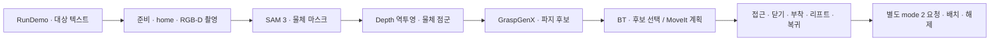

# BEYOND Grasp

RGB-D 영상에서 텍스트로 지정한 물체를 찾고, PiPER로 접근·집기·리프트·배치를 수행하는
ROS 2 Jazzy 프로젝트입니다. SAM 3가 물체를 분할하고 GraspGenX가 파지 후보를 생성하며,
Behavior Tree가 MoveIt 2와 그리퍼를 호출해 작업을 실행합니다.
심과 실물은 같은 집기·배치 트리를 사용합니다.

[빠른 시작](grasp-pipeline-guide.md){ .md-button .md-button--primary }
[설정 안내](real-bt.md){ .md-button }
[시스템 구조](project-overview.md){ .md-button }

## 데모 영상

  <iframe src="https://www.youtube-nocookie.com/embed/bAOhPEUKsSQ"
          title="BEYOND Grasp 데모 영상"
          loading="lazy"
          allow="accelerometer; autoplay; clipboard-write; encrypted-media; gyroscope; picture-in-picture; web-share"
          referrerpolicy="strict-origin-when-cross-origin"
          allowfullscreen></iframe>

[YouTube에서 보기](https://www.youtube.com/watch?v=bAOhPEUKsSQ)

## 어디서 시작할까

- **처음 실행하고 싶다**

    [환경과 빌드](project-containers.md) → [GPU 서버 준비](inference-server-operation.md) →
    [빠른 시작](grasp-pipeline-guide.md) 순서로 준비하고 첫 집기를 실행합니다.

- **장치와 동작을 바꾸고 싶다**

    [Runner 장치 설정](runner-device-settings.md)에서 카메라·CAN을 선택하고,
    [BT와 공통 설정](real-bt.md)에서 관측 자세·그리퍼·지도를 조정합니다.

- **실행이 실패했다**

    [문제 해결](troubleshooting.md)에서 서버·영상·TF·계획·실행을 구분하고,
    [후보 탈락 진단](grasp-troubleshooting.md)에서 선택 실패 원인을 찾습니다.

- **구현하거나 외부에서 호출하고 싶다**

    [시스템 구조](project-overview.md) → [BT 실행 흐름](bt-flows.md) →
    [코드 안내](project-code-map.md)로 구현을 읽고,
    [RunDemo 인터페이스](bt-operation.md)와 [BT 노드 참조](bt-grasp-stages.md)를 확인합니다.

## 동작 흐름

로봇 PC는 센서·TF·BT·MoveIt·장치 제어를 담당하고, GPU 서버는 두 모델의 추론을 담당합니다.
기본 집기 트리는 `demo_width.xml`이며 분할 점군에서 닫기 폭을 추정합니다.
[집기·배치 상세 흐름](bt-flows.md)에서 각 단계와 실패 처리를 확인할 수 있습니다.

## 현재 동작과 범위

- 집기와 배치는 별도 요청입니다. 집기 성공 후에는 계획용 부착 형상을 유지합니다.
- 기본 집기 트리의 다음 pick은 남은 대상을 **현재 위치에서 개방·해제**합니다.
  지정 위치에 놓으려면 먼저 `mode: 2`로 배치를 요청합니다.
- 실물 닫기는 현재 설정의 2초 명령 완료를 기준으로 하며 실제 잡힘을 판정하지 않습니다.
- 카메라 장착값은 명목값 또는 사용자 조정값입니다. 실제 위치 정확도에는 hand-eye 보정이 필요합니다.
- `/run_demo`는 manipulation 인터페이스입니다. 이동 베이스 Navigation은 별도로 연동합니다.

[실물 PiPER 준비](piper-hardware-moveit.md) · [데이터와 좌표계](project-data.md) ·
[테스트와 개발](development.md)
