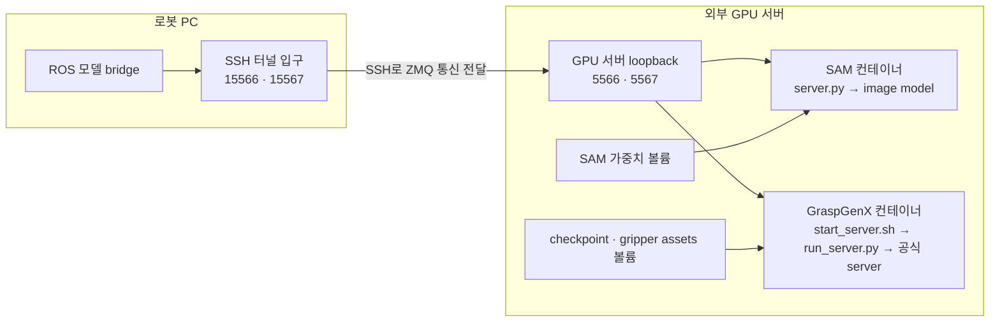

# 외부 GPU 추론 서버 운영

현재 배포된 SAM 3·GraspGenX 서버를 접속·운영하는 절차입니다.
아래 Docker 명령은 **SSH로 접속한 GPU 서버의 호스트 터미널**에서 실행합니다.
ROS 컨테이너나 모델 컨테이너 안에서 실행하는 명령은 별도로 표시합니다.

## 1. GPU 서버 접속

현재 runner 설정의 접속 정보는 다음과 같습니다.

```bash
# 로봇 PC 또는 접속 가능한 PC에서
ssh -p 5022 ircgroup1@166.104.138.121
```

주소·계정·SSH 포트의 관리 원본은 로봇 PC의 `ros_runner/config/runners.yaml`에 있는
`inference_connection`입니다. 서버를 변경했다면 직접 SSH 접속 명령도 그 값에 맞춥니다.
인증은 SSH 키/agent 등 호스트 SSH 환경을 사용하며 비밀번호를 YAML에 저장하지 않습니다.

서버의 현재 배포 디렉터리:

```bash
cd /home/ircgroup1/rwh_lab/rwh-inference/20261111
```

## 2. 컨테이너와 추론 프로세스의 관계

현재 두 컨테이너는 **시작 시 모델을 로드하고 추론 서버를 자동 실행**합니다.
일상적인 시작·중지는 `docker start/stop/restart`로 관리합니다.
컨테이너에 접속한 뒤 Python 서버를 한 번 더 실행할 필요가 없습니다.

| 항목 | SAM 3 | GraspGenX |
|---|---|---|
| 컨테이너 | `rwh-sam3-server` | `rwh-graspgenx-server` |
| 서버 호스트 공개 포트 | `127.0.0.1:5567` | `127.0.0.1:5566` |
| 컨테이너 수신 포트 | 5567 | 5566 |
| 모델 코드 | `/opt/sam3` | `/opt/GraspGenX` |
| 서버 어댑터 | `/opt/segmentation` | `/opt/deploy` |
| 자동 실행 명령 | `python -u /opt/segmentation/server.py --endpoint tcp://0.0.0.0:5567` | `bash /opt/deploy/scripts/start_server.sh` |
| 요청 → 응답 | RGB·텍스트 → 마스크 | 객체 XYZ → 파지 후보 |

컨테이너 init은 `tini -g`이며 서버와 자식 프로세스에 종료 신호를 전달합니다.
컨테이너를 `docker start`하면 이미지 생성 시 저장한 명령이 다시 실행됩니다.
GPU 가중치 로딩이 끝나 health에 응답해야 모델 준비가 완료됩니다.



SSH는 연결 통로, ZeroMQ는 추론 요청·응답 통신입니다.
GPU 서버 안에서는 ROS BT·TF·MoveIt·CAN driver를 실행하지 않습니다.

## 3. 상태와 시작

```bash
# GPU 서버 호스트에서: 중지된 컨테이너도 표시
docker ps -a --filter name=rwh-sam3-server --filter name=rwh-graspgenx-server

# 이미 생성된 두 컨테이너 시작; 모델 서버도 자동 실행
docker start rwh-sam3-server rwh-graspgenx-server
```

이미 실행 중이면 별도의 Python 명령을 추가하지 않습니다.
상태의 `Up`은 컨테이너가 실행 중이라는 뜻이며 모델 준비는 아래 health로 확인합니다.

```bash
docker logs --tail 100 rwh-sam3-server
docker logs --tail 100 rwh-graspgenx-server
```

## 4. 중지와 재시작

```bash
# 두 모델 중지
docker stop rwh-sam3-server rwh-graspgenx-server

# SAM만 다시 시작
docker start rwh-sam3-server

# GraspGenX 재시작: 프로세스 종료 후 모델 재로딩
docker restart rwh-graspgenx-server
```

한 모델만 제어하려면 해당 컨테이너 이름만 지정합니다.
중지·재시작 동안 해당 모델의 요청은 실패하거나 timeout이 발생할 수 있습니다.
ROS 노드·SSH 터널은 별도 프로세스이므로 모델 컨테이너 중지가 이들을 종료하지는 않습니다.

현재 restart policy는 `unless-stopped`입니다. 비정상 종료 시 재시작할 수 있으며,
명시적인 `docker stop`은 중지 상태를 유지합니다.
컨테이너 내부에서 `pkill`로 모델만 종료하면 재시작 정책에 따라 다시 올라올 수 있으므로
운영 중지에는 호스트의 `docker stop`을 사용합니다.

## 5. 컨테이너 안에 접속

```bash
# GPU 서버 호스트에서: 실행 중인 컨테이너에 셸 추가
docker exec -it rwh-sam3-server bash
# 또는
docker exec -it rwh-graspgenx-server bash
```

이 명령은 실행 중인 컨테이너에 셸을 하나 추가합니다. 중지된 컨테이너라면 `docker start`가 먼저입니다.

SAM 컨테이너 안:

```bash
ps -eo pid,ppid,args
ls -lh /data/models/sam3.pt
ls /opt/segmentation
```

GraspGenX 컨테이너 안:

```bash
ps -eo pid,ppid,args
cat /opt/deploy/config/server.remote.yaml
ls /opt/GraspGenX/ext/graspgenx_checkpoints/release
```

셸을 나올 때:

```bash
exit
```

`exit`는 방금 들어간 셸만 닫습니다. 기존 추론 서버는 계속 실행됩니다.
컨테이너 안에서 같은 `server.py`나 `start_server.sh`를 다시 실행하면 이미 사용 중인
포트에 bind하려다가 실패할 수 있습니다.

## 6. Health 확인

아래 명령은 GPU 서버 호스트에서 실행하며 실제 추론·로봇 동작 없이 health 요청만 보냅니다.

```bash
# SAM 3
docker exec -w /opt/segmentation rwh-sam3-server python -c \
  "from wire import request; print(request('tcp://127.0.0.1:5567', {'action': 'health'}, timeout=5))"

# GraspGenX: 현재 배포 포트 5566을 명시
docker exec rwh-graspgenx-server python /opt/deploy/scripts/health_check.py \
  --endpoint tcp://127.0.0.1:5566
```

정상 응답 예:

```text
{'status': 'ok', 'backend': 'sam3', 'mock': False}
GraspGenX healthy
```

서버 안 health는 성공하지만 로봇 PC에서 실패하면 SSH 터널과 runner 포트 매핑을 확인합니다.
ROS bridge가 실행 중인 **ROS 컨테이너**에서는 다음을 사용합니다.

```bash
ros2 service call /sam3/health std_srvs/srv/Trigger '{}'
ros2 service call /graspgenx/health std_srvs/srv/Trigger '{}'
```

## 7. 로그와 GPU 확인

GPU 서버 호스트에서:

```bash
docker logs -f --tail 100 rwh-sam3-server
# 다른 터미널에서
docker logs -f --tail 100 rwh-graspgenx-server
```

`docker logs -f`에서 Ctrl+C는 로그 보기를 끝낼 뿐 모델을 중지하지 않습니다.

```bash
docker top rwh-sam3-server -eo pid,ppid,args
docker top rwh-graspgenx-server -eo pid,ppid,args
nvidia-smi
```

GraspGenX 시작 스크립트는 stdout/stderr를 `/data/logs/server-*.log`에도 저장합니다.
이 파일은 서버 호스트의 배포 디렉터리 `logs/`에 남습니다.
SAM 서버 출력은 기본적으로 `docker logs`에서 확인합니다.

## 8. 코드·모델·설정 파일 구조

서버 호스트의 배포 디렉터리는 다음과 같습니다.

```text
/home/ircgroup1/rwh_lab/rwh-inference/20261111/
├── config/graspgenx.yaml
├── sam3/models/sam3.pt
├── sam3/cache/
├── graspgenx/models/
│   ├── graspgenx_checkpoints/release/   # gen, dis 모델
│   └── ...                           # 공식 gripper assets
├── graspgenx/cache/
├── graspgenx/trt/
├── logs/
└── scripts/start-remote-inference.sh
```

| 서버 호스트 경로 | 컨테이너 경로 | 용도 |
|---|---|---|
| `sam3/models` | SAM `/data/models` | 체크포인트, read-only |
| `sam3/cache` | SAM `/data/cache` | 캐시 |
| `graspgenx/models` | Grasp `/opt/GraspGenX/ext` | 체크포인트·그리퍼 assets |
| `graspgenx/cache` | Grasp `/data/cache` | 캐시 |
| `graspgenx/trt` | Grasp `/data/trt` | runtime artifacts |
| `config/graspgenx.yaml` | Grasp `/opt/deploy/config/server.remote.yaml` | 서버 설정, read-only |
| `logs` | 두 컨테이너 `/data/logs` | 로그 저장 경로 |

현재 GraspGenX 설정:

```yaml
checkpoint_root: /opt/GraspGenX/ext/graspgenx_checkpoints/release
assets_dir: auto
default_gripper: piper_hand
host: 0.0.0.0
port: 5566
fast_inference: false
```

`GRASPGENX_SERVER_CONFIG`가 위 컨테이너 설정 파일을 선택합니다.
`start_server.sh`가 로그를 준비하고 `run_server.py`를 실행합니다.
`run_server.py`는 checkpoint·그리퍼 assets를 확인하고 공식 ZMQ server entrypoint를 실행합니다.
환경에 따라 공식 entrypoint가 같은 Python 프로세스에서 실행되어 `docker top`에
`run_server.py`로 보일 수 있습니다.

SAM은 `/opt/segmentation/server.py`가 `/data/models/sam3.pt`를 읽어 image model을
GPU에 로드한 뒤 분할 요청을 처리합니다. 요청별로 이미지 상태를 새로 구성합니다.

## 9. 변경 반영과 새 환경

| 변경 | 반영 방법 |
|---|---|
| SSH 주소·터널 포트 | runner YAML 수정 → 호스트 터널 재시작 → BT 재활성화 |
| ROS 후보 수·대상·그리퍼 설정 | ROS 설정 수정 후 관련 runner 재시작 |
| GraspGenX bind-mount YAML | 서버 호스트 설정 파일 수정 → 해당 컨테이너 재시작 |
| 이미지 안 Python 코드 | 이미지 재빌드·컨테이너 재생성 |
| 가중치/asset 파일 | 볼륨의 파일 교체 후 모델 재로딩·설정 확인 |

모델의 수신 포트를 변경하면 서버 Docker 포트 공개 설정과 runner의 remote 포트도 일치해야 합니다.
Docker published 포트는 기존 컨테이너의 단순 restart로 바뀌지 않으므로 재생성이 필요합니다.
현재 컨테이너 이미지는 `localhost/rwh-sam3:server-snapshot-20261111`,
`localhost/rwh-graspgenx:server-snapshot-20261111`입니다. 코드 변경을 이미지에 반영하지 않고
`docker restart`만 하면 같은 코드가 다시 실행됩니다.

새 장비에서 두 컨테이너가 모두 없는 경우 배포 디렉터리의
`scripts/start-remote-inference.sh`가 모델 볼륨과 이미지를 사용해 생성합니다.
기존 컨테이너가 있으면 이 스크립트는 생성을 거부하므로 일상 운영에는 start/stop을 사용합니다.
이미지와 모델 파일 준비는 [환경과 빌드](project-containers.md)를 참고하세요.

## 문제를 좁히는 순서

1. `docker ps -a`: 두 컨테이너의 실행/종료 상태.
2. `docker logs`: 가중치·assets 누락, GPU 로딩 오류, 포트 bind 오류.
3. 서버 내부 health: 모델 프로세스가 요청에 응답하는지.
4. 로봇 PC 호스트 `systemctl --user status rwh-inference-tunnel`: SSH 연결.
5. ROS health와 runner 시작 로그: 로컬 포트·bridge endpoint.

[런타임·SSH 설정](piper-runtime.md) · [SAM 3](sam3-perception.md) ·
[GraspGenX](graspgenx-model.md) · [실행 가이드](grasp-pipeline-guide.md)
