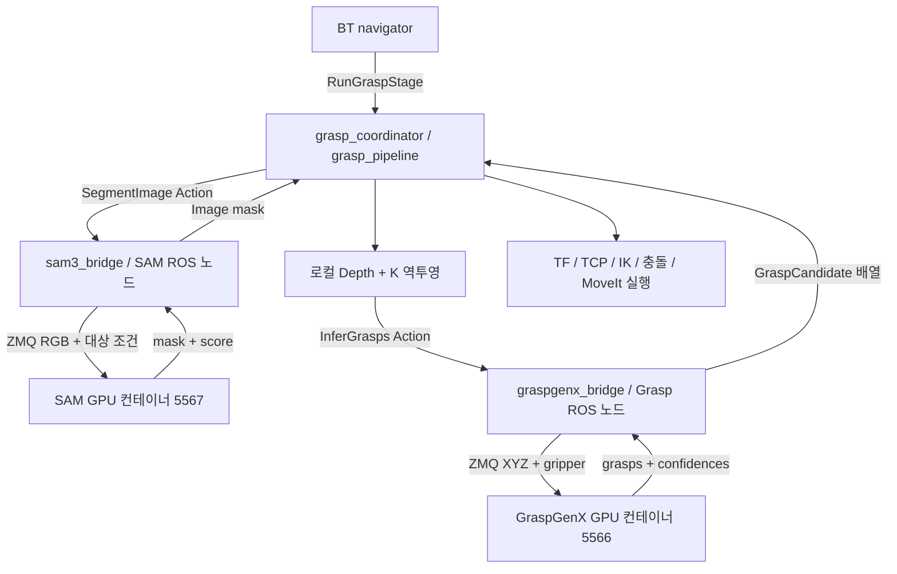

# 모델별 ROS bridge와 파지 pipeline

GPU 모델 컨테이너는 유지하고, ROS 코드의 책임을 별도 패키지·프로세스로 분리했습니다.
SAM과 GraspGenX가 같은 ROS 서버에서 추론하는 구성이 아닙니다.



## 패키지와 프로세스

| 패키지 | 실행 노드/역할 | 모델 통신 |
|---|---|---|
| `rwh_beyond_sam3_bridge` | `sam3_bridge`: RGB 분할 Action 서버 | SAM ZMQ 5567 |
| `rwh_beyond_graspgenx_bridge` | `graspgenx_bridge`: 파지 추론 Action 서버 | GraspGenX ZMQ 5566 |
| `rwh_beyond_grasp_pipeline` | `grasp_coordinator`: 관측·점군·후보 선택·이동·상태 | ROS Action/Service로 bridge 호출 |
| `rwh_beyond_model_utils` | 공통 XYZ/Depth/RGB/pose 변환·wire helper 라이브러리 | 별도 ROS 노드 없음 |
| `rwh_beyond_grasp_bridge` | 이전 Python import·실행 명령 호환 래퍼 | 실제 구현은 위 패키지로 위임 |
| `rwh_beyond_msgs` | 공용 Action·메시지 정의 | `SegmentImage`, `InferGrasps`, `RunGraspStage` |

`rwh_beyond_model_utils`는 공통 코드를 복제하지 않기 위한 Python 라이브러리입니다.
패키지가 있다고 모두 별도 프로세스가 실행되는 것은 아닙니다.
현재 pipeline의 `grasp_pipeline.launch.py`는 **세 노드**를 함께 시작합니다.
각 모델 bridge는 자신의 `bridge.launch.py`로 독립 실행할 수 있습니다.

## ROS API

| API | 타입 | 입출력 |
|---|---|---|
| `/segment_image` | `rwh_beyond_msgs/action/SegmentImage` | RGB·대상 text/box/point → 처리 후 mask·score·instance_count·mock |
| `/infer_grasps` | `rwh_beyond_msgs/action/InferGrasps` | 객체 XYZ 또는 Depth/RGBD 편의 입력 → 파지 후보 |
| `/sam3/health` | `std_srvs/srv/Trigger` | SAM 실제 모델 health; message에 JSON |
| `/graspgenx/health` | `std_srvs/srv/Trigger` | GraspGenX 실제 모델 health; message에 JSON |
| `/grasp/*` | `rwh_beyond_msgs/action/RunGraspStage` | BT의 관측·추론·선택·이동 단계, 기존 endpoint 유지 |

`/grasp/infer_grasps`는 BT 관측 ID를 다루는 coordinator 단계이고,
`/infer_grasps`는 모델 추론 bridge입니다. `/grasp/segment_object`와 `/segment_image`도 같은 관계입니다.

## BT 공통 설정과 단독 실행 설정

BT 설정은 `rwh_beyond_bringup/config/bt_demo.yaml` 하나로 관리합니다.
`bt_demo.launch.py params_file:=...`는 같은 YAML을 navigator, lifecycle manager,
SAM bridge, GraspGenX bridge, coordinator 모두에 전달합니다.
명시한 launch 인자와 `RWH_SEGMENTATION_ENDPOINT`, `RWH_GRASP_ENDPOINT`,
`RWH_GRASP_TARGET_TEXT` 환경변수는 공통 YAML보다 우선합니다.

모델 bridge의 `config/bridge.yaml`과 pipeline의 `config/grasp_pipeline.yaml`은
각 패키지를 단독으로 launch할 때의 기본 설정이며 BT에서는 읽지 않습니다.
단독 `grasp_pipeline.launch.py`는 `params_file`, `sam3_params_file`,
`graspgenx_params_file`을 별도로 지정할 수 있습니다.

## 현재 로컬 네트워크

ROS 작업 컨테이너를 `moma_mj_lab_1.1.2_hostcan`으로 옮긴 뒤 두 모델도 같은 host
네트워크로 전환했습니다. endpoint와 ROS API는 유지됩니다. 기존 GUI 컨테이너의
네트워크에 모델이 남아 있으면 `check_ready`에서 timeout이 발생합니다.
[전환·복구 절차](piper-runtime.md)를 참고하세요.

## 실행

전체 실험은 [처음 터미널부터 실행](grasp-pipeline-guide.md)의 runner 절차를 사용합니다.
`bt_demo.launch.py`가 새 pipeline launch를 포함하므로 별도 bridge를 중복 시작하지 않습니다.

모델별로 ROS 인터페이스만 단독 실행하려면 ROS 컨테이너에서 각각 실행합니다.
GPU 모델 서버는 미리 켜져 있어야 합니다.

```bash
# 터미널 1: SAM ROS 인터페이스만
ros2 launch rwh_beyond_sam3_bridge bridge.launch.py \
  endpoint:=tcp://127.0.0.1:5567

# 터미널 2: GraspGenX ROS 인터페이스만
ros2 launch rwh_beyond_graspgenx_bridge bridge.launch.py \
  endpoint:=tcp://127.0.0.1:5566
```

독립 GraspGenX 노드는 POINT_CLOUD/DEPTH_IMAGE 입력을 SAM 없이 처리합니다.
RGBD 편의 입력에는 `/segment_image` 서버가 필요합니다.
두 모델 ROS 인터페이스를 함께 시작하되 coordinator·MoveIt은 실행하지 않으려면:

```bash
ros2 launch rwh_beyond_graspgenx_bridge inference.launch.py
```

coordinator까지 수동 실행하려면 시뮬레이션 준비 후:

```bash
ros2 launch rwh_beyond_grasp_pipeline grasp_pipeline.launch.py
```

## 실패와 취소

각 bridge는 한 번에 하나의 추론 goal을 허용하고 중복 요청을 거부합니다.
분할/추론 실패는 ROS Action 실패로 반환되며 coordinator는 뒤의 이동을 실행하지 않습니다.
SAM 결과는 기본적으로 실제 모델만 허용하고 mock은 명시적 테스트 설정에서만 허용합니다.
ROS 취소는 해당 bridge의 ZMQ 대기를 끝내지만 모델 컨테이너에서 이미 시작된 GPU 계산을 강제 중단하지 않습니다.
관측·계획 ID, 촬영 시각 TF, 충돌/접촉 정리와 이동 순서 검사는 pipeline에 유지합니다.

## 코드의 시작점

```text
rwh_beyond_sam3_bridge/rwh_beyond_sam3_bridge/
  action_server.py         # /segment_image와 /sam3/health
  action_client.py         # ROS client, pipeline와 RGBD 편의 API가 사용
  segmentation_client.py   # SAM ZMQ 요청과 mask 검증/침식

rwh_beyond_graspgenx_bridge/rwh_beyond_graspgenx_bridge/
  inference_action_server.py  # /infer_grasps와 /graspgenx/health
  infer_cloud.py / infer_depth.py / infer_rgbd.py

rwh_beyond_grasp_pipeline/rwh_beyond_grasp_pipeline/
  grasp_coordinator.py
  perception_stages.py / inference_stages.py
  selection_stages.py / motion_stages.py / visualization.py
```

기존 `rwh_beyond_grasp_bridge`의 같은 이름 파일은 구현 복사본이 아니라 import 호환 래퍼입니다.
기존 CLI와 XML은 유지하되 새 기능의 수정·확장은 위 소유 패키지에서 진행합니다.


## 2026-11-11 검증

- 기존 회귀와 새 SAM 단독 Action 검사: 78개 테스트·7개 하위 검사 통과.
- SAM 단독: RGB-only payload·header 보존·mock 기본 거부·입력 거부·중복 goal·취소/락 해제.
- GraspGenX 단독: SAM ROS 서버 없이 POINT_CLOUD 추론 성공.
- 실제 모델 계획 디버그: 분할·점군·추론·후보 선택·RViz late subscription, RViz와 MoveIt 각각 1개.
- 실제 모델 전체 BT: 점군 2,785개, 약 7.37 cm 리프트·마지막 홈 복귀, 양쪽 접촉 유지.
- 별도 runner 취소 전용 시험: 후보 선택 중 취소 후 대상 제외 영역·손가락 충돌 규칙 복원.
- 첫 계획 디버그는 MoveObservation 시작 상태의 joint3 경계 초과로 중단됐으며 모델 단계에는 도달하지 않음.
  새 시뮬레이션의 후속 실행은 성공했다. 관절 제한·충돌 검사를 완화하지 않았다.

성공률·실물 파지·장시간 유지 검증을 뜻하지 않습니다.
[상세 결과 JSON](validation/model-bridges-2026-11-11.json)을 참고하세요.
