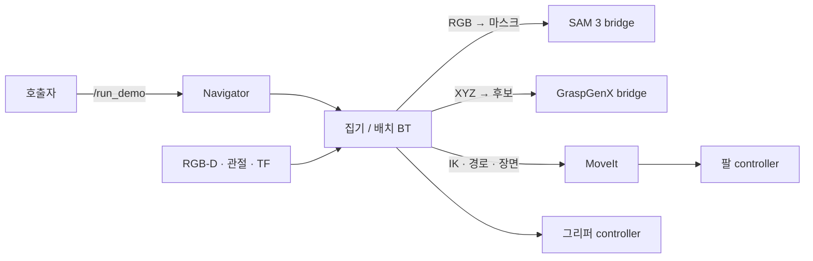

# 코드를 따라 읽기

외부 호출의 진입점은 `/run_demo`입니다. 실행 순서는 **BT XML**, 단계의 구현은 **BT 플러그인**, 모델·센서·구동기 연결은 **launch와 각 ROS 노드**가 담당합니다.

## 패키지별 책임

| 패키지 | 책임과 코드 진입점 |
|---|---|
| `rwh_beyond_bringup` | [bt_demo.launch.py](https://github.com/ggh-png/rwh_beyond/blob/main/rwh_beyond_bringup/launch/bt_demo.launch.py)가 실행 모드·카메라·모델 브릿지·Navigator를 연결합니다. 공통 파라미터는 `config/bt_demo.yaml`에 있습니다. |
| `rwh_beyond_navigator` | `src/demo_navigator.cpp`가 RunDemo 목표를 트리에 연결하고 취소·피드백·결과를 관리합니다. `src/xml_tree_filter.cpp`는 XML의 빈 포트와 include를 정리합니다. |
| `rwh_beyond_bt` | `behavior_trees/`가 순서를, `plugins/action/`이 각 단계를 정의합니다. `src/motion_context.cpp`에 후보 검사·폭 계산·MoveIt 클라이언트가 있습니다. |
| `rwh_beyond_sam3_bridge`, `rwh_beyond_graspgenx_bridge` | 각각 `SegmentImage`, `InferGrasps` 액션을 제공하고 GPU 서버에 요청합니다. 공통 영상·점군·프로토콜 변환은 `rwh_beyond_model_utils`에 있습니다. |
| `rwh_beyond_grasp_pipeline` | 모델 브릿지 launch, 실물 궤적 전송, 계획용 점군 필터를 제공합니다. |
| `rwh_beyond_msgs` | 외부 액션과 서비스 타입의 원본입니다. `action/`, `srv/`, `msg/`를 확인하세요. |

## 집기부터 배치까지

1. **트리 선택.** Navigator가 Goal의 `behavior_tree` 또는 모드별 기본 XML을 선택합니다.
2. **인식.** `perception_actions.cpp`에서 RGB-D·관절을 캡처하고, SAM 분할 마스크를 깊이 영상에 적용해 객체 점군을 만든 뒤 GraspGenX로 후보를 구합니다. 멀티뷰 경로는 `multiview_actions.cpp`와 `src/multiview.cpp`에서 점군을 융합합니다.
3. **집기.** `SelectFeasibleGrasp`가 후보 폭과 TCP·IK·경로를 검사합니다. 이후 노드는 Blackboard에 저장된 `GraspPlan`을 받아 접근, 닫기·부착, 리프트, 복귀를 수행합니다.
4. **배치.** 별도 Goal에서 `place.xml`이 home → 저장된 `place` → 개방·해제 → 저장된 `front` → home을 실행합니다. 부착 중에는 `MoveJointPose`의 도착 확인이 해제 조건입니다.

더 자세한 내용은 [BT 실행 흐름](bt-flows.md), [Blackboard와 플러그인 구조](bt-architecture.md), [데이터와 좌표계](project-data.md)를 참고하세요. 실행 순서·취소·장면 변경은 `rwh_beyond_bt/test/test_motion.cpp`, Navigator 결과 전달은 `rwh_beyond_navigator/test/`에서 확인할 수 있습니다.
