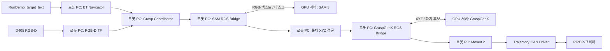

# 시스템 구성

BEYOND Grasp는 물체 인식, 파지 후보 생성, 로봇 경로 계획과 실행을 연결합니다.

## 실행 경계

| 위치 | 실행 기능 |
|---|---|
| 로봇 PC | 센서 수신, TF, Depth 역투영, ROS bridge, BT, 후보 선택, MoveIt, 실물 명령 전달 |
| GPU 서버 | SAM 3 이미지 분할, GraspGenX 파지 후보 생성 |
| MuJoCo | 심 모드의 센서·관절 피드백·controller backend |

모델 통신은 ZeroMQ/TCP를 사용합니다. 외부 GPU 서버에 SSH 터널로 연결할 수도 있습니다.
모델이 같은 PC에 있는 구성도 bridge endpoint만 맞추면 사용할 수 있습니다.

## 공통 시나리오

준비 확인 → Octomap 갱신 → home → 그리퍼 열기 → 관측 이동 → Octomap 갱신 →
SAM 분할 → 물체 점군 → 파지 추론·선택 → 사전 접근 → 최종 접근 → 닫기·계획용 부착 →
리프트 → 관측 자세 복귀 → home 복귀.

심·실물의 차이는 backend와 시간 설정입니다. 시나리오·home/관측 목표 계산·계획용 부착·리프트는 공유합니다.
실물 닫기는 4초 명령 완료로 처리하며 물체를 잡았는지는 확인하지 않습니다.
계획용 부착은 물체를 들고 있다고 가정한 충돌 모델입니다.

## 현재 범위

- 대상은 Action의 `target_text`로 지정합니다.
- 실제 잡힘 여부 확인, 자동 놓기, Place, Navigation 연동은 포함하지 않습니다.
- 카메라 장착 TF는 명목값이며 hand-eye 실측 보정이 필요합니다.
- 물체 인식 성공과 로봇의 도달·파지 성공은 별개입니다.

[실행 가이드](grasp-pipeline-guide.md) · [Action 인터페이스](bt-operation.md)
