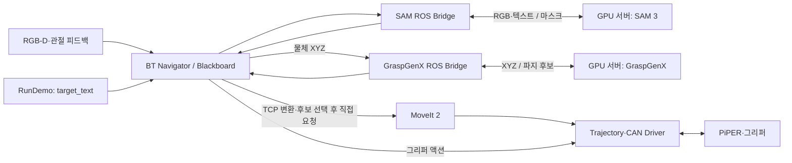

# 시스템 구성

BEYOND Grasp는 물체 인식, 파지 후보 생성, 로봇 경로 계획과 실행을 연결합니다.

## 실행 경계

| 위치 | 실행 기능 |
|---|---|
| 로봇 PC | 센서 수신, TF, Depth 역투영, ROS bridge, BT, 후보 선택, MoveIt, 실물 명령 전달 |
| GPU 서버 | SAM 3 이미지 분할, GraspGenX 파지 후보 생성 |
| MuJoCo | 심 모드의 센서·관절 피드백·controller backend |

모델 통신은 ZeroMQ/TCP를 사용합니다. 외부 GPU 서버에 SSH 터널로 연결할 수도 있습니다.
모델이 같은 PC에 있는 구성도 bridge endpoint만 맞추면 사용할 수 있습니다.

## 공통 시나리오

기본 `demo_multiview.xml`은 정면 관측으로 집기를 시도한 뒤 필요하면 좌·우 점군을 융합해 다시 시도합니다.
파지 계획이 선택되면 접근 → 닫기·장면 부착 → 리프트 → home 복귀를 실행합니다.
Octomap 갱신 단계는 공통 YAML의 `octomap_enabled: false` 설정에서 건너뜁니다.
계획 장면에 등록하는 부착 형상은 로봇이 물체를 든 상태의 충돌 검사에 쓰이며, 액션 성공은 시퀀스 완료를 뜻합니다.

## 현재 범위

- 대상은 Action의 `target_text`로 지정합니다.
- mode 2로 배치·해제를 수행합니다. 실제 잡힘 판정과 Navigation 자동 연동은 포함하지 않습니다.
- 카메라 장착 TF는 명목값이며 hand-eye 실측 보정이 필요합니다.
- 물체 인식 성공과 로봇의 도달·파지 성공은 별개입니다.

[실행 가이드](grasp-pipeline-guide.md) · [Action 인터페이스](bt-operation.md)
