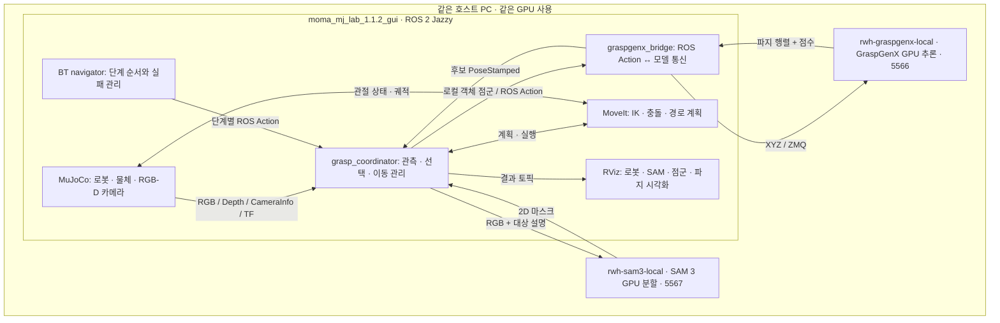

# 전체 흐름 한눈에

이 프로젝트는 **카메라 영상에서 지정한 물체를 찾고, 그 물체를 잡을 자세를 추론한 뒤,
PiPER가 실제로 실행할 수 있는 경로를 골라 MuJoCo에서 집는 시스템**입니다.

## 1. 프로그램은 어디서 실행되나

SAM과 GraspGenX는 별도 컨테이너입니다. SAM 이미지가 GraspGenX 이미지를 기반으로 만들어졌어도
실행 중인 두 모델 프로세스와 파일시스템은 각각 독립적입니다. 둘 다 ROS 컨테이너의 네트워크 공간을
공유하므로 ROS 컨테이너 안에서 `127.0.0.1:5567`, `127.0.0.1:5566`으로 접속합니다.

## 2. 저장소와 책임

아래 경로는 모두 ROS 컨테이너의 `/root/ros2_ws/src` 기준입니다.

| 저장소 | 책임 | 자주 보는 위치 |
|---|---|---|
| `rwh_beyond` | BT, 공용 메시지, 모델 Bridge, coordinator, 통합 launch, 이 문서 | `rwh_beyond_bt/`, `rwh_beyond_grasp_bridge/` |
| `ros_runner` | launch 프로세스를 의존성에 따라 시작·종료 | `config/runners.yaml` |
| `moma-mj-lab` | MuJoCo 물리, 카메라, ROS 연결, 시뮬레이션 bringup | `ros2_ws/src/moma_mujoco_ros/`, `ros2_ws/src/moma_bringup/` |
| `agx_arm_ros` | AgileX 공식 PiPER description·MoveIt·실물 driver | `agx_arm_moveit/`, `agx_arm_ctrl/` |

`rwh_beyond/deploy/sam3-docker`, `rwh_beyond/deploy/graspgenx-docker`는 모델 배포 소스입니다.
호스트의 `~/sam3_workspace`, `~/graspgenx_workspace`는 이미지 빌드·모델·로그를 보관하는 운영 공간입니다.

## 3. 한 번의 집기에서 벌어지는 일

1. `ros_runner`를 켜고 `activate_bt_demo_sim`을 호출합니다. 시뮬레이터·MoveIt이 시작되고,
   `bt_demo.launch.py`가 grasp pipeline·navigator·lifecycle manager·통합 RViz를 시작합니다.
2. `/run_demo` goal을 보내면 기본 `demo.xml`을 실행합니다. **활성화 자체는 집기를 시작하지 않습니다.**
3. 준비 확인 → 지도 갱신 → 홈 → 그리퍼 열기 → 관측 자세로 이동합니다.
4. `SegmentObject`가 같은 시점 RGB-D·CameraInfo·TF·관절 상태를 저장하고, SAM에 RGB와 대상 조건을 보냅니다.
5. `BuildObjectCloud`가 SAM 마스크 안의 Depth만 골라 ROS CPU에서 XYZ 점군을 만듭니다.
6. `InferGrasps`가 그 점군을 GraspGenX로 보내 파지 후보와 점수를 받습니다.
7. `SelectFeasibleGrasp`가 좌표/TCP 보정, 관측 기반 충돌 형상, IK·접근·리프트·사전 접근 경로를 검사합니다.
8. 선택한 계획으로 사전 접근 → 최종 접근 → 닫기 → 접촉 확인·부착 → 리프트 → 홈 복귀합니다.

마지막에 자동으로 내려놓거나 그리퍼를 열지 않습니다. 실패한 단계 뒤의 단계는 실행하지 않습니다.

## 4. BT와 Python의 관계

BT C++ 플러그인은 단계 순서·Action 요청·성공/실패/취소를 관리합니다.
Python coordinator는 카메라 관측, 모델 호출, MoveIt 검사와 저장된 경로를 관리합니다.

- Blackboard: 실제 마스크·점군·후보 메시지와 `observation_id`, `plan_id`를 단계 사이에 전달합니다.
- coordinator 내부: 원본 RGB-D·촬영 TF·관절 상태·선택된 궤적·부착 상태를 보관합니다.
- GPU 서버: 분할 또는 파지 추론만 수행합니다. 로봇의 관절·충돌 장면·이동 명령은 처리하지 않습니다.

노드별로 C++ 헤더·CPP와 endpoint를 분리했지만, Python 백엔드는 상태 공유를 위해 한 coordinator
프로세스에 역할별 모듈을 연결한 구조입니다. 각 단계가 모두 별도 Python 서버인 구성은 아닙니다.

## 5. 검증 결과와 제한 {#validation}

기존 실제 모델 시험에서 분할·점군·파지·약 7.4~7.7 cm 리프트·홈 복귀를 확인했습니다.
RViz 결과 보존과 활성화/종료 시험도 기록되어 있습니다. 아래 원시 기록은 서로 다른 시점의 시험입니다.

| 기록 | 내용 |
|---|---|
| [BT 역할 분리](validation/bt-split-2026-11-11.json) | 데이터 전달, 전체 집기, 취소 복원 |
| [Nav2 스타일](bt-code-style.md) | 헤더/CPP·플러그인 로딩·검사 |
| [MoveIt 통합 화면](validation/moveit-grasp-debug-2026-11-11.json) | SAM·점군·후보·선택 자세 표시 |
| [RViz 소유](validation/bt-rviz-owner-2026-11-11.json) | RViz 1개, MoveIt 1개, 종료 연동 |
| [SAM 초기 실험](validation/sam3-local-2026-11-10.json) | 실제 추론과 시작/유지 실패 기록 |

이는 일반 물체나 실물에서의 성공률이 아닙니다. `START_STATE_INVALID`, 불완전한 Cartesian 경로,
리프트 후 유지 중 미끄러짐도 관찰됐습니다. 현재 선택기는 하향 접근, 수평 지지면·작은 물체 가정과
MuJoCo 물리 검증 서비스에 의존합니다. 시뮬레이터의 접촉 검증도 기존 `grasp_object` fixture 대상입니다.
텍스트를 바꾸는 것만으로 임의 물체의 집기 전체가 검증되는 것은 아닙니다.

다음: [컨테이너 구축과 파일 위치](project-containers.md)
