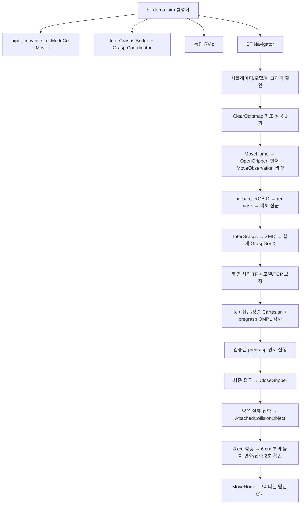

# 빨간 상자 파지 BT

> 처음 읽는 경우 [전체 흐름](project-overview.md) → [현재 실행 절차](grasp-pipeline-guide.md) → [코드 안내](project-code-map.md) 순서로 보세요. 이 페이지의 상세·과거 예제보다 현재 실행 절차를 우선합니다.


> 2026-11-11: 기본 BT는 [역할별 플러그인](bt-grasp-stages.md)으로 전환했다.
> 아래 `GraspStep` 예제와 이전 실험 기록은 호환 경로·변경 이력이다. 현재 XML은 `demo.xml`을 기준으로 한다.

> 아래 색상 기반 설명·집기 측정은 기존 color_demo 기록이다. 현재 runner 기본값은
> SAM 3이며 [새 분할 경로](sam3-perception.md)를 먼저 참고한다.
> 기존 회귀 실행은 `RWH_SEGMENTATION_BACKEND=color_demo`를 명시한다.

`bt_demo_sim → piper_moveit_sim`으로 환경을 준비하고, BT launch에서 grasp pipeline을 시작한 뒤 `/run_demo` goal로
RGB-D 인식, 실제 GraspGenX 추론, MoveIt 계획, 접촉 확인, 들어올리기를 실행한다.
**MuJoCo 전용**이며 실물 CAN driver를 시작하지 않는다.

## 실행

GPU 모델 컨테이너 `rwh-graspgenx-local`과 그 안의 모델 서버가 먼저 실행되어 있어야 한다.
컨테이너는 idle 상태로 유지되며 모델 서버는 별도로 시작한다.
로봇 컨테이너의 `tcp://127.0.0.1:5566`으로 연결한다. 다른 endpoint는
runner 시작 전 `RWH_GRASP_ENDPOINT`로 지정한다. runner는 GPU 컨테이너를
조작하지 않고 ROS Bridge와 coordinator만 관리한다.

```bash
source /root/ros2_ws/install/setup.bash
ros2 service call /runner_manager_node/activate_bt_demo_sim std_srvs/srv/Empty "{}"
# bt_navigator가 active가 된 다음 실행
ros2 action send_goal /run_demo rwh_beyond_msgs/action/RunDemo "{}" --feedback
```

현재 세션의 runner node 이름은 `runner_manager_node`다. 다른 이름으로
실행한 경우 service prefix도 그 node 이름을 따른다.

현재 트리는 리프트 성공 후 `MoveHome`으로 복귀하며 그리퍼는 닫힌 상태를 유지한다.
이는 내려놓기가 아니며 홈 복귀 중 물체가 미끄러질 수 있다. 이미 든 상태에서 새 goal은
이동/열기 전에 거부한다. 내려놓기/놓기 시퀀스는 아직 없다. 새 시뮬레이션으로
초기화하려면 다음처럼 simulator와 그 의존 runner들을 껐다가 시작한다.

```bash
ros2 service call /runner_manager_node/deactivate_piper_moveit_sim std_srvs/srv/Empty "{}"
ros2 service call /runner_manager_node/activate_bt_demo_sim std_srvs/srv/Empty "{}"
```

runner 활성화 자체는 이동 goal을 보내지 않는다. Groot2 모델 XML을 다시
불러오고 `rwh_beyond_bt/behavior_trees/demo.xml`을 열면 현재 순서를 볼 수 있다.
예전 home/up/close/home/open 트리는 `legacy_demo.xml`에 보존했다.

## GraspStep이 여러 번 나오는 이유

`GraspStep`은 한 번의 파지를 통째로 반복하는 노드가 아니라,
`command`에 해당하는 **한 단계만 실행하는 공통 Action BT 플러그인**이다.
Groot2의 `name`은 각 역할을 구분한다. **모델 추론은 prepare에서만 한 번** 한다.

| BT name | command | 역할 |
|---|---|---|
| CheckSimulationAndModel | check_ready | MuJoCo/실제 모델 확인, 이미 들고 있는지 검사 |
| PrepareRedBoxGrasp | prepare | 새 RGB-D 획득, 빨간 영역 분할, 추론, 후보/경로 선별 |
| MoveToRedPregrasp | move_pregrasp | prepare에서 검증한 관절 경로 실행 |
| ApproachRedBox | approach | 현재 상태에서 충돌 검사한 직선 최종 접근 |
| VerifyAndAttachRedBox | attach | 실제 양쪽 접촉 확인 후 MoveIt에 부착 |
| LiftAndVerifyRedBox | lift | 충돌 검사한 수직 상승 후 물리적 들어올림 확인 |

공통 플러그인을 재사용하면서도 BT가 단계별 성공/실패/취소를 관리한다.
`RunGraspStep` Action이 이를 coordinator에 전달한다. `pregrasp` 출력은 typed
`TcpPose`이며 시각화/다른 트리에 연결할 수 있다. 기본 트리는 IK 분기가 달라지지
않도록 검증한 관절 pregrasp 경로를 실행한다. 기존 `MoveTcp`도 계속 제공한다.



## 인식과 충돌 모델

- `rgb8/bgr8`의 빨간 영역을 선택하고 3×3 침식 연산을 두 번 적용해 RGB/depth 경계의
  배경 depth 유입을 줄인다. 카메라의 원래 stamp와 optical frame을 보존한다.
- MuJoCo의 segmentation ID나 물체 pose로 계획하지 않는다. 이 demo는 알려진
  4×4×5 cm 상자 크기와 RGB-D 표면으로 중심/지지면을 추정한다. 범용 객체 검출기는 아니다.
- 대상은 `red_grasp_target`, 관측 지지면은 `observed_support_table`로 등록한다.
  나머지 환경은 기존 depth Octomap에 남긴다.
- RGB 기반 대상 점을 Octomap 입력에서 제외하고, 정지 상태에서 한 번 clear한 뒤
  새 filtered cloud 2개와 비어 있지 않은 지도를 기다린다. 이는 **prepare의 의미적 지도
  교체**다. 최초 `ClearOctomap once=true`와 별개이며, 계획을 통과시키기 위한 주기적 clear가 아니다.
  지도 준비 전에는 이동하지 않는다.
- ACM은 `red_grasp_target ↔ gripper_link1/gripper_link2` 쌍만 허용한다.
  그리퍼와 Octomap 전체의 충돌을 허용하지 않는다.
- 물리 접촉 확인 후에만 AttachedCollisionObject로 옮긴다. MuJoCo에 weld나
  가짜 부착을 만들지 않으며, 상자는 손가락 접촉/마찰로 들린다.
- 준비 실패/취소는 대상 점 제외와 임시 접촉 규칙을 복원한다. 이미 검증된 부착 물체는
  실패/취소해도 collision model에서 유지하며 자동으로 열거나 놓지 않는다.
- CloseGripper는 물체에 막히는 것이 정상인 동작이므로 **gripper 경로**의 위치/속도
  추종 허용오차만 끈다. 팔의 추종/충돌 검사는 유지하며, 이후 실제 물체 양쪽 접촉을 별도로 요구한다.

## 좌표계·후보 선택

촬영 시각의 `T_base_camera × T_camera_model × T_model_tcp`를 사용한다.
현재 `piper_hand` 모델의 fingertip은 +Z 0.130 m이고, 모델 닫힘 방향 +X를 실제
PiPER의 ±Y 닫힘 방향으로 맞추는 Z -90° 보정을 적용했다. 이 값은 **현재 시뮬레이션
모델에서 검증한 값**이며 실물 캘리브레이션을 대신하지 않는다.

base 기준 아래 방향에서 35° 이내인 후보를 대상으로 테이블 여유, IK, 전체 접근/상승
Cartesian fraction, 관측 자세부터 pregrasp까지의 OMPL 경로를 검사한다. 그리퍼의
180° 대칭 후보도 검사한다. 모델 점수 순으로 가능 후보를 고르며, 없으면 실패한다.
고정된 정답 파지 pose로 대체하지 않는다. 부분 Cartesian 경로는 실행하지 않는다.

설정은 `rwh_beyond_grasp_bridge/config/grasp_pipeline.yaml`이다. 현재 접근 거리와
상승 거리는 각각 8 cm, 추론은 100개 요청/상위 100개 중 선별한다.

## 진단과 RViz

| 항목 | 인터페이스 |
|---|---|
| 분할 마스크 | /grasp/red_mask |
| 모델에 보낸 객체 점군 snapshot | /grasp/object_cloud |
| 선택한 TCP 목표 | /grasp/selected_tcp |
| 단계/오류 | /run_demo feedback, RunGraspStep result |
| 물리 접촉/높이 확인 | /simulation/grasp_state (Trigger) |
| 대상 RGB 점 제외 | /simulation/exclude_red_target (SetBool) |
| 실패/취소 정리 | /grasp/cleanup (Trigger) |

RViz에 객체 점군과 선택 TCP 축 표시를 추가했다. 마스크 영상은 선택 표시다.
선택 점군/TCP는 **계획 당시 snapshot/목표**로, 이동 후 물체 추적을 의미하지 않는다.
`simulation/grasp_state`의 정답 위치는 **파지/리프트 검증에만 사용**하고 계획에는 쓰지 않는다.

## 검증

- 단독 BT 통합: 실제 모델 추론과 양쪽 접촉, 물체 약 7.8 cm 상승 확인.
- private ROS domain의 실제 runner: 자동 기동 → 준비 중 cancel → ACM/점 제외 복원 →
  재실행 → 약 7.5 cm 상승 → 이미 든 상태의 추가 goal 거부 → 의존성 종료까지 통과.
- 현재 일반 ROS graph와 GUI/RViz runner에서도 SUCCESS 확인. 성공 후 8초 시점에도 양쪽 접촉과 6 cm 이상 높이를 확인했다.
- BT/Bridge/인식/오류 전달 단위 테스트와 simulation 단위 테스트 통과.

재현 테스트는 실제 GPU 서버가 필요하며 반드시 독립 domain에서 실행한다.

```bash
ROS_DOMAIN_ID=96 MUJOCO_GL=osmesa python3 \
  /root/ros2_ws/src/rwh_beyond/rwh_beyond_grasp_bridge/test/red_pick_integration.py
ROS_DOMAIN_ID=97 python3 \
  /root/ros2_ws/src/rwh_beyond/rwh_beyond_grasp_bridge/test/runner_pick_integration.py
```

성공한 닫기에서는 원하는 aperture=0 명령을 계속 유지해 actuator force 한도 내에서
파지력을 유지한다. 취소/실패 시에는 측정 위치를 유지한다. 자세에 따라 미끄러짐은
발생할 수 있으며 장시간 안정성/파지 성공률은 보장하지 않는다.

실물 동작, 임의 물체/복수 빨간 물체, 내려놓기, 동적 장애물의 실시간 회피는 이 demo의 범위가 아니다.

## 현재 XML의 전체 단계와 속성

2026-11-10 커밋 준비 시점의 `demo.xml`은 `MoveObservation`이 주석 처리되어
홈 자세에서 바로 prepare한다. 관측 자세 노드는 사용 가능하며, 이전 집기 통합
검증은 관측 자세를 포함한 트리에서 수행했다. 마지막 홈 복귀를 포함한 현재 XML의
전체 집기 성공은 이번 문서 정리에서 재실행하지 않았다. 홈에서 대상이 안 보이면
prepare가 실패하므로 카메라 시야를 확인하거나 관측 자세를 다시 사용한다.

| 순서 | 노드/command | 수행 내용 |
|---|---|---|
| 1 | GraspStep / check_ready | MuJoCo·실제 모델 health, 이미 잡고 있는지 확인 |
| 2 | ClearOctomap | clear 후 새 cloud 2개와 지도 재생성 확인; 동일 노드 첫 성공 이후 생략 |
| 3 | MoveHome | joint1~joint6을 0 rad로 계획·이동 |
| 4 | OpenGripper | 그리퍼 열기 |
| 선택 | MoveObservation | 지정된 관절 관측 자세로 이동; 현재 XML에서는 주석 처리 |
| 5 | GraspStep / prepare | 객체 점군 추출·추론·TF/TCP·IK·충돌/경로 검사; 팔 이동 없음 |
| 6 | GraspStep / move_pregrasp | 준비 단계에서 저장한 관절 경로 실행 |
| 7 | GraspStep / approach | 파지 위치까지 Cartesian 최종 접근 |
| 8 | CloseGripper | 닫기 명령; 접촉 성공은 다음 단계에서 검사 |
| 9 | GraspStep / attach | 양쪽 손가락 접촉 확인 후 MoveIt에만 부착 등록 |
| 10 | GraspStep / lift | 기본 8 cm 상승, 실제 높이 변화 >6 cm와 양쪽 접촉 2초 확인 |
| 11 | MoveHome | 닫힌 그리퍼로 홈 복귀; 내려놓기/해제 없음 |

`Sequence`는 위에서 아래로 실행하며 한 단계 실패 시 뒤의 노드는 실행하지 않는다.
`name`은 로그/Groot2 표시 이름, `command`는 coordinator 작업 선택이다.
`server_timeout="1000"`은 Action 요청 응답 대기의 ms 값이며 전체 동작 제한 시간이 아니다.
`pregrasp="{red_pregrasp}"`는 `TcpPose`를 Blackboard에 기록한다. 현재 move_pregrasp는
이 값을 입력받는 대신 coordinator가 저장한 검증된 경로를 실행한다.

## 빨간 상자 점군 추출과 ZMQ 요청

prepare는 `camera/color/image_raw`, `camera/depth/image_rect_raw`,
`camera/depth/camera_info`에서 동일 timestamp의 새 RGB-D/보정 데이터를 받는다.
등록된 RGB/Depth 픽셀 대응을 전제로 하며, RGB와 Depth frame도 같아야 한다.

1. RGB에서 `R > 80`, `R > 1.8*G`, `R > 1.8*B`를 모두 만족하는 픽셀 선택.
2. 3×3 마스크 침식 두 번으로 경계 배경 혼입 감소.
3. 마스크가 0이 아닌 위치에서 유한하고 양수인 Depth만 선택.
4. CameraInfo의 K 역행렬로 역투영: `[X,Y,Z] = Z * inv(K) * [u,v,1]`.
   일반 pinhole에서 `X=(u-cx)*Z/fx`, `Y=(v-cy)*Z/fy`다.
5. 16UC1 깊이는 mm→m로 변환하고, 32FC1은 m로 사용.
   기본 최소 100점, 최대 200000점이며 초과하면 균등 인덱스로 줄인다.
6. 카메라 optical frame의 연속 float32 N×3 배열을 모델 서버로 보낸다.

현재는 색상 규칙이며 학습 기반 객체 분할이나 연결 성분별 객체 선택이 아니다.
여러 빨간 물체가 있으면 함께 포함될 수 있고, 가려진 뒷면은 복원하지 않는다.
시뮬레이터 정답 pose나 segmentation ID로 추론 입력을 생성하지 않는다.

coordinator는 Depth/CameraInfo/마스크를 `/infer_grasps` Action으로 보내고,
Bridge가 XYZ로 변환해 다음 payload를 msgpack + msgpack-numpy로 직렬화한다.
RGB 이미지, ROS header, 로봇 관절값, MoveIt scene은 ZMQ 요청에 포함하지 않는다.

```python
{
    "action": "infer",
    "point_cloud": xyz,           # float32, N×3, camera optical frame, meters
    "gripper_name": "piper_hand",
    "num_grasps": 100,
    "grasp_threshold": -1.0,       # 점수 임계값 필터 비활성화
    "topk_num_grasps": 100,
}
```

후보 개수는 `grasp_pipeline.yaml`/ROS 파라미터로 변경 가능하다.
Bridge는 반환된 4×4 행렬·점수를 검증하고 입력 frame/stamp를 가진 PoseStamped로
변환한다. 로봇 기준 TF/TCP 보정과 실행 가능 후보 선택은 coordinator에서 수행한다.
마스크와 점군은 `/grasp/red_mask`, `/grasp/object_cloud`로도 발행한다.

## 모델 컨테이너와 모델 프로세스 운영

다음 명령은 로봇 컨테이너가 아닌 **호스트 PC**에서 실행한다.

```bash
# 없으면 생성하고, 이미 있으면 시작: idle 컨테이너만 기동
bash ~/graspgenx_workspace/docker/scripts/local_podman.sh start
# 모델을 foreground로 기동; Ctrl+C는 모델만 종료
bash ~/graspgenx_workspace/docker/scripts/local_podman.sh model-start
# 다른 터미널에서 모델 로딩 완료 확인
bash ~/graspgenx_workspace/docker/scripts/local_podman.sh health
# 컨테이너 전체 중지
bash ~/graspgenx_workspace/docker/scripts/local_podman.sh stop
```

모델이 이미 실행 중이면 중복 기동하지 않는다. 모델 로그는 exec 터미널과
`~/graspgenx_workspace/logs/server-*.log`에서 확인한다. idle PID 1인 컨테이너의
`podman logs`는 모델 출력 확인 용도가 아니다. endpoint는 로봇 컨테이너 내부
`tcp://127.0.0.1:5566`이며 호스트 localhost와 다르다. 전체 생성 옵션은
`deploy/graspgenx-docker/scripts/local_podman.sh`와 `LOCAL_PODMAN.md`를 참고한다.


### 최신 BT의 명시적 로컬 점군 단계

현재 기본 트리는 MoveObservation을 활성화하고, segment_target → build_object_cloud →
prepare → 이동/파지/리프트 → MoveHome 순서다. SAM이 반환한 마스크와 촬영 Depth/K를
로봇 PC의 ROS CPU에서 XYZ로 바꾼 뒤 PointCloud 입력 Action으로 GraspGenX에 전달한다.
[실험 결과와 최신 흐름](sam3-perception.md)을 참고한다.
위의 관측 생략/마지막 홈 복귀 미검증 설명은 이전 사용자 구성의 기록이다.
