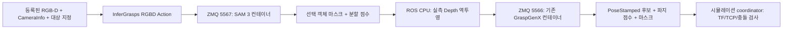

# SAM 3 객체 분할과 GraspGenX 연결

## 구조와 현재 검증 범위

색상에 의존하지 않는 분할 경로를 추가했다. GPU 모델은 같은 서버의 서로 다른
컨테이너에서 실행한다. ROS/MoveIt은 로봇 컨테이너에만 둔다.



SAM 3는 마스크를 만들고 GraspGenX는 XYZ로 파지 후보를 만든다. 가벼운 Depth 역투영은
기존 CPU ROS Bridge를 재사용한다. Depth 전체를 GPU 서버로 전송할 필요가 없고
GraspGenX 공식 프로토콜도 유지한다. SAM 3D의 생성 형상이나 RGB에서 추정한 깊이를
사용하지 않는다. 두 GPU 모델은 하나의 Action 안에서 순차 호출한다.

현재 공식 가중치 다운로드는 인증 후에도 HTTP 403으로 거부되어 모델 접근 승인 확인이
필요하다. SAM 3 import/CUDA 인식과 코드·프로토콜 테스트는 실제 가중치 추론과 다르다.
가중치 승인·다운로드·실제 mask 품질·두 모델 동시 상주 VRAM/지연시간은 후속 검증 항목이다.
SAM 실패 시 color_demo나 mock으로 자동 대체하지 않는다.

## 컨테이너 실행 (호스트 PC)

테스트한 로컬 이미지: `localhost/rwh-sam3:f1647e8-cu130`.
SAM upstream commit: `f1647e8d0c1d280991f4d1b7d974c2704537fe66`.
PyTorch 2.9.1+cu130과 torchvision 0.24.1+cu130으로 고정하고 기존 추론 이미지의
CUDA 계층을 재사용한다. 기존 컨테이너의 Python 환경은 변경하지 않는다.

```bash
# 운영 복사본: ~/sam3_workspace/deploy
bash ~/sam3_workspace/deploy/local_podman.sh build
bash ~/sam3_workspace/deploy/local_podman.sh start
# 승인된 계정으로 직접 로그인. 토큰은 터미널의 숨김 입력만 사용한다.
podman exec -it rwh-graspgenx-local /opt/venv/bin/huggingface-cli login
# 모델 접근 승인 후 다운로드
bash ~/sam3_workspace/deploy/local_podman.sh download
# foreground: Ctrl+C는 모델만 종료, idle 컨테이너는 계속 유지
bash ~/sam3_workspace/deploy/local_podman.sh model-start
# 다른 터미널
bash ~/sam3_workspace/deploy/local_podman.sh health
```

승인 신청: https://huggingface.co/facebook/sam3 . 로그인 성공과 모델 접근 승인은 별개다.
fine-grained 토큰은 해당 gated 모델의 읽기도 허용해야 한다. 토큰은 이미지나 레포에
넣지 않는다. 로컬 helper는 기존 개인 HF 캐시를 읽기 전용 `/auth`로 연결하고,
다운로드에만 사용한다. 체크포인트는 `~/sam3_workspace/models`, 캐시는 cache,
로그는 logs에 영속화한다. 인증정보·모델 파일은 Git에 포함하지 않는다.

CPU 2개/RAM 8 GiB/GPU 0 CDI/read-only root/no-new-privileges이며 GPU allocator fraction은
0.65다. 이는 모든 GPU 할당의 전역 quota가 아니다. GraspGenX·RViz와 함께 실행할 때
실측 VRAM 확인이 필요하다. 컨테이너는 기존 로봇 컨테이너 network namespace를 공유한다.
호스트 포트는 공개하지 않는다. 로봇 컨테이너 네트워크가 재생성되면 재연결이 필요하다.

원격 Docker용 compose는 localhost 포트만 공개하고 명시적 자원/GPU 할당을 요구한다.
BASE_IMAGE는 공식 PyTorch/CUDA 기반으로 필요한 Python/추론 의존성이 준비된 이미지를
지정해야 하며, 기본 로컬 GraspGenX 이미지가 원격 서버에도 있다고 가정하지 않는다.
원격 서버에는 아직 배포하지 않았다.

## ROS Action 입력·출력

기존 POINT_CLOUD=0, DEPTH_IMAGE=1에 RGBD=2를 추가했다. Action 타입 변경이므로
관련 패키지를 rebuild하고 기존 Action 서버·클라이언트/BT runner를 재시작해야 한다.

| 입력 | 의미 |
|---|---|
| rgb_image, depth_image, camera_info | 등록된 RGB-D와 그에 맞는 pinhole calibration |
| target_text | 예: box, mug. 색상과 무관한 텍스트 대상 지정 |
| target_box | 원본 이미지 pixel xyxy; 4개가 모두 0이면 미지정 |
| use_selection_point, selection_u/v | 텍스트/박스로 얻은 객체 중 해당 픽셀을 포함하는 대상 선택 |
| selection_policy | 기본 unique: 다중 후보를 거부. highest_score는 명시적 선택일 때만 사용 |
| gripper_name, num_grasps, top_k | 기존 GraspGenX 설정 |

클릭은 현재 객체 선택용이며 SAM의 직접 point prompt 입력이 아니다. 분할에는 텍스트
또는 박스가 필요하다. SAM API에는 pixel xyxy를 정규화된 cxcywh로 바꿔 전달한다.

결과에는 기존 candidates와 함께 object_mask, segmentation_score,
segmentation_instances가 들어간다. 분할 점수와 파지 점수는 다른 의미다.
마스크는 경계 배경 Depth 혼입을 줄이기 위해 3×3 침식 1회를 적용한다.
빈 마스크/잘못된 frame·timestamp·크기/비정상 모델 응답은 실패 처리한다.
Mock은 테스트에서만 명시적으로 허용하며 결과는 MOCK_ONLY로 표시한다.

```bash
# 로봇 컨테이너: 추론만, 이동 없음
source /root/ros2_ws/install/setup.bash
ros2 launch rwh_beyond_grasp_bridge inference.launch.py \
  endpoint:=tcp://127.0.0.1:5566 segmentation_endpoint:=tcp://127.0.0.1:5567

# 다른 터미널: 등록된 RGB uint8 HxWx3 NPY와 Depth NPY 입력
ros2 run rwh_beyond_grasp_bridge infer_rgbd depth.npy rgb.npy \
  --frame camera_color_optical_frame --fx 600 --fy 600 --cx 320 --cy 240 \
  --text box --box 100 100 300 300 --save-mask selected_mask.npy
```

위 calibration 숫자는 예시이며 실제 CameraInfo 값으로 바꿔야 한다.
저장 이미지 CLI는 하나의 snapshot에 동일 stamp를 부여하므로 TF/이동 검증용이 아니다.
실시간 coordinator는 촬영 시각의 TF를 추론 전에 저장한다. scene과 카메라는 추론 중
정지해 있어야 하며, 객체 이동/온라인 추적과 실물 자동 실행은 아직 지원하지 않는다.

## runner·BT와 충돌 모델

runner 기본값은 SAM 3다. `RWH_SEGMENTATION_ENDPOINT`(기본 5567),
`RWH_GRASP_ENDPOINT`(5566), `RWH_GRASP_TARGET_TEXT`(box)로 지정한다.
박스/선택 픽셀은 grasp_coordinator의 target_box/selection_point 파라미터로 지정한다.
기존 색상 demo를 의도적으로 실행할 때만 `RWH_SEGMENTATION_BACKEND=color_demo`를 사용한다.
runner는 GPU 모델 프로세스를 자동 시작하지 않는다. 기존 GraspStep prepare를 재사용하며
check_ready에서 실제 SAM 서버도 확인한다.

SAM 경로에서는 고정 4×4×5 cm 크기를 쓰지 않는다. 선택된 표면과 주변 Depth에서
가까운 수평 지지면을 추정하고, 지지면 위의 관측 AABB에 padding을 더해 충돌 객체를 만든다.
이는 보이지 않는 뒷면을 복원한 정확한 물체 모델이 아니다. 수평 테이블/작은 물체가
초기 가정이며 지지면이 불확실하면 재관측하도록 실패한다. 밀집된 물체의 완전한
충돌 형상과 일반적인 기울어진 지지면은 추가 검증이 필요하다.

MuJoCo의 `simulation/set_grasp_region` 서비스에는 선택 마스크에서 유도한 base_link
AABB를 전달한다. 이후 카메라가 움직여도 고정 base 영역으로 해당 점을 Octomap 입력에서
제외한다. 테이블을 보존하기 위해 지지면보다 3 mm 높은 곳부터 제외한다. 부피 안에
다른 물체가 겹치면 함께 제외될 수 있으므로 밀집 환경의 실물 안전성 검증을 대신하지 않는다.
실패·취소 시 영역을 복원하며, color_demo만 기존 빨간색 제외 서비스를 사용한다.

coordinator의 실제 이동·attach/lift 검증은 계속 MuJoCo 전용이다. 현재 물리 검증 서비스는
기존 시뮬레이터의 grasp_object fixture를 검사한다. 범용 실물 파지 성공 검증기는 아니다.
전체 SAM→실제 모델→BT 집기는 가중치와 관측 품질 검증 후 독립 ROS domain에서 진행한다.

## 이번 검증 기록 — 2026-11-10

- 메시지/Bridge/시뮬레이터/BT/navigator 5개 패키지 build 성공.
- SAM 전용 이미지 build, idle 컨테이너 기동, 공식 SAM import 및 CUDA 인식 성공.
- Bridge/runner: 49 passed, 3 subtests passed. 합성 마스크에 의한 RGBD Action 왕복,
  마스크 shape·RGB/Depth 정합·분할 서버 timeout·미검출·mock 기본 거부를 포함한다.
- 서버 순수 분할/선택 로직: 3 passed. 다중 객체 거부, 선택 픽셀, 명시적 점수 선택 검사.
- MuJoCo venv: 4 passed. 기존 닫기 유지와 선택 영역 유효성/해제 검사.
- BT/navigator test-result 집계: 28/7, errors/failures 0.
- strict MkDocs build 및 세 레포 git diff --check 성공.
- 사용자 직접 HF 로그인 성공 후 다운로드 재시도는 GatedRepoError 403으로 실패했다.
  실제 SAM 가중치 추론·마스크 정확도·통합 BT 집기는 검증하지 않았다.
- 실제 로봇 이동 명령은 전송하지 않았으며 신규 모델 컨테이너는 idle 상태로 유지한다.
  기존 GPU 서버 권한이나 호스트 패키지·드라이버·런타임은 변경하지 않았다.

```bash
source /root/ros2_ws/install/setup.bash
cd /root/ros2_ws
PYTEST_DISABLE_PLUGIN_AUTOLOAD=1 ROS_DOMAIN_ID=93 python3 -m pytest -q \
  src/rwh_beyond/rwh_beyond_grasp_bridge/test src/ros_runner/test/test_piper_runners.py
cd src/rwh_beyond/deploy/sam3-docker
PYTEST_DISABLE_PLUGIN_AUTOLOAD=1 python3 -m pytest -q test_segmentation_core.py
cd /root/ros2_ws
PYTEST_DISABLE_PLUGIN_AUTOLOAD=1 MUJOCO_GL=osmesa /opt/moma-venv/bin/python -m pytest -q \
  src/moma-mj-lab/ros2_ws/src/moma_mujoco_ros/test/test_grip_hold.py \
  src/moma-mj-lab/ros2_ws/src/moma_mujoco_ros/test/test_grasp_region.py
```
